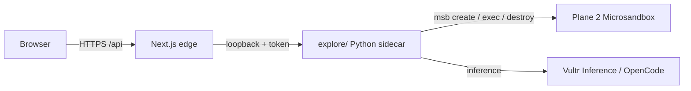

# API.md — How components communicate

Killhub communication is plane-scoped. **Plane 1 owns the public Jobs API and SSE** ([DECISIONS.md](DECISIONS.md) D28). The **Python `explore/` sidecar owns job state** (D52) and exposes an internal Worker API on loopback. Plane 1 → Plane 2 over the harness (Microsandbox `msb` / SDK). Plane 2 never calls Plane 1 — enforced by network policy (D39).

Related: [ARCHITECTURE.md](ARCHITECTURE.md) · [DATABASE.md](DATABASE.md) · [DECISIONS.md](DECISIONS.md)

---

## Overview



| Path | Protocol | Auth (v1) |
|------|----------|-----------|
| Browser → Next.js | HTTPS | None (public demo) + admission (D40); edge bind `127.0.0.1` behind proxy on demo (D46) |
| Next.js → `explore/` | HTTP localhost Internal Worker API | Loopback + `INTERNAL_API_TOKEN` (D52) |
| Control plane → Vultr API | HTTPS | `VULTR_API_KEY` on Plane 1 server only |
| Control plane → Plane 2 | Microsandbox `msb` / SDK on VX1 | Host access for harness; network policy (D39) |
| Control plane → Vultr Serverless Inference | HTTPS `https://api.vultrinference.com/v1` | `VULTR_INFERENCE_*` (+ `OPENCODE_*`) on Plane 1 only (D25) |
| Plane 2 → Plane 1 / management | — | **Denied** (D39); probe-tested |

---

## Internal Worker API (Python sidecar — D52)

Frozen **before** implementing N1/E1. Not public. Base URL e.g. `http://127.0.0.1:8100`. Header: `Authorization: Bearer $INTERNAL_API_TOKEN`.

| Method | Path | Purpose |
|--------|------|---------|
| `POST` | `/internal/jobs` | Create job `{ github_url }` → `{ job_id }` (admission applied here or in Next before proxy) |
| `GET` | `/internal/jobs/{id}` | Full snapshot (same shape as public GET) |
| `GET` | `/internal/jobs/{id}/events` | SSE (same event model as public) |
| `DELETE` | `/internal/jobs/{id}` | Cancel (idempotent — D56) |
| `GET` | `/internal/jobs/{id}/screenshots` | Timeline |
| `GET` | `/internal/jobs/{id}/screenshots/{shot_id}` | Bytes |
| `GET` | `/internal/health` | Sidecar + ledger liveness |

Next.js public `/api/jobs*` and `/health` **proxy** to these routes (mapping `/health` → sidecar + self). Next.js must not maintain a parallel job store.

---

## Jobs API (public — Plane 1 Next.js)

### `POST /api/jobs`

Create a job (admission — D40; pre-flight — D45).

**Request**

```json
{ "github_url": "https://github.com/org/repo" }
```

**Response `201`**

```json
{ "job_id": "…" }
```

**Errors**

| Code | When |
|------|------|
| `400` | Invalid URL (not public HTTPS github.com) |
| `429` | Rate limit exceeded or inference budget exhausted |
| `503` | Global concurrency full and queue full |

Error body: `{ "error": "…", "code": "rate_limited" \| "inference_budget" \| "queue_full" \| "invalid_url" \| "preflight_blocked" }`.

---

### `GET /api/jobs/{id}`

Full job snapshot for poll/hydrate.

**Response `200` (shape)**

```json
{
  "job_id": "…",
  "status": "installing",
  "progress": 55,
  "current_step": "pip install -r requirements.txt",
  "steps_completed": ["analyzing", "planning", "provisioning"],
  "updated_at": "…",
  "error": null,
  "event_cursor": "42",
  "profile": { },
  "readiness": null,
  "verification": {
    "kind": "original_application",
    "original_failure": null
  },
  "sandbox_id": "…",
  "inference_model": "…",
  "expires_at": "…",
  "cleanup": { "status": "pending", "attempts": 0 },
  "destroyed_at": null,
  "environment": { "environment_id": "…", "state": "running", "expires_at": "…" },
  "vuln_report": null,
  "screenshot_ids": [],
  "receipt": null
}
```

| Field | Meaning |
|-------|---------|
| `event_cursor` | Last durable event id at snapshot time — pass to SSE as `Last-Event-ID` / `?after=` (D55) |
| `verification` | Outcome class (D54); `generated_demo` must carry `original_failure` when original setup failed |
| `cleanup` / `destroyed_at` | Destroy lifecycle; `destroyed_at` only when removal confirmed (D57) |
| `readiness` | Probe evidence; independent of terminal `completed` (D37) |
| `screenshot_ids` | May be empty (D31) |

**Errors:** `404` unknown job.

Poll and SSE must agree on `status` / `progress` (D13).

---

### `GET /api/jobs/{id}/events`

Server-Sent Events stream (proxied from sidecar).

| SSE `type` | Payload (conceptual) |
|------------|----------------------|
| `status` | `{ status }` |
| `progress` | `{ progress, current_step }` |
| `log` | `{ message, kind?, … }` — kinds include `sandbox_create` \| `sandbox_replace` \| `sandbox_destroy` \| `repair_attempt` \| `mcp_assessment` \| `mcp_stdio_verify` \| `containment_probe` \| `network_probe` \| `agent` \| `harness` \| `admission` \| `cancel` |
| `screenshot` | `{ screenshot_id, step, caption, url }` |
| `error` | `{ message, code? }` |
| `span` | Timed step boundaries (D49) |
| `finding` | Structured finding draft/final (D49) |
| `containment` | Matrix dimension results (D58) |
| `lifecycle` | Sandbox created/replaced/destroying/destroyed/destroy_failed (D49, D57) |

Keep-alives at least ~every 15s while open (D50). Payloads must not include real secrets.

#### Cursor / replay (D55)

1. Client `GET` snapshot → read `event_cursor`.
2. Open SSE with `Last-Event-ID: {event_cursor}` or `?after={event_cursor}` (exclusive).
3. Server replays durable events after the cursor, then tails live.
4. Events retained for `EVENT_RETENTION` (active job lifetime + configurable post-terminal window).
5. **Expired / unknown cursor:** HTTP `410` on subscribe **or** first SSE `error` with `code=cursor_expired`. Client must re-fetch snapshot and resubscribe — **must not** continue from `0` without user-visible reset (avoids silent gaps).

- Stream stays open through non-terminal `error` events until terminal job state.
- Client disconnect does **not** cancel the job.

---

### `GET /api/jobs/{id}/screenshots`

Ordered timeline (may be `[]`).

### `GET /api/jobs/{id}/screenshots/{shot_id}`

Image bytes (`image/png`) or redirect to object storage.

---

### `DELETE /api/jobs/{id}`

Explicit cancel (D56).

| Case | Behavior |
|------|----------|
| Running / queued / creating | Commit `cancel_requested_at`, status → `cancelled` (after best-effort abort); abort in-flight bootstrap/`msb create`; destroy partial sandbox; emit `log.kind=cancel` + lifecycle |
| Already `cancelled` | **Idempotent** `200` with same terminal snapshot |
| Other terminal (`completed` / `failed`) | `409` or `200` no-op with existing terminal snapshot (pick one at implement; document — prefer `200` no-op for demo UX) |

After cancel is committed, the ledger **rejects** worker updates other than cleanup/destroy fields.

---

### `GET /health`

Control-plane liveness. Proxies/aggregates Next process + `/internal/health`. May include non-sensitive admission gauges — never secrets.

---

## Job state machine (shared contract)

```
pending → [queued] → analyzing → planning → provisioning → installing
       → verifying ⇄ repairing
       → scanning → finalizing → completed | failed | cancelled
```

| Phase | Typical work |
|-------|----------------|
| `queued` | Waiting for concurrency slot (D40) |
| `analyzing` / `planning` | Bootstrap create → inspect → validated runtime profile (`schema_version`); replace VM if image differs |
| `provisioning` / `installing` | Services + install commands from executable profile (D51); flag failures |
| `verifying` / `repairing` | Supervise processes; probes — MCP stdio via in-guest helper or HTTP/TCP/command; set `readiness` + `verification.kind` |
| `scanning` | SCA (`source=sca`) + cite-checked `vuln_review`; optional MCP assessment; separate intentional-app findings |
| `finalizing` | Persist receipt; destroy with confirm-only `destroyed_at`; containment matrix evidence |
| `completed` | Terminal success with honest verification label (D54) |

Destroy triggers: terminal states \| absolute `expires_at` — **not** readiness alone. Cleanup may end `destroy_failed` without `destroyed_at` (D57).

---

## Plane 1 → Plane 2 (Harness API)

Internal to `explore/harness.py`:

| Call | Input | Output |
|------|-------|--------|
| `create_environment` | `job_id`, bootstrap or runtime plan | `environment_id` |
| `replace_environment` | `job_id`, new OCI image / plan | new `environment_id` (one live VM) |
| `wait_until_ready` | `environment_id` | guest running or timeout |
| `exec` | `environment_id`, `cmd` | `{ stdout, stderr, exit_code }` |
| `copy_in` / `copy_out` | paths | void / bytes |
| `destroy_environment` | `environment_id` | `{ confirmed: bool, error? }` — confirmed false ⇒ `destroy_failed` |

**Rules**

- Bootstrap first (D36); runtime requires schema-valid profile (D51).
- Network policy + install-then-offline phases (D39, D43).
- MCP `stdio`: run in-guest verify helper; do not HTTP-ping stdio servers.
- `expires_at` absolute; touch must not extend (D41).
- Destroy confirm-only (D57). One sandbox per job (D27).

---

## Plane 1 → Inference / OpenCode

Vultr Serverless Inference only (D25). Trusted OpenCode config (D38). Prompts under `prompts/`. Persist `inference_model` + usage (D40).

---

## Artifact handoff

| Artifact | Producer | Consumer |
|----------|----------|----------|
| Bootstrap profile | Harness (trusted) | First create |
| Runtime profile (`schema_version`) | Plan loop | Provision / replace / report |
| MCP stdio verify evidence | In-guest helper | Readiness + receipt |
| Screenshots | Plane 2 Playwright → copy_out | Jobs API |
| Vuln report | SCA + cite-checked review (+ optional MCP assessment) | Report UI |
| Verification | Gates on evidence (D47, D54) | Snapshot + receipt |
| Containment matrix | Harness probes (D58) | `containment` SSE + receipt |

---

## Versioning

Public HTTP remains unversioned under `/api/...` in v1. **Profile** schema is versioned via `schema_version` (D51). Breaking API changes require a decision entry.
