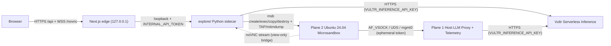

# API.md — How components communicate

Killhub communication is plane-scoped. **Plane 1 owns the public Jobs API, SSE, and authenticated view-only `noVNC` proxy** ([DECISIONS.md](DECISIONS.md) D28, D71). The **Python `explore/` sidecar owns job state** (D52) and exposes an internal Worker API on loopback plus the host-side **Vultr Inference LLM Proxy** over hypervisor IPC. Plane 1 drives Plane 2 via the harness (`msb` / SDK + TAP/`mitmdump`). General IP traffic from Plane 2 → Plane 1 public/management/sibling destinations remains **denied** and probe-tested (D39, D65, D70, D71).

Related: [ARCHITECTURE.md](ARCHITECTURE.md) · [DATABASE.md](DATABASE.md) · [DECISIONS.md](DECISIONS.md)

---

## Overview



| Path | Protocol | Auth (v1) |
|------|----------|-----------|
| Browser → Next.js | HTTPS / WSS (`/api/jobs/*/novnc`) | None (public demo) + admission (D40); edge bind `127.0.0.1` behind reverse proxy on demo (D46) |
| Next.js → `explore/` | HTTP / WS localhost Internal Worker API | Loopback + `INTERNAL_API_TOKEN` (D52) |
| Control plane → Vultr API | HTTPS | `VULTR_API_KEY` on Plane 1 server only |
| Control plane → Plane 2 | Microsandbox `msb` / SDK + TAP bridge on VX1 | Host access for harness; TAP/`mitmdump` + network policy (D39, D70) |
| Plane 2 → Host LLM Proxy / Telemetry | `AF_VSOCK` (preferred) or UDS / `mgmt0` | Per-job ephemeral proxy token; **never** `VULTR_INFERENCE_API_KEY` (D71) |
| Control plane / Host LLM Proxy → Vultr Inference | HTTPS `https://api.vultrinference.com/v1` | `VULTR_INFERENCE_API_KEY` on Plane 1 only (D25, D71) |
| Plane 2 → Plane 1 public/internal HTTP, management, siblings | — | **Denied** (D39, D70); positive-control probe-tested (D65) |

> **Known Step 04/05 Implementation Bugs to Fix in Next Implementation Step:**
> 1. **Live SSE `progress` hoisting (`explore/api/routes.py:141-152`):** Initial replay (`routes.py:111-114`) hoists `progress` and `current_step` to top-level SSE JSON, but the live-tailing loop (`routes.py:141-152`) only hoists `status`. Add the `if event.type == "progress":` hoist block so `JobLiveView.tsx` updates live progress bars.
> 2. **SSE polling latency (`explore/api/routes.py:123,138`):** Avoid sleeping `max(keepalive_seconds - 2, 0)` (13s) after empty poll before checking new events; wake on ledger event signal or short poll interval with independent keepalive timer.
> 3. **Compose port binding (`docker-compose.yml:7-8`):** Change `8100:8100` to `127.0.0.1:8100:8100` (or compose-internal `expose`).

---

## Internal Worker API & Host LLM Proxy (Python sidecar — D52, D71)

Base URL e.g. `http://127.0.0.1:8100`. Header: `Authorization: Bearer $INTERNAL_API_TOKEN` (except Host LLM Proxy, which listens on the hypervisor IPC endpoint and validates the per-job ephemeral guest token).

| Method | Path | Purpose |
|--------|------|---------|
| `POST` | `/internal/jobs` | Create job (`github_url` or `target_type` + locator) → `{ job_id }` |
| `GET` | `/internal/jobs/{id}` | Full snapshot (same shape as public GET) |
| `GET` | `/internal/jobs/{id}/events` | SSE (same event model as public) |
| `DELETE` | `/internal/jobs/{id}` | Cancel (idempotent finalizer path — D61) |
| `GET` | `/internal/jobs/{id}/screenshots` | Timeline |
| `GET` | `/internal/jobs/{id}/screenshots/{shot_id}` | Bytes (`image/png`) |
| `GET` | `/internal/jobs/{id}/verdict` `[v2]` | Canonical `DetonationVerdict` JSON (`schemas/detonation_verdict.v1.json`) |
| `GET` | `/internal/jobs/{id}/telemetry` `[v2]` | Bounded runtime telemetry counters + NDJSON events slice |
| `GET` | `/internal/jobs/{id}/pcap` `[v2]` | Captured TAP bridge PCAP (`application/vnd.tcpdump.pcap`) |
| `GET / WS` | `/internal/jobs/{id}/novnc` `[v2]` | Authenticated **view-only** `noVNC` WebSocket/HTTP proxy to Plane 2 |
| `GET` | `/internal/health` | Sidecar + ledger liveness |
| `POST` | `/internal/llm-proxy/v1/chat/completions` `[v2]` | **Hypervisor IPC only (`AF_VSOCK`/UDS/`mgmt0`)** — Plane 2 OpenCode → Vultr Inference proxy with Layer 1 circuit breaker (`429`) |

Next.js public `/api/jobs*` and `/health` **proxy** to these routes (mapping `/health` → sidecar + self). Next.js must not maintain a parallel job store.

---

## Jobs API (public — Plane 1 Next.js)

### `GET /api/jobs`

Recent job summaries (D69 / D77). Newest first. Server-side pagination via `limit` + `offset`. Optional `github_url` filters to runs for one canonical repo (D79 — used by `/repos/…` history).

**Query**

| Param | Default | Max | Purpose |
|-------|---------|-----|---------|
| `limit` | `48` | `200` | Page size |
| `offset` | `0` | — | Rows to skip (newest-first) |
| `github_url` | — | — | Exact match on canonical allowlisted git URL (D78); `400` / `invalid_url` if invalid |

**Response `200`**

```json
{
  "jobs": [
    {
      "job_id": "…",
      "github_url": "https://github.com/org/repo",
      "status": "installing",
      "progress": 55,
      "current_step": "…",
      "created_at": "…",
      "updated_at": "…",
      "screenshot_id": "…",
      "screenshot_url": "/api/jobs/…/screenshots/…",
      "error": null,
      "verification": null,
      "safety": null,
      "queue_position": null,
      "expected_wait_seconds": null
    }
  ],
  "total": 128,
  "limit": 12,
  "offset": 0
}
```

Job and repo feed cards expose the receipt’s `active_checks` with install trace coverage, the number of MCP tool descriptions reviewed, the active finding count, and the highest-priority active finding. For historical receipts the API reconstructs these fields from retained check events when available. Missing coverage means no recorded result. MCP receipt tools return the same object, the dependency scan status and review, a total finding count, and up to ten findings in severity order.

`total` is the matching job count in the ledger (all jobs, or filtered to `github_url`). `screenshot_id` is the latest still when present; otherwise `null`. `screenshot_url` is an absolute Vultr CDN URL when Object Storage + `OBJECT_STORAGE_CDN_BASE_URL` are configured (D76); otherwise the relative `/api/jobs/{id}/screenshots/{screenshot_id}` path when a still exists; otherwise `null`. `safety` is a slim security-outcome stamp for the feed UI: `safe` | `high_risk` | `review` | `unknown`, or `null` while the job is non-terminal or has no receipt yet (full dossier / `vuln_report` stay on `GET /api/jobs/{id}`). When `status` is `pending` or `queued`, `queue_position` is the 1-based FIFO place (1 = next to claim) and `expected_wait_seconds` is a soft ETA derived from recent terminal job durations (fallback `ESTIMATED_JOB_SECONDS`); both are `null` once the job leaves the queue.

---

### `GET /api/repos`

Repo-grouped feed for the home Entries grid (D79). One row per distinct canonical `github_url`, ordered by most recent run. Server-side pagination via `limit` + `offset`.

**Query**

| Param | Default | Max | Purpose |
|-------|---------|-----|---------|
| `limit` | `48` | `200` | Page size |
| `offset` | `0` | — | Groups to skip (newest activity first) |

**Response `200`**

```json
{
  "repos": [
    {
      "github_url": "https://github.com/org/repo",
      "run_count": 3,
      "latest": {
        "job_id": "…",
        "github_url": "https://github.com/org/repo",
        "status": "completed",
        "progress": 100,
        "current_step": "…",
        "created_at": "…",
        "updated_at": "…",
        "screenshot_id": "…",
        "screenshot_url": "/api/jobs/…/screenshots/…",
        "error": null,
        "verification": null,
        "safety": "safe"
      }
    }
  ],
  "total": 42,
  "limit": 9,
  "offset": 0
}
```

`total` is `COUNT(DISTINCT github_url)`. `latest` uses the same summary shape as `GET /api/jobs`. UI links each card to `/repos/{host}/{…path}` (e.g. `/repos/github.com/org/repo`), which lists runs via `GET /api/jobs?github_url=…`. GitHub-only short path `/{owner}/{repo}` (D82) is a client-side create shortcut — not a new Jobs API — and redirects to `/jobs/{id}` after `POST /api/jobs`.

---

### `POST /api/jobs`

Create a job (admission — D40; pre-flight — D45; target intake — D15). The worker can claim it after preflight passes. A hard failure returns a job ID with a terminal receipt and no sandbox generation.

**Request (v1 baseline — preserved)**

```json
{ "github_url": "https://github.com/org/repo" }
```

**Request (v2 extended intake — optional fields, D15 / `DynamicInstallSpec`)**

```json
{
  "github_url": "https://github.com/org/repo",
  "target_type": "github_repo | npm_package | pypi_package | fixture",
  "mcp_registry_ref": "npm:@modelcontextprotocol/server-filesystem@0.6.2",
  "fixture_id": "scenario-1-indirect-prompt-injection",
  "run_detonation": true
}
```

- When `target_type` is omitted (v1 behavior), `github_url` is required and validated against `^https://github\.com/[A-Za-z0-9_.-]+/[A-Za-z0-9_.-]+$`.
- When `target_type` is `npm_package`, `pypi_package`, or `fixture`, either `mcp_registry_ref` or `fixture_id` must be provided and pre-screened before bootstrap create (D45).

**Response `201`**

```json
{ "job_id": "…" }
```

**Errors**

| Code | When |
|------|------|
| `400` | Invalid URL or invalid target/registry/fixture specifier |
| `429` | Rate limit exceeded or inference budget exhausted |
| `503` | Global concurrency full and queue full |

Error body: `{ "error": "…", "code": "rate_limited" \| "inference_budget" \| "queue_full" \| "invalid_url" \| "invalid_target" \| "preflight_blocked" }`.

---

### `GET /api/jobs/{id}`

Full job snapshot for poll/hydrate.

**Response `200` (shape)**

```json
{
  "job_id": "…",
  "github_url": "https://github.com/org/repo",
  "target_type": "github_repo",
  "target_locator": "https://github.com/org/repo",
  "status": "installing",
  "progress": 55,
  "current_step": "pip install -r requirements.txt",
  "steps_completed": ["analyzing", "planning", "provisioning"],
  "created_at": "…",
  "updated_at": "…",
  "error": null,
  "event_cursor": "42",
  "profile": { },
  "install_spec": { },
  "scenario_plan": { },
  "readiness": null,
  "verification": {
    "kind": "original_application",
    "original_failure": null
  },
  "verify_result": null,
  "sandbox_id": "…",
  "resolved_commit": "abc123…",
  "current_profile_revision": 2,
  "current_sandbox_generation": 1,
  "inference_model": "…",
  "inference_usage": { },
  "expires_at": "…",
  "cleanup": { "status": "pending", "attempts": 0 },
  "destroyed_at": null,
  "cancel_requested_at": null,
  "environment": { "environment_id": "…", "generation": 1, "state": "running", "expires_at": "…" },
  "novnc": { "available": true, "ws_path": "/api/jobs/…/novnc", "view_only": true },
  "vuln_report": null,
  "detonation_verdict": null,
  "screenshot_ids": [],
  "receipt": null
}
```

| Field | Meaning |
|-------|---------|
| `event_cursor` | Last **retained** durable event id at snapshot time — pass to SSE as `Last-Event-ID` / `?after=` (D55, D67) |
| `resolved_commit` | Full SHA of inspected source (or pinned ref); required after first clone; reused on replace (D62) |
| `current_profile_revision` / `current_sandbox_generation` | Pointers into revision/generation history (D64) |
| `install_spec` / `scenario_plan` `[v2]` | Latest validated `DynamicInstallSpec` (`schemas/dynamic_install_spec.v1.json`) and `TestScenarioPlan` (`schemas/test_scenario_plan.v1.json`) |
| `detonation_verdict` `[v2]` | Canonical `DetonationVerdict` (`schemas/detonation_verdict.v1.json`) once generated |
| `novnc` `[v2]` | View-only `noVNC` availability and proxy path while generation is `running` |
| `verification` | Outcome class (D54); `generated_demo` must carry `original_failure` when original setup failed |
| `cleanup` / `destroyed_at` | Destroy lifecycle; job-level `destroyed_at` only when **current** removal confirmed (D57, D64) |
| `cancel_requested_at` | Set on cancel request; freezes ordinary writers before terminal `cancelled` (D61) |
| `readiness` | Probe evidence; independent of terminal outcome (D37, D66) |
| `screenshot_ids` | May be empty (D31) |

**Errors:** `404` unknown job.

Poll and SSE must agree on `status` / `progress` (D13).

---

### `GET /api/jobs/{id}/events`

Server-Sent Events stream (proxied from sidecar).

| SSE `type` | Payload (conceptual) |
|------------|----------------------|
| `status` | `{ status }` |
| `progress` | `{ progress, current_step }` |
| `log` | `{ message, kind?, … }` — v1 kinds: `sandbox_create` \| `sandbox_replace` \| `sandbox_destroy` \| `repair_attempt` \| `mcp_assessment` \| `mcp_stdio_verify` \| `containment_probe` \| `network_probe` \| `agent` \| `harness` \| `admission` \| `cancel`; detonation kinds: `mitmdump_http` \| `mitmdump_dns` \| `doh_dot_quic_drop` \| `canary_block` \| `strace` \| `overlayfs` \| `mcp_wire_tap` \| `cgroup_v2` \| `llm_proxy_429` \| `tool_diff` \| `kill_switch` \| `novnc` \| `discovery` \| `test_planner` \| `telemetry` |
| `screenshot` | `{ screenshot_id, step, caption, url }` |
| `error` | `{ message, code? }` |
| `span` | Timed step boundaries (D49) |
| `finding` | Structured finding (`id`, `severity`, `source`, `atlas_tactic?`, `owasp_mcp?`, `sensor?`, `blocked?`) (D49) |
| `containment` | Matrix dimension results + `key_isolation_verified` (D58, D71) |
| `lifecycle` | Sandbox created/replaced/destroying/destroyed/destroy_failed (D49, D57) |
| `gap` | Contiguous prune tombstone when byte budget drops a prefix (D67) |
| `telemetry` `[v2]` | `{ sensor, summary, counters? }` — live `mitmdump` HTTP/S+DNS, `strace`, `overlayfs`, `mcp_wire_tap`, `cgroup_v2` updates |
| `tool_diff` `[v2]` | `{ t0_tools_sha256, final_tools_sha256, diffs[] }` — rug pull / tool drift alert |
| `kill_switch` `[v2]` | `{ layer, reason, http_status?, timestamp }` — Layer 1/2/3 kill switch activation |
| `novnc` `[v2]` | `{ available, ws_path, view_only: true }` |

> Note: Adding new top-level SSE `type` values (`telemetry`, `tool_diff`, `kill_switch`, `novnc`) requires updating both `explore/models.py:EventType` and the `addEventListener` list in `frontend/components/JobLiveView.tsx`.

Keep-alives at least ~every 15s while open (D50). Payloads must not include real secrets or raw canary plaintext.

#### Cursor / replay (D55, D67)

1. Client `GET` snapshot → read `event_cursor` (last **retained** event).
2. Open SSE with `Last-Event-ID: {event_cursor}` or `?after={event_cursor}` (exclusive).
3. Server replays durable events after the cursor **contiguously**, then tails live.
4. Events retained for `EVENT_RETENTION` (active job lifetime + configurable post-terminal window), subject to `MAX_JOB_LOG_BYTES`.
5. Under byte pressure, prune a **prefix** of oldest events and insert one durable `gap` event; never delete middle events (D67). A fresh snapshot restores history only within the **current retained window** (complete forward from the gap/tombstone).
6. **Expired / unknown / pruned-range cursor:** HTTP `410` on subscribe **or** first SSE `error` with `code=cursor_expired`. Client must re-fetch snapshot and resubscribe — **must not** continue from `0` without user-visible reset.

- Stream stays open through non-terminal `error` events until terminal job state (`completed` \| `failed` \| `cancelled`).
- Client disconnect does **not** cancel the job.

---

### `GET /api/jobs/{id}/screenshots` & `/screenshots/{shot_id}`

- `GET /api/jobs/{id}/screenshots` — Ordered timeline (may be `[]`).
- `GET /api/jobs/{id}/screenshots/{shot_id}` — Image bytes (`image/png`) or redirect to object storage.

---

### `GET /api/jobs/{id}/novnc` `[v2]`

Authenticated, **view-only** WebSocket/HTTP proxy to the active Plane 2 microVM `noVNC` display showing in-VM OpenCode detonation (D18, D71).

- **Security:**
  - Enforces view-only RFB flag (`view_only=true`) — browser clients cannot send keyboard/mouse input into the detonation VM.
  - Bound to `127.0.0.1` behind the Vultr edge reverse proxy (D46); Next.js proxies to `explore/` `/internal/jobs/{id}/novnc` with `INTERNAL_API_TOKEN`.
  - Returns `404` if job does not exist; `409` (`code=sandbox_not_running`) if no active generation is in `running` state.
  - Closes cleanly when the sandbox transitions to `destroying` / `destroyed` / terminal state.

---

### `GET /api/jobs/{id}/verdict` `[v2]`

Returns the canonical **Detonation Verdict JSON** conforming to `schemas/detonation_verdict.v1.json`.

- **Response `200`:** `application/json` matching `schemas/detonation_verdict.v1.json` (`schema_version`, `scan_id`, `target`, `verdict`, `containment_proof`, `mcp_capabilities`, `findings`, `atlas_coverage_matrix`, `owasp_mcp_coverage`, `telemetry`).
- **Errors:** `404` unknown job or verdict not yet persisted (`code=verdict_not_ready`).

---

### `GET /api/jobs/{id}/telemetry` & `GET /api/jobs/{id}/pcap` `[v2]`

- `GET /api/jobs/{id}/telemetry?limit=200&after_seq=0`:
  - Returns bounded JSON summary of runtime sensor counters plus redacted NDJSON telemetry records copied from Plane 2 (`mitmdump` HTTP/S+DNS, DoH/DoT/QUIC drops, canary blocks, `strace`, `overlayfs` diffs, `mcp_wire_tap`, `cgroup_v2`, `llm_proxy`).
  - Redacts any canary values or auth tokens before returning.
- `GET /api/jobs/{id}/pcap`:
  - Streams `storage/artifacts/{job_id}/capture.pcap` (`Content-Type: application/vnd.tcpdump.pcap`) when `pcap_enabled=true` and file exists (bounded by `MAX_COPY_BYTES` / disk caps, D40/D60).
  - Returns `404` (`code=pcap_not_available`) if PCAP capture was disabled or absent.

---

### `DELETE /api/jobs/{id}`

Explicit cancel (**D61**; supersedes earlier D56 wording).

| Case | Behavior |
|------|----------|
| Running / queued / creating / finalizing | (1) Set `cancel_requested_at`; **freeze ordinary workers**; (2) abort in-flight bootstrap/`msb create` (best effort); (3) run **bounded finalizer**: flush telemetry (Layer 3 grace), destroy sandbox + TAP/iptables/OverlayFS, emit `log.kind=cancel` + lifecycle, persist **receipt** (and partial/aborted `detonation_verdict` if applicable); (4) only then set terminal `status=cancelled`. SSE stays open until that terminal event. |
| Already `cancelled` | **Idempotent** `200` with same terminal snapshot |
| Other terminal (`completed` / `failed`) | `200` no-op with existing terminal snapshot |

**Ordinary writers** (plan loop, install, repair, assessment, non-cleanup status/progress/profile mutations) are rejected after `cancel_requested_at`.

**Finalizer allowlist** (authorized until terminal): `cleanup.*`, destroy/lifecycle evidence, `receipt`, `detonation_verdict`, cancel-related `log`/`span`/`containment`/`kill_switch`, `progress`/`current_step` for cleanup only, and `status` → `finalizing` then `cancelled`.

---

### `GET /health`

Control-plane liveness. Proxies/aggregates Next process + `/internal/health`. May include non-sensitive admission gauges — never secrets.

---

## Host LLM Proxy (Plane 2 → Plane 1 Hypervisor IPC — D71, D72)

`POST /internal/llm-proxy/v1/chat/completions` (OpenAI-compatible endpoint hosted by Plane 1 on `AF_VSOCK` / UDS / `mgmt0` only — **not** reachable via public HTTP or `/api/*`).

1. **Key Isolation (D19, D71):** Guest OpenCode (`/home/agent/.config/opencode/` & `opencode.db`) is seeded with `OPENAI_BASE_URL` pointing to the IPC proxy and a **per-job ephemeral dummy bearer token** (`kh_proxy_<job_id>_<nonce>`). `VULTR_INFERENCE_API_KEY` stays strictly on Plane 1 and is injected only when Plane 1 forwards the validated request to `https://api.vultrinference.com/v1/chat/completions`.
2. **Layer 1 Circuit Breaker (D72):** Before forwarding to Vultr Inference, the proxy enforces:
   - `max_turns = 12` per detonation run
   - `max_tokens = 60000` cumulative proxy budget per detonation run
   - Repeated / oscillating tool-call pattern detection (e.g., identical tool+args repeated `>= 3` times across recent turns)
3. **Response on Trip:** Returns HTTP **`429`** (`{ "error": { "message": "Kill switch Layer 1 tripped", "type": "rate_limit_error", "code": "kill_switch_layer1", "reason": "max_turns | max_tokens | oscillating_tool_call" } }`), records `llm_proxy_429_blocks += 1`, and emits `kill_switch` SSE event.

---

## Job state machine (shared contract)

```
pending → [queued] → analyzing → planning → provisioning → installing
       → verifying ⇄ repairing
       → scanning → finalizing → completed | failed | cancelled
```

| Phase | Typical work |
|-------|----------------|
| `queued` | Waiting for concurrency slot (D40) |
| `analyzing` / `planning` | Bootstrap create → inspect → Environment/Install Planner produces `DynamicInstallSpec` & validated runtime profile (`schema_version`); replace VM if image differs |
| `provisioning` / `installing` | TAP/`mitmdump`/OverlayFS/cgroup v2 setup + `/run/mcp-package-cache` install; record `package_sha256_before`/`after` |
| `verifying` / `repairing` | Supervise processes; readiness probes (`mcp_stdio_verify` or HTTP/TCP/command); Discovery (`@modelcontextprotocol/inspector` / SDK fallback) → Test Planner (`TestScenarioPlan`) → Monitored OpenCode detonation (`noVNC` + Host LLM Proxy + runtime sensors) |
| `scanning` | Plane-1 SCA (`source=sca`) + cite-checked `vuln_review` + `DetonationVerdict` synthesis (`AML.TA0000`–`AML.TA0015`, `MCP01:2025`–`MCP10:2025`); optional offline containment verification |
| `finalizing` | Flush telemetry, persist receipt + `DetonationVerdict`; destroy sandbox + TAP/iptables/OverlayFS with confirm-only job-level `destroyed_at`; containment matrix evidence; also the cancel finalizer phase (D61) |
| `completed` | Terminal success with honest verification label (D54) & `DetonationVerdict` per gate table (D66) |
| `cancelled` | Terminal only **after** finalizer + receipt (D61) |

---

## Plane 1 → Plane 2 (Harness API)

Internal to `explore/harness.py` (agent-facing subset still bound by D38 + **D60**):

| Call | Input | Output |
|------|-------|--------|
| `create_environment` | `job_id`, bootstrap profile or `DynamicInstallSpec` | `environment_id` + generation + TAP/IPC handles |
| `replace_environment` | `job_id`, new OCI image / plan | new `environment_id` (one live VM; inherits `expires_at`; D64) |
| `wait_until_ready` | `environment_id` | guest running or timeout |
| `exec` | `environment_id`, `cmd` | `{ stdout, stderr, exit_code }` |
| `copy_in` | `environment_id`, **logical helper id or allowlisted relative path**, guest dest | void — host path resolved server-side (D60) |
| `copy_out` | `environment_id`, guest src, **artifact kind** (`screenshot` \| `lockfile` \| `telemetry` \| `pcap` \| `log` \| …) | bytes written only under server-selected `storage/artifacts\|screenshots/{job_id}/` (D60) |
| `destroy_environment` | `environment_id` | `{ confirmed: bool, error? }` — flushes telemetry then removes VM + TAP/iptables/OverlayFS; confirmed false ⇒ `destroy_failed` |

### `copy_in` / `copy_out` host-path rules (D60)

| Rule | Requirement |
|------|-------------|
| No arbitrary host paths | Callers pass logical helper ids / artifact kinds; harness maps to allowlisted roots |
| `copy_in` sources | Only under Killhub helper roots (e.g. `explore/helpers/`); `realpath` must stay inside root |
| Traversal / symlinks | Reject `..` segments and symlink escape outside the allowlisted root; reject non-regular files unless explicitly allowlisted |
| `copy_out` destinations | Only server-selected per-job dirs (`storage/screenshots/{job_id}/`, `storage/artifacts/{job_id}/`); never overwrite arbitrary host files |
| Size | Enforce `MAX_COPY_BYTES` per call and job disk caps (D40); fail closed on overflow |
| Guest paths | Remain inside sandbox workdir / published guest policy |

---

## Artifact handoff

| Artifact | Producer | Consumer |
|----------|----------|----------|
| Bootstrap profile | Harness (trusted) | First create |
| Runtime profile (`schemas/environment_profile.v1.json`) | Environment Planner | Provision / replace / report |
| `DynamicInstallSpec` (`schemas/dynamic_install_spec.v1.json`) | Environment/Install Planner Agent | Ubuntu 24.04 microVM provisioner |
| `TestScenarioPlan` (`schemas/test_scenario_plan.v1.json`) | Discovery → Test-Planner Agent | In-VM OpenCode detonation driver |
| `DetonationVerdict` (`schemas/detonation_verdict.v1.json`) | Verdict Aggregator / `vuln_review` | `JobReceipt` + `/verdict` API + Report UI |
| Telemetry NDJSON & PCAP | `AF_VSOCK`/UDS + `mitmdump` + `tcpdump` | `/telemetry` + `/pcap` + Verdict |
| Screenshots | Plane 2 Playwright → `copy_out` | Jobs API |
| Containment matrix | Harness probes (D58, D65) | `containment` SSE + receipt |

---

## Versioning

Public HTTP remains unversioned under `/api/...` in v1. All 4 JSON contracts under `schemas/` are versioned via `schema_version` (`"1"`). Breaking API changes require a decision entry.
