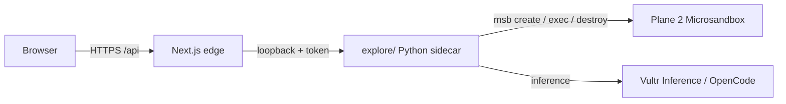

# API.md — How components communicate

Killhub communication is plane-scoped. **Plane 1 owns the public Jobs API and SSE** ([DECISIONS.md](DECISIONS.md) D28). The **Python `explore/` sidecar owns job state** (D52) and exposes an internal Worker API on loopback. Plane 1 → Plane 2 over the harness (Microsandbox `msb` / SDK). Plane 2 never calls Plane 1 — enforced by network policy (D39).

Related: [ARCHITECTURE.md](ARCHITECTURE.md) · [DATABASE.md](DATABASE.md) · [DECISIONS.md](DECISIONS.md) · [docs/CODEMAP.md](docs/CODEMAP.md) · [docs/GLOSSARY.md](docs/GLOSSARY.md)

---

## Overview



| Path | Protocol | Auth (v1) |
|------|----------|-----------|
| Browser → Next.js | HTTPS ([killhub.pro](https://killhub.pro)) | None (public demo) + admission (D40); edge bind `127.0.0.1` behind proxy on demo (D46) |
| **Operator MCP → Next.js** | stdio MCP and/or public `POST /mcp` → tools call `/api/*` ([D81](DECISIONS.md)) | Same as browser (anonymous + admission); optional `KILLHUB_API_TOKEN` Bearer |
| Next.js → `explore/` | HTTP localhost Internal Worker API | Loopback + `INTERNAL_API_TOKEN` (D52) |
| Control plane → Vultr API | HTTPS | `VULTR_API_KEY` on Plane 1 server only |
| Control plane → Plane 2 | Microsandbox `msb` / SDK on VX1 | Host access for harness; network policy (D39) |
| Control plane → Vultr Serverless Inference | HTTPS `https://api.vultrinference.com/v1` | `VULTR_INFERENCE_*` (+ `OPENCODE_*`) on Plane 1 only (D25) |
| Plane 2 → Plane 1 / management | — | **Denied** (D39); probe-tested |
| Environment Agent → harness | stdio MCP `killhub-harness` | Job-scoped; not the operator MCP (D23, D38) |

---

## Internal Worker API (Python sidecar — D52)

Frozen **before** implementing N1/E1. Not public. Base URL e.g. `http://127.0.0.1:8100`. Header: `Authorization: Bearer $INTERNAL_API_TOKEN`.

| Method | Path | Purpose |
|--------|------|---------|
| `POST` | `/internal/jobs` | Create job `{ github_url }` → `{ job_id }` (admission applied here or in Next before proxy) |
| `GET` | `/internal/jobs` | Recent job **summaries** newest-first (`?limit=` default 48 max 200, `?offset=` default 0, optional `?github_url=` exact filter) with `total` (D69, D77, D79) |
| `GET` | `/internal/repos` | Distinct **`github_url` groups** newest activity first (`?limit=` / `?offset=`) with `total` for the home feed (D79) |
| `GET` | `/internal/jobs/{id}` | Full snapshot (same shape as public GET) |
| `GET` | `/internal/jobs/{id}/events` | SSE (same event model as public) |
| `GET` | `/internal/jobs/{id}/events/recent` | Last N durable events JSON (`?limit=` default 50 max 200) — D81 |
| `DELETE` | `/internal/jobs/{id}` | Cancel (idempotent finalizer path — D61) |
| `GET` | `/internal/jobs/{id}/screenshots` | Timeline |
| `GET` | `/internal/jobs/{id}/screenshots/{shot_id}` | Bytes |
| `GET`/`POST` | `/internal/mcp` | Operator MCP JSON-RPC (D81); tools still target public Jobs API via `KILLHUB_BASE_URL` |
| `GET` | `/internal/health` | Sidecar + ledger liveness |

Next.js public `/api/jobs*`, `/api/repos`, `/mcp`, and `/health` **proxy** to these routes (mapping `/health` → sidecar + self). Next.js must not maintain a parallel job store.

---

## Jobs API (public — Plane 1 Next.js)

### `GET /api/jobs`

Recent job summaries (D69 / D77). Newest first. Server-side pagination via `limit` + `offset`. Optional `github_url` filters to runs for one canonical repo (D79 — used by `/repos/…` history).

**Query**

| Param | Default | Max | Purpose |
|-------|---------|-----|---------|
| `limit` | `48` | `200` | Page size |
| `offset` | `0` | — | Rows to skip (newest-first) |
| `github_url` | — | — | Exact match on canonical allowlisted git URL (D78); `400` / `invalid_url` if invalid |

**Response `200`**

```json
{
  "jobs": [
    {
      "job_id": "…",
      "github_url": "https://github.com/org/repo",
      "status": "installing",
      "progress": 55,
      "current_step": "…",
      "created_at": "…",
      "updated_at": "…",
      "screenshot_id": "…",
      "screenshot_url": "/api/jobs/…/screenshots/…",
      "error": null,
      "verification": null,
      "safety": null,
      "queue_position": null,
      "expected_wait_seconds": null
    }
  ],
  "total": 128,
  "limit": 12,
  "offset": 0
}
```

Job and repo feed cards expose the receipt’s `active_checks` with install trace coverage, the number of MCP tool descriptions reviewed, the active finding count, the highest-priority active finding, and a `by_check` list with a count, highest severity, and representative finding ID for each observed check type. For historical receipts the API reconstructs these fields from retained check events when available. Missing coverage means no recorded result. MCP receipt tools return the same object, the dependency scan status and review, a total finding count, and up to ten findings in severity order.

`total` is the matching job count in the ledger (all jobs, or filtered to `github_url`). `screenshot_id` is the latest still when present; otherwise `null`. `screenshot_url` is an absolute Vultr CDN URL when Object Storage + `OBJECT_STORAGE_CDN_BASE_URL` are configured (D76); otherwise the relative `/api/jobs/{id}/screenshots/{screenshot_id}` path when a still exists; otherwise `null`. `safety` is a slim security-outcome stamp for the feed UI: `safe` | `high_risk` | `review` | `unknown`, or `null` while the job is non-terminal or has no receipt yet (full dossier / `vuln_report` stay on `GET /api/jobs/{id}`). When `status` is `pending` or `queued`, `queue_position` is the 1-based FIFO place (1 = next to claim) and `expected_wait_seconds` is a soft ETA derived from recent terminal job durations (fallback `ESTIMATED_JOB_SECONDS`); both are `null` once the job leaves the queue.

---

### `GET /api/repos`

Repo-grouped feed for the home Entries grid (D79). One row per distinct canonical `github_url`, ordered by most recent run. Server-side pagination via `limit` + `offset`.

**Query**

| Param | Default | Max | Purpose |
|-------|---------|-----|---------|
| `limit` | `48` | `200` | Page size |
| `offset` | `0` | — | Groups to skip (newest activity first) |

**Response `200`**

```json
{
  "repos": [
    {
      "github_url": "https://github.com/org/repo",
      "run_count": 3,
      "latest": {
        "job_id": "…",
        "github_url": "https://github.com/org/repo",
        "status": "completed",
        "progress": 100,
        "current_step": "…",
        "created_at": "…",
        "updated_at": "…",
        "screenshot_id": "…",
        "screenshot_url": "/api/jobs/…/screenshots/…",
        "error": null,
        "verification": null,
        "safety": "safe"
      }
    }
  ],
  "total": 42,
  "limit": 9,
  "offset": 0
}
```

`total` is `COUNT(DISTINCT github_url)`. `latest` uses the same summary shape as `GET /api/jobs`. UI links each card to `/repos/{host}/{…path}` (e.g. `/repos/github.com/org/repo`), which lists runs via `GET /api/jobs?github_url=…`. GitHub-only short path `/{owner}/{repo}` (D82) is a client-side create shortcut — not a new Jobs API — and redirects to `/jobs/{id}` after `POST /api/jobs`.

---

### `POST /api/jobs`

Create a job (admission — D40; pre-flight — D45).

**Request**

```json
{ "github_url": "https://github.com/org/repo" }
```

`github_url` is the historical field name for the source repo URL (D78). Accepted values: public HTTPS git URLs on `github.com`, `gitlab.com`, `bitbucket.org`, or `codeberg.org` (optional `.git` suffix).

**Response `201`**

```json
{ "job_id": "…" }
```

**Errors**

| Code | When |
|------|------|
| `400` | Invalid URL (not a public HTTPS git URL on an allowlisted host — D78) |
| `429` | Rate limit exceeded or inference budget exhausted |
| `503` | Global concurrency full and queue full |

Error body: `{ "error": "…", "code": "rate_limited" \| "inference_budget" \| "queue_full" \| "admission_unavailable" \| "invalid_url" \| "preflight_blocked" }`.

`429` = `rate_limited` or `inference_budget`. `503` = `queue_full` or `admission_unavailable` (Valkey required but unreachable — D71). Never silent drop (D40).

---

### `GET /api/jobs/{id}`

Full job snapshot for poll/hydrate.

**Response `200` (shape)**

```json
{
  "job_id": "…",
  "status": "installing",
  "progress": 55,
  "current_step": "pip install -r requirements.txt",
  "steps_completed": ["analyzing", "planning", "provisioning"],
  "updated_at": "…",
  "error": null,
  "event_cursor": "42",
  "profile": { },
  "readiness": null,
  "verification": {
    "kind": "original_application",
    "original_failure": null
  },
  "sandbox_id": "…",
  "resolved_commit": "abc123…",
  "current_profile_revision": 2,
  "current_sandbox_generation": 1,
  "inference_model": "…",
  "expires_at": "…",
  "cleanup": { "status": "pending", "attempts": 0 },
  "destroyed_at": null,
  "cancel_requested_at": null,
  "environment": { "environment_id": "…", "generation": 1, "state": "running", "expires_at": "…" },
  "vuln_report": null,
  "screenshot_ids": [],
  "receipt": null,
  "queue_position": null,
  "expected_wait_seconds": null
}
```

| Field | Meaning |
|-------|---------|
| `event_cursor` | Last **retained** durable event id at snapshot time — pass to SSE as `Last-Event-ID` / `?after=` (D55, D67) |
| `resolved_commit` | Full SHA of inspected source; required after first clone; reused on replace (D62) |
| `current_profile_revision` / `current_sandbox_generation` | Pointers into revision/generation history (D64) |
| `verification` | Outcome class (D54); `generated_demo` must carry `original_failure` when original setup failed |
| `cleanup` / `destroyed_at` | Destroy lifecycle; job-level `destroyed_at` only when **current** removal confirmed (D57, D64) |
| `cancel_requested_at` | Set on cancel request; freezes ordinary writers before terminal `cancelled` (D61) |
| `readiness` | Probe evidence; independent of terminal outcome (D37, D66) |
| `screenshot_ids` | May be empty (D31) |
| `queue_position` / `expected_wait_seconds` | Computed for `pending`/`queued` only (FIFO place + soft ETA); `null` when not in queue — not ledger columns |

**Errors:** `404` unknown job.

The pinned filesystem profile enables the optional `filesystem_read_v1` assessment after original-app readiness and confirmed offline egress. The job snapshot exposes its evidence under `vuln_report.mcp_assessment`, the terminal receipt under `receipt.dossier.mcp_assessment`, and the operator's slim receipt under `mcp_assessment`. A measured result records the tool, source commit, schema digest, expected and returned content digests, elapsed time, time limit and fixture integrity. `passed` means the expected content arrived within the bound and the synthetic fixture remained intact. `failed` means a measured expectation differed. `partial` means measurement evidence was unavailable. `skipped` includes the reason a planned check could not run. Older helper-presence assessments can have `status=ok` without a behavior check identifier. An omitted assessment remains optional.

Poll and SSE must agree on `status` / `progress` (D13).

---

### `GET /api/jobs/{id}/events`

Server-Sent Events stream (proxied from sidecar).

| SSE `type` | Payload (conceptual) |
|------------|----------------------|
| `status` | `{ status }` |
| `progress` | `{ progress, current_step }` |
| `log` | `{ message, kind?, … }` — kinds include `sandbox_create` \| `sandbox_replace` \| `sandbox_destroy` \| `repair_attempt` \| `mcp_assessment` \| `mcp_stdio_verify` \| `containment_probe` \| `network_probe` \| `agent` \| `harness` \| `admission` \| `cancel` |
| `screenshot` | `{ screenshot_id, step, caption, url }` |
| `error` | `{ message, code? }` |
| `span` | Timed step boundaries (D49) |
| `finding` | Structured finding draft/final (D49) |
| `containment` | Matrix dimension results (D58) |
| `lifecycle` | Sandbox created/replaced/destroying/destroyed/destroy_failed (D49, D57) |
| `gap` | Contiguous prune tombstone when byte budget drops a prefix (D67) |

Keep-alives at least ~every 15s while open (D50). Payloads must not include real secrets.

#### Cursor / replay (D55, D67)

1. Client `GET` snapshot → read `event_cursor` (last **retained** event).
2. Open SSE with `Last-Event-ID: {event_cursor}` or `?after={event_cursor}` (exclusive).
3. Server replays durable events after the cursor **contiguously**, then tails live.
4. Events retained for `EVENT_RETENTION` (active job lifetime + configurable post-terminal window), subject to `MAX_JOB_LOG_BYTES`.
5. Under byte pressure, prune a **prefix** of oldest events and insert one durable `gap` event; never delete middle events (D67). A fresh snapshot restores history only within the **current retained window** (complete forward from the gap/tombstone).
6. **Expired / unknown / pruned-range cursor:** HTTP `410` on subscribe **or** first SSE `error` with `code=cursor_expired`. Client must re-fetch snapshot and resubscribe — **must not** continue from `0` without user-visible reset.

- Stream stays open through non-terminal `error` events until terminal job state (`completed` \| `failed` \| `cancelled`).
- Client disconnect does **not** cancel the job.

---

### `GET /api/jobs/{id}/screenshots`

Ordered timeline (may be `[]`). Each row includes ledger fields plus a public `url`: absolute Vultr CDN URL when the still is on Object Storage and `OBJECT_STORAGE_CDN_BASE_URL` is set (D76); otherwise the relative `/api/jobs/{id}/screenshots/{screenshot_id}` path.

### `GET /api/jobs/{id}/screenshots/{shot_id}`

Image bytes (`image/png`). Serves a local hot cache when present; otherwise streams from Vultr Object Storage when `storage_path` is `s3://…` or `STORAGE_BACKEND=s3` (D72). Remains available when CDN is configured (hot cache / non-CDN clients).

---

### `DELETE /api/jobs/{id}`

Explicit cancel (**D61**; supersedes earlier D56 wording).

| Case | Behavior |
|------|----------|
| Running / queued / creating / finalizing | (1) Set `cancel_requested_at`; **freeze ordinary workers**; (2) abort in-flight bootstrap/`msb create` (best effort); (3) run **bounded finalizer**: destroy sandbox, emit `log.kind=cancel` + lifecycle, persist **receipt**; (4) only then set terminal `status=cancelled`. SSE stays open until that terminal event. |
| Already `cancelled` | **Idempotent** `200` with same terminal snapshot |
| Other terminal (`completed` / `failed`) | `200` no-op with existing terminal snapshot |

**Ordinary writers** (plan loop, install, repair, assessment, non-cleanup status/progress/profile mutations) are rejected after `cancel_requested_at`.

**Finalizer allowlist** (authorized until terminal): `cleanup.*`, destroy/lifecycle evidence, `receipt`, cancel-related `log`/`span`/`containment`, `progress`/`current_step` for cleanup only, and `status` → `finalizing` then `cancelled`.

---

### `GET /health`

Control-plane liveness. Proxies/aggregates Next process + `/internal/health`. May include non-sensitive admission gauges — never secrets.

---

## Job state machine (shared contract)

```
pending → [queued] → analyzing → planning → provisioning → installing
       → verifying ⇄ repairing
       → scanning → finalizing → completed | failed | cancelled
```

| Phase | Typical work |
|-------|----------------|
| `pending` / `queued` | In admission queue (D40). Create uses `queued` when running jobs already fill `MAX_CONCURRENT_JOBS`; otherwise `pending`. Worker claims either FIFO. Snapshot/list expose `queue_position` (1-based) + soft `expected_wait_seconds`. |
| `analyzing` / `planning` | Bootstrap create → inspect → validated runtime profile (`schema_version`); replace VM if image differs |
| `provisioning` / `installing` | Services + install commands from executable profile (D51); flag failures |
| `verifying` / `repairing` | Supervise processes; probes — MCP stdio via in-guest helper or HTTP/TCP/command; set `readiness` + `verification.kind` |
| `scanning` | SCA (`source=sca`) + cite-checked `vuln_review`; optional MCP assessment; separate intentional-app findings |
| `finalizing` | Persist receipt; destroy with confirm-only job-level `destroyed_at`; containment matrix evidence; also the cancel finalizer phase (D61) |
| `completed` | Terminal success with honest verification label (D54) per gate table (D66) |
| `cancelled` | Terminal only **after** finalizer + receipt (D61) |

Destroy triggers: after finalizer on terminal paths \| absolute `expires_at` — **not** readiness alone. Cleanup may end `destroy_failed` without job-level `destroyed_at` (D57). Gate outcomes: [DECISIONS.md](DECISIONS.md) D66.

**Stall / timeout terminalization (D83):** Plane-1 reaper also fails non-terminal jobs when (1) `now - created_at >= JOB_TIMEOUT_SECONDS` → receipt `dossier.code=job_timeout`; (2) `now >= expires_at` (even with no sandbox) → `expires_at`; (3) claimed/in-flight with `now - updated_at >= JOB_STALL_SECONDS` → `job_stalled`. Claiming with no pipeline flags is a no-op (jobs stay `pending`). Workers emit ledger `progress` heartbeats (`payload.kind=heartbeat`) so `updated_at` reflects liveness; SSE comment keep-alives alone do not.

---

## Plane 1 → Plane 2 (Harness API)

Internal to `explore/harness.py` (agent-facing subset still bound by D38 + **D60**):

| Call | Input | Output |
|------|-------|--------|
| `create_environment` | `job_id`, bootstrap or runtime plan | `environment_id` + generation |
| `replace_environment` | `job_id`, new OCI image / plan | new `environment_id` (one live VM; inherits `expires_at`; D64) |
| `wait_until_ready` | `environment_id` | guest running or timeout |
| `exec` | `environment_id`, `cmd` | `{ stdout, stderr, exit_code }` |
| `copy_in` | `environment_id`, **logical helper id or allowlisted relative path**, guest dest | void — host path resolved server-side (D60) |
| `copy_out` | `environment_id`, guest src, **artifact kind** (`screenshot` \| `lockfile` \| `log` \| …) | bytes written only under server-selected `storage/artifacts\|screenshots/{job_id}/` (D60) |
| `destroy_environment` | `environment_id` | `{ confirmed: bool, error? }` — confirmed false ⇒ `destroy_failed` |

### `copy_in` / `copy_out` host-path rules (D60)

| Rule | Requirement |
|------|-------------|
| No arbitrary host paths | Callers pass logical helper ids / artifact kinds; harness maps to allowlisted roots |
| `copy_in` sources | Only under Killhub helper roots (e.g. `explore/helpers/`); `realpath` must stay inside root |
| Traversal / symlinks | Reject `..` segments and symlink escape outside the allowlisted root; reject non-regular files unless explicitly allowlisted |
| `copy_out` destinations | Only server-selected per-job dirs (`storage/screenshots/{job_id}/`, `storage/artifacts/{job_id}/`); never overwrite arbitrary host files |
| Size | Enforce `MAX_COPY_BYTES` per call and job disk caps (D40); fail closed on overflow |
| Guest paths | Remain inside sandbox workdir / published guest policy |

**Rules**

- Bootstrap first (D36); runtime requires schema-valid profile (D51); persist profile **revisions** (D64).
- Resolve and persist `resolved_commit`; re-clone at that SHA after replace (D62).
- Network policy + install → **deny-all remaining egress** verify phase (D39, D43); preinstall assessment tooling (D63).
- MCP `stdio`: run in-guest verify helper; do not HTTP-ping stdio servers.
- `original_application` launches the built checkout — no unpinned `npx -y` (D62).
- `expires_at` absolute and inherited on replace; touch must not extend (D41, D64).
- Destroy confirm-only (D57). One live sandbox per job (D27).

---

## Plane 1 → Inference / OpenCode

Vultr Serverless Inference only (D25). Trusted OpenCode config (D38). Prompts under `explore/prompts/`. Persist `inference_model` + usage (D40).

---

## Artifact handoff

| Artifact | Producer | Consumer |
|----------|----------|----------|
| Bootstrap profile | Harness (trusted) | First create |
| Runtime profile (`schema_version`) | Plan loop | Provision / replace / report |
| MCP stdio verify evidence | In-guest helper | Readiness + receipt |
| Screenshots | Plane 2 Playwright → copy_out | Jobs API |
| Vuln report | SCA + cite-checked review (+ optional MCP assessment) | Report UI |
| Verification | Gates on evidence (D47, D54) | Snapshot + receipt |
| Containment matrix | Harness probes (D58) | `containment` SSE + receipt |

---

### `GET /api/jobs/{id}/events/recent`

Last N durable events for a job (ascending `event_id`). Used by operator MCP `tail_events` (D81). Does not replace SSE.

**Query:** `limit` default `50`, max `200`.

**Response `200`:** `{ job_id, limit, events: [{ event_id, type, message, payload, timestamp }] }`.

---

## Operator MCP (D81)

Shared tools: [`explore/operator_mcp_tools.py`](explore/operator_mcp_tools.py). Stdio: [`explore/operator_mcp.py`](explore/operator_mcp.py). HTTP: public **`POST /mcp`** → explore `/internal/mcp`. Wraps the **public** Jobs API — not `killhub-harness`. Prefer slim tools (`get_job_status`, `get_receipt`, `create_and_wait`) over verbose `get_job`.

| Env | Default | Purpose |
|-----|---------|---------|
| `KILLHUB_BASE_URL` | `https://killhub.pro` | Plane 1 edge origin (local: `http://127.0.0.1:3000`) |
| `KILLHUB_API_TOKEN` | empty | Optional `Authorization: Bearer` (unused on anonymous demo) |

| Tool | Maps to / behavior |
|------|-------------------|
| `create_job` | `POST /api/jobs` |
| `create_jobs` | Up to 5 creates; per-URL `job_id` or error |
| `create_and_wait` | Create + poll (default 900s) → slim receipt or soft-timeout status |
| `get_job` | Full snapshot (verbose) |
| `get_job_status` | Slim status + `done` + `ui_url` |
| `get_receipt` | Slim verification / readiness / findings |
| `list_jobs` / `list_repos` | Feed list endpoints |
| `list_fixtures` / `run_fixture` | Public M7 fixtures from `explore/fixtures/m7.json` |
| `cancel_job` | `DELETE /api/jobs/{id}` |
| `wait_job` | Soft timeout (default 60s) → slim status/`done` |
| `tail_events` | `GET /api/jobs/{id}/events/recent` |
| `list_screenshots` | Screenshot urls + `killhub://…` resource URIs |

Resources: `resources/read` on `killhub://jobs/{job_id}/screenshots/{shot_id}` returns the public screenshot URL as `text/uri-list` (not image bytes).

Cursor (stdio):

```json
{
  "mcpServers": {
    "killhub": {
      "command": "/absolute/path/to/killhub/explore/.venv/bin/python",
      "args": ["-m", "operator_mcp"],
      "cwd": "/absolute/path/to/killhub/explore",
      "env": { "KILLHUB_BASE_URL": "https://killhub.pro" }
    }
  }
}
```

Cursor (HTTP — remote agents; prefer stdio in-desktop):

```json
{
  "mcpServers": {
    "killhub": {
      "url": "https://killhub.pro/mcp"
    }
  }
}
```

Public `/mcp` edge behavior (Streamable HTTP–friendly): **POST** only; **GET → 405**; JSON-RPC **notifications → 202** (empty body). Over HTTP, `create_and_wait` is capped at **120s** — prefer `create_job` + short `wait_job`.

---

## Versioning

Public HTTP remains unversioned under `/api/...` in v1. **Profile** schema is versioned via `schema_version` (D51). Breaking API changes require a decision entry.

### Intake policy and health

`GET /api/fixtures` returns `restricted` and a `fixtures` array from the active worker policy. Each entry includes its id and public repository URL. In restricted mode only pinned public-demo fixtures appear. Operator MCP and the submission form read this catalog.

`GET /health` returns HTTP 503 if Explore is unconfigured, unavailable, or reports an unhealthy ledger or admission store. Explore also returns HTTP 503 on a failed dependency check.

The vulnerability report summary includes checked and discovered pinned dependency entry counts when inputs yield packages. The terminal vulnerability-scan log also records `packages_checked` and `packages_discovered`. Budgets, unavailable inputs and failed lookups preserve partial coverage. Counts refer to entries extracted from copied files.

GitHub preflight warnings include `http_status` and `reason` (`rate_limited` or `access_denied`). When GitHub supplies numeric quota headers, events also include `rate_limit_remaining`, `rate_limit_reset` (Unix seconds), and `retry_after_seconds`. During a cooldown the worker reuses the quota warning across repositories sharing the same API and credential. These warnings remain available in report details.
