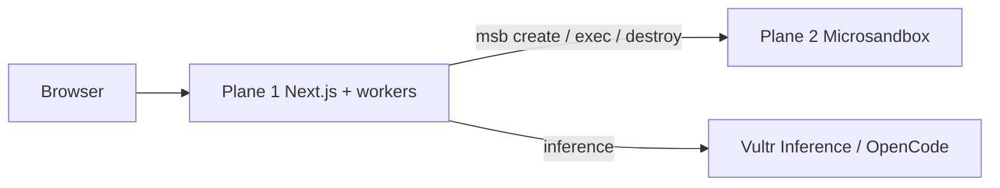

# API.md — How components communicate

Killhub communication is plane-scoped. **Plane 1 owns the Jobs API and SSE** ([DECISIONS.md](DECISIONS.md) D28). Plane 1 → Plane 2 over the harness (Microsandbox `msb` / SDK on a Vultr VX1 host). Plane 2 never calls Plane 1.

Related: [ARCHITECTURE.md](ARCHITECTURE.md) · [DATABASE.md](DATABASE.md) · [DECISIONS.md](DECISIONS.md)

---

## Overview



| Path | Protocol | Auth (v1) |
|------|----------|-----------|
| Browser → Next.js | HTTPS | None (public demo) |
| Next.js ↔ `explore/` workers | In-process or localhost sidecar | Same host; not a public plane |
| Control plane → Vultr API | HTTPS | `VULTR_API_KEY` on Plane 1 server only |
| Control plane → Plane 2 | Microsandbox `msb` / SDK on VX1 | Host access for harness; sandbox is job-scoped |
| Control plane → Vultr Serverless Inference | HTTPS `https://api.vultrinference.com/v1` | `VULTR_INFERENCE_*` (+ `OPENCODE_*`) on Plane 1 only (D25) |

---

## Jobs API (Plane 1)

Served by Next.js (route handlers). `explore/` workers update job state; they do not own the public HTTP surface.

### `POST /api/jobs`

Create a job.

**Request**

```json
{ "github_url": "https://github.com/org/repo" }
```

**Response `201`**

```json
{ "job_id": "…" }
```

**Errors:** `400` invalid URL (not public HTTPS github.com).

---

### `GET /api/jobs/{id}`

Full job snapshot for poll/hydrate.

**Response `200` (shape)**

```json
{
  "job_id": "…",
  "status": "installing",
  "progress": 55,
  "current_step": "pip install -r requirements.txt",
  "steps_completed": ["analyzing", "planning", "provisioning"],
  "updated_at": "…",
  "error": null,
  "profile": { },
  "readiness": null,
  "sandbox_id": "…",
  "inference_model": "…",
  "destroyed_at": null,
  "environment": { "environment_id": "…", "state": "running" },
  "vuln_report": null,
  "screenshot_ids": []
}
```

| Field | Meaning |
|-------|---------|
| `sandbox_id` | Microsandbox name / id (same as `environment.environment_id` when set) |
| `inference_model` | Vultr Serverless Inference model id used for this job |
| `destroyed_at` | UTC timestamp when Plane 2 sandbox was stopped/removed; null while alive |
| `screenshot_ids` | May be empty — screenshots are optional (D31) |

**Errors:** `404` unknown job.

Poll and SSE must agree on `status` / `progress` (D13).

---

### `GET /api/jobs/{id}/events`

Server-Sent Events stream.

| SSE `type` | Payload (conceptual) |
|------------|----------------------|
| `status` | `{ status }` |
| `progress` | `{ progress, current_step }` |
| `log` | `{ message, kind?, sandbox_id?, attempt?, detail? }` — `kind`: `sandbox_create` \| `sandbox_destroy` \| `repair_attempt` \| `mcp_assessment` \| `containment_probe` \| `agent` \| `harness` |
| `screenshot` | `{ screenshot_id, step, caption, url }` — only when a still was captured |
| `error` | `{ message }` |

`log` payloads must not include secrets.

- Support **Last-Event-ID** / event id resume for catch-up.
- Stream stays open through `error` events until terminal job state.
- Client disconnect does **not** cancel the job.

---

### `GET /api/jobs/{id}/screenshots`

Ordered timeline (may be `[]`):

```json
[
  {
    "id": "…",
    "step": "verifying",
    "caption": "HTTP healthcheck",
    "url": "/api/jobs/{id}/screenshots/{shot_id}",
    "created_at": "…"
  }
]
```

### `GET /api/jobs/{id}/screenshots/{shot_id}`

Image bytes (`image/png`) or redirect to object storage.

---

### `DELETE /api/jobs/{id}`

Explicit cancel. Plane 1 stops the worker (best effort), destroys Plane 2 sandbox, emits terminal `cancelled`.

---

### `GET /health`

Control-plane liveness. `200` when process is up.

---

## Job state machine (shared contract)

```
pending → analyzing → planning → provisioning → installing
       → verifying ⇄ repairing
       → scanning → ready | failed | cancelled
```

| Phase | Typical work |
|-------|----------------|
| `analyzing` / `planning` | Plan loop steps 1–3 → `environment_profile.json` |
| `provisioning` / `installing` | Plane 2 create + install attempts (no allowlist; flag failures) |
| `verifying` / `repairing` | Launch + readiness; `git_mcp` = MCP handshake listing tools (D30); `webapp` / `demo` = profile probe; capped retries |
| `scanning` | SCA + AI `vuln_review`; optional MCP Inspector/SDK assessment when `mcp.security_assessment.enabled` (D35); also best-effort SCA after partial failure |
| `ready` | Profile + readiness + report available (screenshots and MCP assessment optional; neither gates ready) |

---

## Plane 1 → Plane 2 (Harness API)

Not an HTTP public API. Internal interface in `explore/harness.py` (or equivalent):

| Call | Input | Output |
|------|-------|--------|
| `create_environment` | `job_id`, plan from profile | `environment_id` (sandbox name) |
| `wait_until_ready` | `environment_id` | ready or timeout error |
| `exec` | `environment_id`, `cmd` | `{ stdout, stderr, exit_code }` |
| `copy_in` / `copy_out` | paths host ↔ sandbox | void / bytes |
| `destroy_environment` | `environment_id` | void (idempotent stop + remove) |

**Rules**

- Implemented with Microsandbox (`msb` / SDK) on the Vultr VX1 host — see [IMPLEMENTATION_TEST_VM.md](IMPLEMENTATION_TEST_VM.md).
- Timeouts on every `exec`.
- Map `environment_profile.json` → OCI image + CPU/memory before create.
- Never pass `VULTR_API_KEY` / `VULTR_INFERENCE_*` / `OPENCODE_*` into sandbox env by default.
- Destroy when the agent finishes instructions and all tests (`ready`), or on cancel, fail, `ENV_TTL_SECONDS`, or orphan reaper.
- One sandbox per job covers explore + test (D27).

---

## Plane 1 → Inference

OpenCode client uses **Vultr Serverless Inference** only (`VULTR_INFERENCE_BASE_URL` default `https://api.vultrinference.com/v1`) with prompts under `prompts/`:

- `discover_environment.md`
- `validate_environment_spec.md`
- `repair_from_errors.md`
- `vuln_review.md`
- Optional: MCP assessment planning lives in discover/validate (encode `mcp.security_assessment` when warranted — D35)

Persist `inference_model` on the job. Tool use is limited to harness / sandbox APIs ([AGENTS.md](AGENTS.md)).

---

## Artifact handoff

| Artifact | Producer | Consumer |
|----------|----------|----------|
| `environment_profile.json` | Plane 1 plan loop | Harness → Plane 2; report UI |
| Screenshots (optional) | Plane 1 `screenshots` | Timeline via Jobs API |
| Vuln report | Plane 1 vulnscan + review (+ optional MCP assessment from Plane 2) | Report UI |
| Readiness | Plane 1 `verify` against Plane 2 | Job snapshot + SSE |
| MCP assessment (optional) | Plane 2 Inspector/SDK when profile plans it (D35) | `vuln_report.mcp_assessment` + `log.kind=mcp_assessment` |

---

## Versioning

v1 is unversioned under `/api/...`. Breaking changes require a decision entry and coordinated release.
