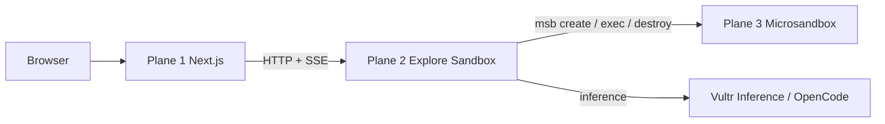

# API.md — How components communicate

Killhub communication is plane-scoped. Plane 1 ↔ Plane 2 over HTTP/SSE. Plane 2 → Plane 3 over the harness (Microsandbox `msb` / SDK on a Vultr VX1 host). Plane 3 never calls Plane 1.

Related: [ARCHITECTURE.md](ARCHITECTURE.md) · [DATABASE.md](DATABASE.md) · [DECISIONS.md](DECISIONS.md)

---

## Overview



| Path | Protocol | Auth (v1) |
|------|----------|-----------|
| Browser → Next.js | HTTPS | None (public demo) |
| Next.js → Explore (`EXPLORE_SANDBOX_URL`) | HTTP/SSE | Private network / compose; tighten later |
| Explore → Vultr API | HTTPS | `VULTR_API_KEY` on Plane 2 only (host/ops; not per-job VM create) |
| Explore → Test VM | Microsandbox `msb` / SDK on VX1 host | Host access for Plane 2; sandbox is job-scoped |
| Explore → OpenCode/Inference | HTTPS | `OPENCODE_*` / Vultr inference on Plane 2 only |

---

## Plane 1 ↔ Plane 2 (Jobs API)

Base URL: `EXPLORE_SANDBOX_URL` (Plane 1 server or BFF proxies to Explore).

### `POST /api/jobs`

Create a job.

**Request**

```json
{ "github_url": "https://github.com/org/repo" }
```

**Response `201`**

```json
{ "job_id": "…" }
```

**Errors:** `400` invalid URL (not public HTTPS github.com).

---

### `GET /api/jobs/{id}`

Full job snapshot for poll/hydrate.

**Response `200` (shape)**

```json
{
  "job_id": "…",
  "status": "installing",
  "progress": 55,
  "current_step": "pip install -r requirements.txt",
  "steps_completed": ["analyzing", "planning", "provisioning"],
  "updated_at": "…",
  "error": null,
  "profile": { },
  "readiness": null,
  "environment": { "environment_id": "…", "state": "running" },
  "vuln_report": null,
  "screenshot_ids": []
}
```

**Errors:** `404` unknown job.

Poll and SSE must agree on `status` / `progress` ([DECISIONS.md](DECISIONS.md) D13).

---

### `GET /api/jobs/{id}/events`

Server-Sent Events stream.

| SSE `type` | Payload (conceptual) |
|------------|----------------------|
| `status` | `{ status }` |
| `progress` | `{ progress, current_step }` |
| `log` | `{ message }` |
| `screenshot` | `{ screenshot_id, step, caption, url }` |
| `error` | `{ message }` |

- Support **Last-Event-ID** / event id resume for catch-up.
- Stream stays open through `error` events until terminal job state.
- Client disconnect does **not** cancel the job.

---

### `GET /api/jobs/{id}/screenshots`

Ordered timeline:

```json
[
  {
    "id": "…",
    "step": "verifying",
    "caption": "HTTP healthcheck",
    "url": "/api/jobs/{id}/screenshots/{shot_id}",
    "created_at": "…"
  }
]
```

### `GET /api/jobs/{id}/screenshots/{shot_id}`

Image bytes (`image/png`) or redirect to object storage.

---

### `DELETE /api/jobs/{id}`

Explicit cancel. Plane 2 stops the worker (best effort), destroys Test VM, emits terminal `cancelled`.

---

### `GET /health`

Plane 2 liveness for compose/orchestration. `200` when process is up.

---

## Job state machine (shared contract)

```
pending → analyzing → planning → provisioning → installing
       → verifying ⇄ repairing
       → scanning → ready | failed | cancelled
```

| Phase | Typical plane work |
|-------|--------------------|
| `analyzing` / `planning` | Plan loop steps 1–3 → `environment_profile.json` |
| `provisioning` / `installing` | Plane 3 create + supported deps |
| `verifying` / `repairing` | Launch MCP/webapp + readiness; capped retries |
| `scanning` | Vuln scan + AI review |
| `ready` | Profile + readiness + report available to Plane 1 |

---

## Plane 2 → Plane 3 (Harness API)

Not an HTTP public API. Internal interface in `explore/harness.py`:

| Call | Input | Output |
|------|-------|--------|
| `create_environment` | `job_id`, plan from profile | `environment_id` (sandbox name) |
| `wait_until_ready` | `environment_id` | ready or timeout error |
| `exec` | `environment_id`, `cmd` | `{ stdout, stderr, exit_code }` |
| `copy_in` / `copy_out` | paths host ↔ sandbox | void / bytes |
| `destroy_environment` | `environment_id` | void (idempotent stop + remove) |

**Rules**

- Implemented with Microsandbox (`msb` / SDK) on the Vultr VX1 host — see [IMPLEMENTATION_TEST_VM.md](IMPLEMENTATION_TEST_VM.md).
- Timeouts on every `exec`.
- Map `environment_profile.json` → OCI image + CPU/memory before create.
- Never pass `VULTR_API_KEY` / `OPENCODE_*` into sandbox env by default.
- Destroy (stop + remove) when the agent finishes instructions and all tests (`ready`), or on cancel, fail, `ENV_TTL_SECONDS`, or orphan reaper.

---

## Plane 2 → Inference

OpenCode client uses Vultr Inference with prompts under `prompts/`:

- `discover_environment.md`
- `validate_environment_spec.md`
- `repair_from_errors.md`
- `vuln_review.md`

Tool use is limited to Explore Sandbox + harness APIs ([AGENTS.md](AGENTS.md)).

---

## Artifact handoff

| Artifact | Producer | Consumer |
|----------|----------|----------|
| `environment_profile.json` | Plane 2 plan loop | Plane 2 harness → Plane 3; Plane 1 report UI |
| Screenshots | Plane 2 `screenshots.py` | Plane 1 timeline via Jobs API |
| Vuln report | Plane 2 `vulnscan` + review | Plane 1 report UI |
| Readiness | Plane 2 `verify` against Plane 3 | Job snapshot + SSE |

---

## Versioning

v1 is unversioned under `/api/...`. Breaking changes require a decision entry and either `/api/v2` or coordinated Plane 1+2 release.
