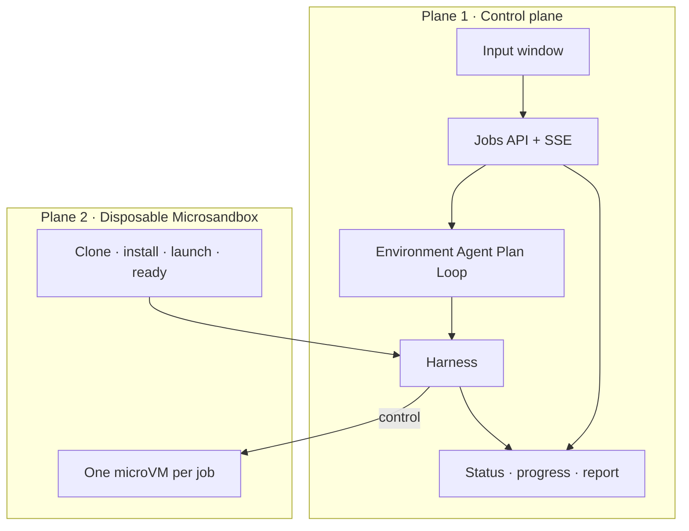
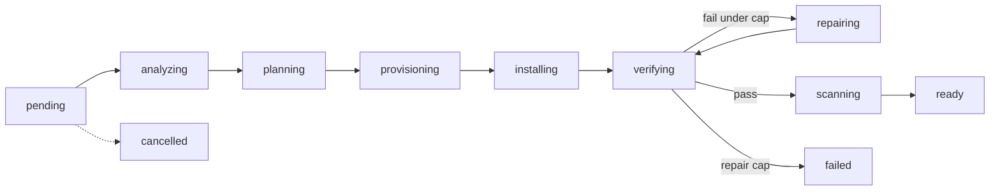
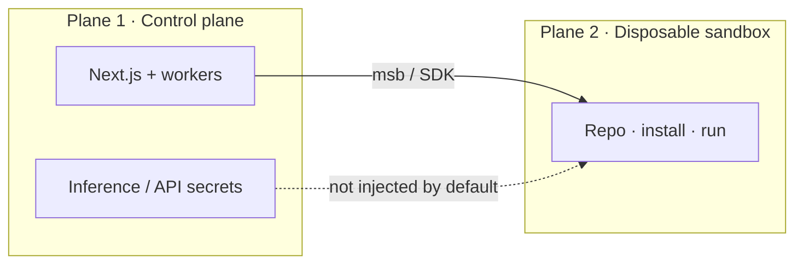
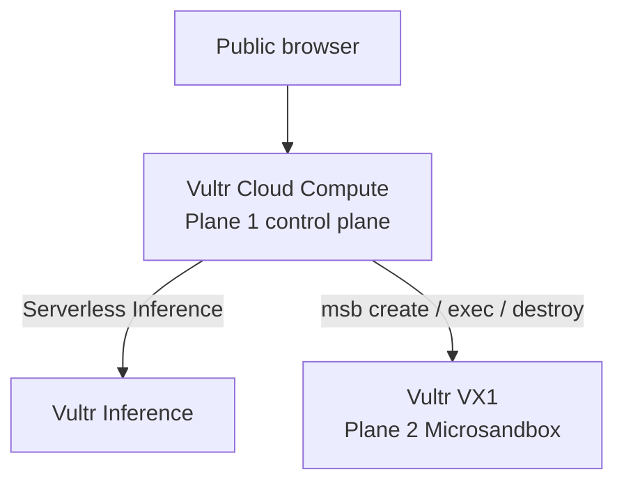

# ARCHITECTURE.md — How the platform is structured

Killhub is a **two-plane** system ([DECISIONS.md](DECISIONS.md) D27–D28):

1. **Control plane** — Next.js (UI + Jobs API/SSE) plus same-host agent/harness workers (`explore/`)
2. **Disposable Microsandbox** — one microVM per job on Vultr VX1 for **both** explore and test (not two VMs)

| Doc | Purpose |
|-----|---------|
| [PRODUCT.md](PRODUCT.md) | What and why |
| [AGENTS.md](AGENTS.md) | Rules for every AI agent |
| [DECISIONS.md](DECISIONS.md) | Agreed technical decisions |
| [DATABASE.md](DATABASE.md) | Data model and rules |
| [API.md](API.md) | How components communicate |
| [IMPLEMENTATION_PLAN.md](IMPLEMENTATION_PLAN.md) | Implementation index |

| Plane | Implementation docs |
|------:|---------------------|
| 1 Control plane | [IMPLEMENTATION_NEXTJS.md](IMPLEMENTATION_NEXTJS.md) · [IMPLEMENTATION_EXPLORE_SANDBOX.md](IMPLEMENTATION_EXPLORE_SANDBOX.md) |
| 2 Disposable Microsandbox | [IMPLEMENTATION_TEST_VM.md](IMPLEMENTATION_TEST_VM.md) |

---

## Two planes

```
┌─────────────────────────────────────────────────────────────────────────┐
│  PLANE 1 — Control plane (Next.js + explore/ workers)                   │
│  UI · Jobs API/SSE · Environment Agent · harness · vuln review          │
│  Secrets stay here (server-side only)                                   │
└───────────────────────────────┬─────────────────────────────────────────┘
                                │ msb create / exec / copy / destroy
                                ▼
┌─────────────────────────────────────────────────────────────────────────┐
│  PLANE 2 — Disposable Microsandbox (per job on Vultr VX1)               │
│  Same VM for explore + test: clone · install · launch · readiness       │
└─────────────────────────────────────────────────────────────────────────┘
```



| Plane | What it is | Owns |
|-------|------------|------|
| **1. Control plane** | Next.js + `explore/` workers on the same durable host | UI; **Jobs API/SSE**; plan loop; profile; harness; optional screenshots; vuln review; inference keys |
| **2. Disposable Microsandbox** | One Microsandbox microVM per job | Untrusted clone/install/run; readiness target; scan target; optional MCP Inspector/SDK assessment (D35); containment probes |

There is **no** separate Explore VM vs Test VM.

---

## Plane 1 — Control plane

**Role:** User surface and durable orchestration. Next.js owns the Jobs API and SSE ([DECISIONS.md](DECISIONS.md) D28). Agent/harness may live in `explore/` as an in-process or same-host sidecar worker — still Plane 1, not a disposable VM.

### Windows

| Window | Contents |
|--------|----------|
| **Input** | Public GitHub URL + start |
| **Status** | Live `status`, `progress`, `current_step`, execution log, optional screenshot timeline |
| **Report** | Setup / profile, sandbox lifecycle, vulnerability findings (SCA + optional MCP assessment), final outcome |

### Responsibilities

- Serve `POST/GET/DELETE /api/jobs…` and SSE from Plane 1
- Run Environment Agent Plan Loop + harness (workers)
- Never put control-plane secrets in browser bundles
- Never execute untrusted repo install/run on the control-plane host — only via harness into Plane 2

### Job snapshot (always available to the UI)

```json
{
  "job_id": "...",
  "status": "installing",
  "progress": 55,
  "current_step": "pip install -r requirements.txt",
  "steps_completed": ["analyzing", "planning", "provisioning"],
  "updated_at": "...",
  "error": null,
  "sandbox_id": "...",
  "destroyed_at": null
}
```

---

## Environment Agent Plan Loop (runs on Plane 1, acts on Plane 2)

```
IN:  Git repo URL
       │
       ▼
┌─────────────────────────────────────────────────────────────┐
│  Environment Agent Plan Loop                                │
│  1. Inspect repo and docs (via sandbox clone/copy/exec)     │
│  2. Infer required services                                 │
│  3. Validate environment and spec                           │
│  4. Provision deps on the same disposable sandbox           │
│  5. Launch chosen target and verify readiness               │
│     (loop on failure → re-inspect / patch profile / retry)  │
└─────────────────────────────────────────────────────────────┘
       │
       ▼
OUT: environment_profile.json  (+ readiness / failure + vuln report)
```

| Step | What the agent does |
|------|---------------------|
| **1. Inspect** | Read tree, README, manifests, lockfiles, scripts inside/via Plane 2; **decide** `git_mcp` \| `webapp` \| `demo` (D34); for MCP, whether to plan `mcp.security_assessment` (D35) |
| **2. Infer** | Runtimes, services, ports, MCP entrypoints — or invent a minimal demo plan for oddball repos |
| **3. Validate** | Complete `environment_profile.json` (OCI image, commands, readiness, optional assessment); reject incomplete specs |
| **4. Provision** | Attempt install/run commands from profile (**no allowlist** — flag failures, D29) |
| **5. Launch + ready** | Start target; **`git_mcp`** = MCP handshake that lists tools (D30); `webapp` / `demo` = profile probe (typically HTTP). Optional MCP Inspector/SDK runs after ready when planned — does not gate ready |

### `environment_profile.json`

```json
{
  "intent": "git_mcp",
  "source": {
    "type": "git",
    "url": "https://github.com/org/repo",
    "ref": "main"
  },
  "runtime": "node",
  "os_image": "ubuntu-24.04",
  "oci_image": "node:22-bookworm",
  "services": [],
  "packages": [],
  "install_commands": [],
  "run_commands": [],
  "mcp": {
    "launch_command": "",
    "readiness": { "type": "mcp_handshake", "timeout_seconds": 60 },
    "security_assessment": {
      "enabled": false,
      "tools": ["inspector", "sdk"],
      "probes": [],
      "notes": "Set enabled true when the agent plans MCP security testing (D35)"
    }
  },
  "healthcheck": { "type": "http", "path": "/", "port": 8000 },
  "ports": [8000],
  "summary": "..."
}
```

### Prompt pack

- `discover_environment` — inspect → intent + draft profile (incl. whether to enable `mcp.security_assessment`)
- `validate_environment_spec` — schema + readiness requirements (+ assessment block if present)
- `repair_from_errors` — capped retry after provision/launch failure
- `vuln_review` — summarize scanner output (+ optional MCP assessment findings)

### Harness

| Concern | Behavior |
|---------|----------|
| **Control** | `msb` / SDK create · exec · copy · stop · remove on VX1 |
| **Report** | Job status/progress/logs; optional screenshots; profile; readiness; vulns |
| **Secrets** | Inference / API keys stay on Plane 1; not injected into Plane 2 by default |

---

## Plane 2 — Disposable Microsandbox

**Role:** The only place untrusted repo code runs. One microVM per job for inspect + install + launch. See [Vultr agent sandboxing](https://docs.vultr.com/how-to-set-up-agent-sandboxing-on-vultr-cloud-compute) and D22/D27.

### Lifecycle

1. Create microsandbox (OCI image + CPU/memory from profile)
2. Clone `source` into the sandbox
3. Run `install_commands` / packages (attempt; flag failures)
4. Launch chosen target; verify readiness
5. Optional MCP Inspector/SDK assessment when profile plans it (D35)
6. Vuln scan against installed tree / lockfiles (also best-effort after partial failure)
7. Stop + remove on `ready` / fail / cancel / TTL

### Constraints

- No Killhub control-plane API keys in sandbox `env` by default
- Inter-sandbox traffic denied by default
- Resource/time caps; prefer non-root; no Docker socket from control plane

---

## End-to-end flow

```
Plane 1 (control)                         Plane 2 (one disposable microVM)
─────────────────                         ────────────────────────────────
Enter URL → create job
Plan loop: inspect / infer / validate ──► clone + read
environment_profile.json
Provision + launch + ready ─────────────► install / run / probe
Optional MCP assessment (D35) ──────────► Inspector / SDK when planned
Vuln scan ──────────────────────────────► SCA target
UI: status · optional shots · report
ready/fail/cancel/TTL → destroy ────────► msb stop + remove
```


---

## Job lifecycle

```
pending → analyzing → planning → provisioning → installing
       → verifying ⇄ repairing
       → scanning → ready | failed | cancelled
```

- **analyzing / planning** — steps 1–3 → validated profile (sandbox may already exist for inspect)
- **provisioning / installing / verifying** — steps 4–5 on Plane 2
- **scanning** — SCA after readiness (or best-effort after partial failure); optional MCP assessment when planned (D35)
- Repair capped by `MAX_REPAIR_ATTEMPTS`
- Jobs are **server-owned** on Plane 1



---

## API and realtime (owned by Plane 1)

| Method | Path | Purpose |
|--------|------|---------|
| `POST` | `/api/jobs` | Create job `{ github_url }` → `{ job_id }` |
| `GET` | `/api/jobs/{id}` | Snapshot |
| `GET` | `/api/jobs/{id}/events` | SSE |
| `GET` | `/api/jobs/{id}/screenshots` | Timeline (may be empty) |
| `GET` | `/api/jobs/{id}/screenshots/{shot_id}` | Image bytes |
| `DELETE` | `/api/jobs/{id}` | Cancel + destroy sandbox |
| `GET` | `/health` | Control-plane liveness |

SSE: `status` · `progress` · `log` · `screenshot` · `error`

GitHub URLs: public HTTPS `github.com` only; else `400`.

---

## Progress and screenshots

Screenshots are **optional** (D31). Prefer browser stills for HTTP webapp verify; skip for CLI-only MCP or early fail. Missing screenshots must not block `ready`.

Caps: `MAX_SCREENSHOTS_PER_JOB`; redact secrets; stills only.

---

## Security boundaries



- Browser never receives control-plane secrets
- Containment probes run **only** in Plane 2 and must be visible in job logs before destroy (D26)

---

## Deployment topology



| Environment | Plane 1 | Plane 2 | Inference |
|-------------|---------|---------|-----------|
| **Local dev** | `docker-compose` | Microsandbox on reachable VX1 (`MSB_HOST`) | Vultr Serverless Inference |
| **Public / demo** | Vultr Cloud Compute | Microsandbox on Vultr VX1 | Vultr Serverless Inference only |

Control plane and VX1 may be the same Vultr host or split; sandboxes never run inside the Next.js process address space as shared-kernel containers substituting for Microsandbox.

---

## Proposed repo layout

```
killhub/
├── frontend/                 # Plane 1 — Next.js (UI + Jobs API/SSE)
├── explore/                  # Plane 1 — agent / harness workers (same host)
├── prompts/
├── storage/                  # profiles/ + screenshots/ (dev)
├── docker-compose.yml        # Local control plane; Plane 2 via Microsandbox on VX1
├── PRODUCT.md … API.md
└── README.md
```

Plane 2 is **not** a checked-in app folder — it is a Microsandbox microVM per job.

### Key configuration

| Variable | Purpose |
|----------|---------|
| `VULTR_API_KEY` | VX1 host ops (Plane 1 server only; never in sandboxes) |
| `VULTR_INFERENCE_BASE_URL` | Default `https://api.vultrinference.com/v1` |
| `VULTR_INFERENCE_API_KEY` | Serverless Inference key |
| `VULTR_INFERENCE_MODEL` | Model id |
| `OPENCODE_*` | Agent client (must target Vultr Inference per D25) |
| `MSB_HOST` / `MSB_DEFAULT_IMAGE` / CPU·memory | Harness → Microsandbox |
| `JOB_TIMEOUT_SECONDS` | Hard wall clock |
| `MAX_REPAIR_ATTEMPTS` | Repair loop cap |
| `ENV_TTL_SECONDS` | Auto-destroy sandbox |
| `VULN_SCAN_*` | Scanner settings |
| `MAX_SCREENSHOTS_PER_JOB` | Screenshot cap |
| `SCREENSHOT_STORAGE` | Artifact store |

---

## Out of scope (v1)

- Private GitHub repos / OAuth
- Multi-user auth / billing
- Long-lived customer sandboxes beyond job TTL
- GPU workloads
- Auto-patching vulnerabilities (report only)
- Weaponizing CVEs / generic app/web exploit suites (SCA + report always; optional MCP Inspector/SDK only when planned — D33/D35; containment probes are isolation-only)
- Non-Vultr clouds for control plane (demo) or sandboxes
- Full session video
- Alternate LLM providers for the Environment Agent
- Separate Explore VM vs Test VM
- Install allowlist that blocks Microsandbox-capable commands (attempt + flag failures)

---

## Related

- [PRODUCT.md](PRODUCT.md) · [AGENTS.md](AGENTS.md) · [DECISIONS.md](DECISIONS.md) · [DATABASE.md](DATABASE.md) · [API.md](API.md)
- [IMPLEMENTATION_PLAN.md](IMPLEMENTATION_PLAN.md)
- [IMPLEMENTATION_NEXTJS.md](IMPLEMENTATION_NEXTJS.md)
- [IMPLEMENTATION_EXPLORE_SANDBOX.md](IMPLEMENTATION_EXPLORE_SANDBOX.md)
- [IMPLEMENTATION_TEST_VM.md](IMPLEMENTATION_TEST_VM.md)
