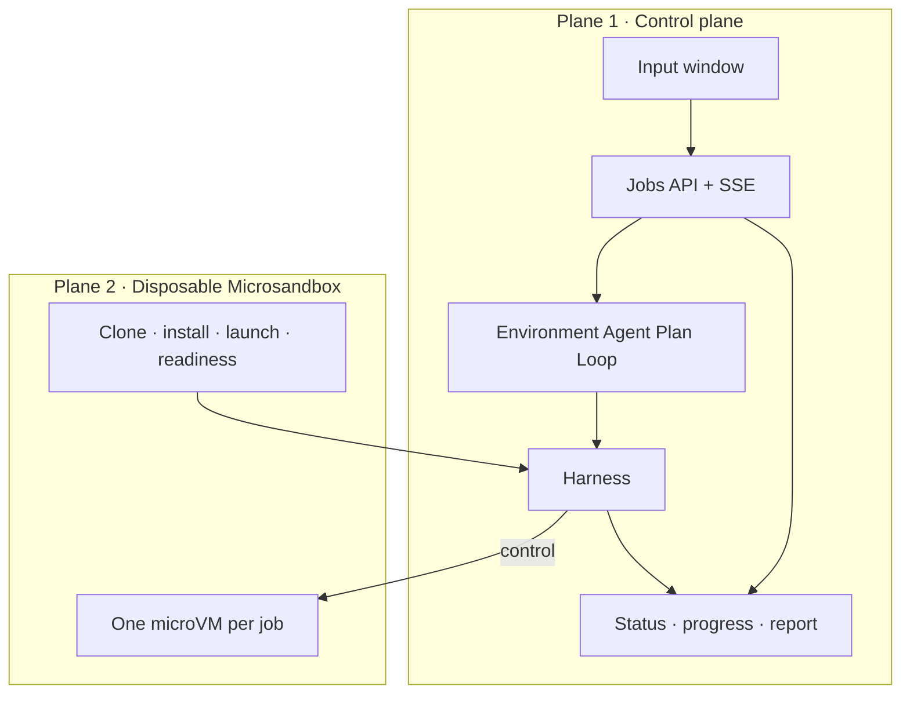
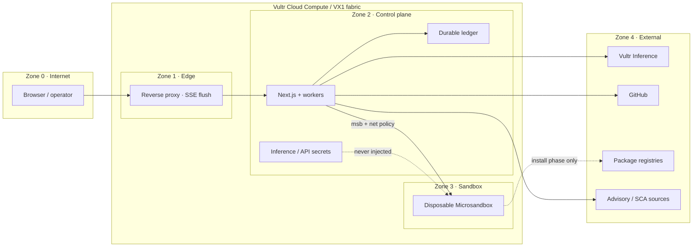
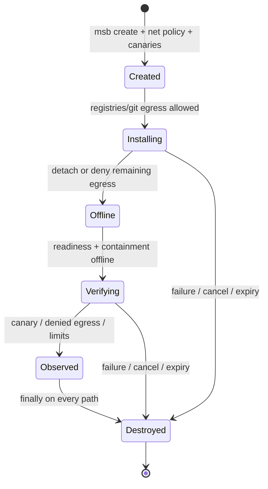
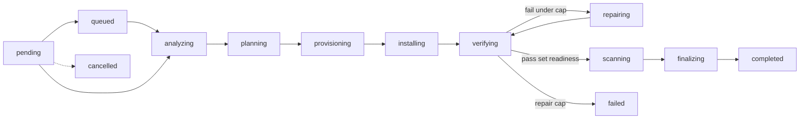
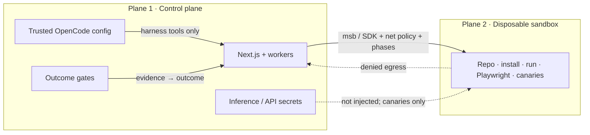
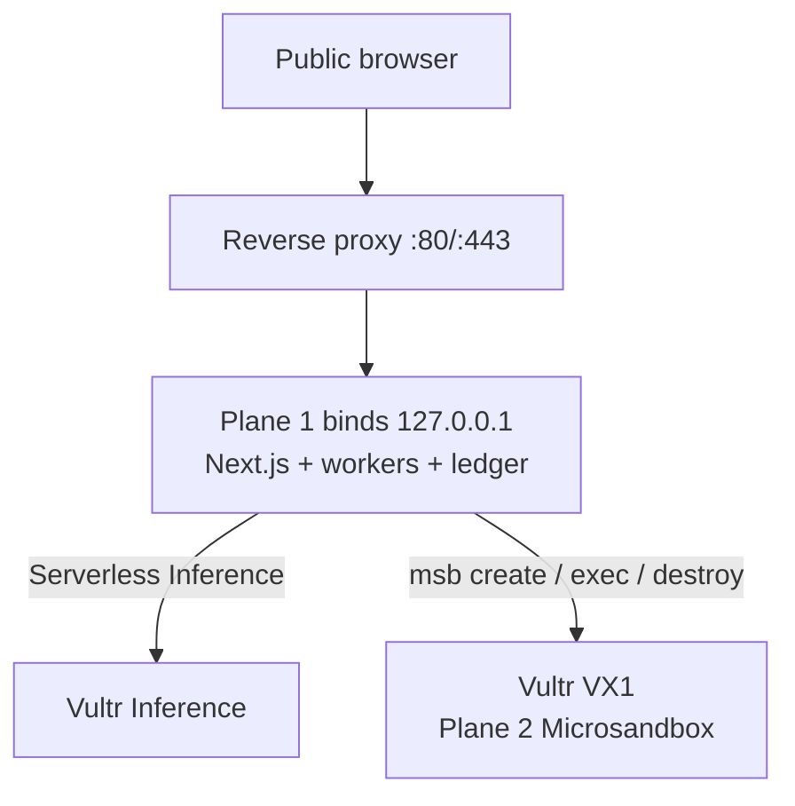

# ARCHITECTURE.md — How the platform is structured

Killhub is a **two-plane** system ([DECISIONS.md](DECISIONS.md) D27–D28):

1. **Control plane** — Next.js (UI + Jobs API/SSE) plus same-host agent/harness workers (`explore/`)
2. **Disposable Microsandbox** — one microVM per job on Vultr VX1 for **both** explore and test (not two VMs)

| Doc | Purpose |
|-----|---------|
| [PRODUCT.md](PRODUCT.md) | What and why |
| [AGENTS.md](AGENTS.md) | Rules for every AI agent |
| [DECISIONS.md](DECISIONS.md) | Agreed technical decisions |
| [DATABASE.md](DATABASE.md) | Data model and rules |
| [API.md](API.md) | How components communicate |
| [IMPLEMENTATION_PLAN.md](IMPLEMENTATION_PLAN.md) | Implementation index |

| Plane | Implementation docs |
|------:|---------------------|
| 1 Control plane | [IMPLEMENTATION_NEXTJS.md](IMPLEMENTATION_NEXTJS.md) · [IMPLEMENTATION_EXPLORE_SANDBOX.md](IMPLEMENTATION_EXPLORE_SANDBOX.md) |
| 2 Disposable Microsandbox | [IMPLEMENTATION_TEST_VM.md](IMPLEMENTATION_TEST_VM.md) |

---

## Two planes

```
┌─────────────────────────────────────────────────────────────────────────┐
│  PLANE 1 — Control plane (Next.js + explore/ workers)                   │
│  UI · Jobs API/SSE · Environment Agent · harness · vuln review          │
│  Secrets stay here (server-side only)                                   │
└───────────────────────────────┬─────────────────────────────────────────┘
                                │ msb create / exec / copy / destroy
                                ▼
┌─────────────────────────────────────────────────────────────────────────┐
│  PLANE 2 — Disposable Microsandbox (per job on Vultr VX1)               │
│  Same VM for explore + test: clone · install · launch · readiness       │
└─────────────────────────────────────────────────────────────────────────┘
```



| Plane | What it is | Owns |
|-------|------------|------|
| **1. Control plane** | Next.js + `explore/` workers on the same durable host | UI; **Jobs API/SSE**; plan loop; profile; harness; optional screenshots; vuln review; inference keys |
| **2. Disposable Microsandbox** | One Microsandbox microVM per job | Untrusted clone/install/run; readiness target; scan target; optional MCP Inspector/SDK assessment (D35); containment probes |

There is **no** separate Explore VM vs Test VM.

---

## Trust zones and boundary matrix (D42)

Finer zones live inside the two planes. Every row must have an enforcement point in code or deploy config.



| From → to | Allowed? | Enforced by |
|-----------|----------|-------------|
| Internet → control plane | Only via edge proxy; app binds `127.0.0.1` on demo (D46) | Deploy reverse proxy + bind address |
| Browser → secrets | Never | No secrets in client bundles; D19 |
| Control plane → sandbox | Harness `msb` create/exec/copy/destroy only | D23, D38 |
| Sandbox → control plane / management | Never | D39 network policy + `network_probe` |
| Sandbox → registries / git | Install/provision phase only | D43 phases + D39 allow/deny |
| Sandbox → internet during verify/containment | No (detached / denied) | D43 |
| Real Killhub secrets → sandbox | Never | D19; canaries instead (D44) |
| Agent narrative → readiness / terminal gates | Never overrides evidence | D47, D37 |
| `vuln_review` claim without finding cite | Dropped / non-authoritative | D48 |

---

## Plane 1 — Control plane

**Role:** User surface and durable orchestration. Next.js owns the **public** Jobs API and SSE edge ([DECISIONS.md](DECISIONS.md) D28) and **proxies** to the Python `explore/` sidecar, which **owns the durable ledger and workers** (D52). Still Plane 1, not a disposable VM.

### Windows

| Window | Contents |
|--------|----------|
| **Input** | Public GitHub URL + start |
| **Status** | Live `status`, `progress`, `current_step`, execution log, optional screenshot timeline |
| **Report** | **Intake dossier / receipt** (D49): profile, readiness proof, SCA (+ optional MCP assessment), canary/containment/network evidence, sandbox lifecycle, gated outcome |

### Responsibilities

- Serve `POST/GET/DELETE /api/jobs…` and SSE from Plane 1
- Run Plane-1 **pre-flight** before bootstrap create when applicable (D45)
- Run Environment Agent Plan Loop + harness (workers)
- Apply **deterministic outcome gates**; agents advise/explain only (D47)
- Never put control-plane secrets in browser bundles
- Never execute untrusted repo install/run on the control-plane host — only via harness into Plane 2
- Persist the job **receipt** in the durable ledger so it outlives the sandbox (D41, D49)

### Job snapshot (always available to the UI)

```json
{
  "job_id": "...",
  "status": "installing",
  "progress": 55,
  "current_step": "pip install -r requirements.txt",
  "steps_completed": ["analyzing", "planning", "provisioning"],
  "updated_at": "...",
  "error": null,
  "sandbox_id": "...",
  "destroyed_at": null
}
```

---

## Environment Agent Plan Loop (runs on Plane 1, acts on Plane 2)

```
IN:  Git repo URL
       │
       ▼
┌─────────────────────────────────────────────────────────────┐
│  Environment Agent Plan Loop                                │
│  −1. Pre-flight (URL · admission · cheap risk) — D45        │
│  0. Create bootstrap sandbox (trusted profile, D36)         │
│     + plant canaries (D44) + net policy (D39)               │
│  1. Inspect repo and docs (via sandbox clone/copy/exec)     │
│  2. Infer required services                                 │
│  3. Validate runtime environment_profile.json               │
│     (replace VM if oci_image ≠ bootstrap — still one VM)    │
│  4. Provision deps (install-phase egress — D43)             │
│  5. Detach/deny egress → launch + verify readiness          │
│     (loop on failure → re-inspect / patch profile / retry)  │
│  6. Scan / canary+containment / cite-checked review (D48)   │
│  7. Destroy (finally) → receipt → completed|failed (D49)    │
└─────────────────────────────────────────────────────────────┘
       │
       ▼
OUT: environment_profile.json + readiness + receipt (vulns · probes · lifecycle)
```

| Step | What the agent / harness does |
|------|---------------------|
| **−1. Pre-flight** | URL + admission + cheap risk checks; hard-fail without creating a sandbox when possible (D45) |
| **0. Bootstrap** | Harness creates Plane 2 from Killhub-owned bootstrap profile (`MSB_DEFAULT_IMAGE`); plant canaries; apply net policy (D36, D44, D39) |
| **1. Inspect** | Read tree, README, manifests, lockfiles, scripts inside/via Plane 2; **decide** `git_mcp` \| `webapp` \| `demo` (D34); for MCP, whether to plan `mcp.security_assessment` (D35) |
| **2. Infer** | Runtimes, services, ports, MCP entrypoints — or invent a minimal demo plan for oddball repos |
| **3. Validate** | Complete **runtime** profile against **versioned schema** (D51): services, CommandSpecs with cwd, process supervision, probes, MCP transport; reject incomplete specs. If `oci_image` differs from bootstrap → **replace** sandbox; never two concurrent VMs (D27/D36) |
| **4. Provision** | Attempt services + install/run from runtime profile (**no allowlist** — flag failures, D29); registries/git egress allowed in this phase (D43) |
| **5. Launch + readiness** | Enter offline/deny-egress phase (D43); supervise processes; set `readiness` + `verification.kind` when probe passes (D37, D54). **`git_mcp` + `stdio`** = in-guest MCP verify helper (JSON-RPC `initialize` → `tools/list`); **`streamable_http`** = HTTP MCP handshake listing tools; `webapp` / `demo` = declared probe. Do **not** destroy on readiness alone. Gates own success (D47) |
| **6–7. Finalize** | SCA + cite-checked `vuln_review` (D48); canary + **containment matrix** (D58); optional MCP assessment; capture artifacts; **confirm destroy**; persist receipt; mark `completed` or `failed` (D49, D57) |

### `environment_profile.json` (schema_version `1` — D51)

Full field rules: [DATABASE.md](DATABASE.md). Example:

```json
{
  "schema_version": "1",
  "intent": "git_mcp",
  "verification_target": "original_application",
  "source": {
    "type": "git",
    "url": "https://github.com/org/repo",
    "ref": "main",
    "commit": "abc123"
  },
  "runtime": "node",
  "os_image": "ubuntu-24.04",
  "oci_image": "node:22-bookworm",
  "workdir": "/workspace/repo",
  "services": [],
  "packages": [],
  "install_commands": [
    { "argv": ["npm", "ci"], "cwd": "/workspace/repo", "timeout_seconds": 600 }
  ],
  "run_commands": [],
  "processes": [
    {
      "name": "mcp",
      "command": { "argv": ["node", "dist/index.js"], "cwd": "/workspace/repo", "timeout_seconds": 30 },
      "supervise": "restart",
      "ready_probe": "mcp_tools"
    }
  ],
  "mcp": {
    "transport": "stdio",
    "entrypoint": "@modelcontextprotocol/server-filesystem",
    "launch_command": {
      "argv": ["npx", "-y", "@modelcontextprotocol/server-filesystem", "/workspace/repo"],
      "cwd": "/workspace/repo",
      "timeout_seconds": 60
    },
    "readiness": { "type": "mcp_handshake", "transport": "stdio", "timeout_seconds": 60 },
    "security_assessment": {
      "enabled": false,
      "tools": ["inspector", "sdk"],
      "probes": [],
      "notes": "Set enabled true when the agent plans MCP security testing (D35)"
    }
  },
  "healthcheck": { "type": "http", "path": "/", "port": 8000 },
  "ports": [8000],
  "summary": "..."
}
```

### Prompt pack

- `discover_environment` — inspect → intent + draft profile (incl. whether to enable `mcp.security_assessment`)
- `validate_environment_spec` — schema + readiness requirements (+ assessment block if present)
- `repair_from_errors` — capped retry after provision/launch failure
- `vuln_review` — summarize scanner output with **citations to finding ids** (D48); include optional MCP assessment / canary / containment findings

### Harness

| Concern | Behavior |
|---------|----------|
| **Control** | `msb` / SDK create · replace · exec · copy · stop · remove on VX1 |
| **Bootstrap** | First create uses trusted bootstrap profile; runtime image may replace in place (D36) |
| **Network** | Apply Killhub egress policy on every create (deny control plane + management; D39); **install then offline** phases (D43) |
| **Canaries** | Plant randomized canaries on create/replace; scan for hits (D44) |
| **Report** | Structured SSE + durable receipt: profile; readiness; findings; probes; lifecycle; optional screenshots (D49) |
| **Secrets** | Inference / API keys stay on Plane 1; not injected into Plane 2 by default |
| **Agent tools** | OpenCode trusted config exposes only job-scoped harness tools (D38) |
| **Gates** | Deterministic rules decide outcomes; agents advise/explain (D47) |

---

## Plane 2 — Disposable Microsandbox

**Role:** The only place untrusted repo code runs. One microVM per job for inspect + install + launch. See [Vultr agent sandboxing](https://docs.vultr.com/how-to-set-up-agent-sandboxing-on-vultr-cloud-compute) and D22/D27.

### Lifecycle

1. Create microsandbox from **bootstrap** profile (`MSB_DEFAULT_IMAGE` + CPU/memory defaults) with Killhub network policy + canaries (D36, D39, D44) — only after pre-flight when hard-fail applies (D45)
2. Clone `source` into the sandbox; inspect/discover
3. If runtime `oci_image` differs → **replace** (destroy bootstrap VM, create new image, re-clone, re-plant canaries) — one live VM (D36)
4. **Install phase:** run `install_commands` / packages with registries/git egress allowed (D43); attempt; flag failures
5. **Offline / deny-egress phase:** supervise processes; verify readiness (MCP stdio helper or HTTP/TCP/command) → set `readiness` + verification kind (D37, D43, D51, D54)
6. Optional MCP Inspector/SDK assessment when profile plans it (D35)
7. Vuln scan against installed tree / lockfiles; canary + **containment matrix** (timeout, host-access, sibling-access, host-liveness — D58) + network probes
8. Optional Playwright stills **inside** Plane 2 (D38); copy out
9. Stop + remove in a **finally** path; set `destroyed_at` **only if confirmed** else `destroy_failed` (D57); emit lifecycle evidence (D49)

### Network phases (D43)



### Constraints

- No Killhub control-plane API keys in sandbox `env` by default; canaries only (D19, D44)
- Inter-sandbox traffic denied by default
- Egress to public control-plane destinations and Microsandbox management endpoints **denied and probe-tested** (D39)
- After install: verify/containment run with egress detached or registries-denied (D43)
- Resource/time caps + absolute `expires_at` (host reaper; `msb touch` cannot extend — D41); prefer non-root; no Docker socket from control plane

---

## End-to-end flow

```
Plane 1 (control)                         Plane 2 (one disposable microVM)
─────────────────                         ────────────────────────────────
Enter URL → admit job (D40) → ledger
Bootstrap create ───────────────────────► msb create (default image + net policy)
Plan loop: inspect / infer / validate ──► clone + read
Runtime profile; image change? ─────────► replace VM (still one live) or continue
Provision + launch + readiness ─────────► install / run / probe → readiness field
Optional MCP assessment (D35) ──────────► Inspector / SDK when planned
Vuln scan + finalize ───────────────────► SCA / shots in guest; copy out
UI: status · optional shots · report
completed/fail/cancel/expiry → destroy ─► msb stop + remove
```

---

## Job lifecycle

```
pending → [queued] → analyzing → planning → provisioning → installing
       → verifying ⇄ repairing
       → scanning → finalizing → completed | failed | cancelled
```

- **analyzing / planning** — bootstrap create → inspect → validated **runtime** profile (replace VM if image differs)
- **provisioning / installing / verifying** — install/launch; set `readiness` on probe pass (D37)
- **scanning / finalizing** — SCA (+ optional MCP assessment); persist report; destroy sandbox; then `completed`
- Repair capped by `MAX_REPAIR_ATTEMPTS`
- Jobs are **server-owned** on Plane 1 (durable ledger — D41)



---

## API and realtime (owned by Plane 1)

| Method | Path | Purpose |
|--------|------|---------|
| `POST` | `/api/jobs` | Create job `{ github_url }` → `{ job_id }` (`429`/`503` on admission — D40) |
| `GET` | `/api/jobs/{id}` | Snapshot |
| `GET` | `/api/jobs/{id}/events` | SSE |
| `GET` | `/api/jobs/{id}/screenshots` | Timeline (may be empty) |
| `GET` | `/api/jobs/{id}/screenshots/{shot_id}` | Image bytes |
| `DELETE` | `/api/jobs/{id}` | Cancel + destroy sandbox |
| `GET` | `/health` | Control-plane liveness |

SSE: `status` · `progress` · `log` · `screenshot` · `error` · `span` · `finding` · `containment` · `lifecycle` (+ keep-alives — D49, D50)

GitHub URLs: public HTTPS `github.com` only; else `400`. Pre-flight may reject before sandbox create (D45).

---

## Progress and screenshots

Screenshots are **optional** (D31). Prefer browser stills for HTTP webapp verify; **Playwright runs inside Plane 2** (D38); Plane 1 stores copied stills. Skip for CLI-only MCP or early fail. Missing screenshots must not invalidate readiness or block `completed`.

Caps: `MAX_SCREENSHOTS_PER_JOB` + disk budgets (D40); redact secrets; stills only.

---

## Admission (public demo)

Anonymous `POST /api/jobs` is gated by D40: global concurrency, bounded queue, request throttling, inference budgets, disk/log caps. Rejections: `429` / `503` with explicit error codes ([API.md](API.md)).

---

## Security boundaries

See the **trust-zone boundary matrix** above (D42). Summary:



- Browser never receives control-plane secrets
- Demo deploy: edge proxy faces internet; app binds localhost (D46)
- OpenCode: trusted system config; deny host shell; repo instructions untrusted (D38)
- Plane 2 must not reach Plane 1 public endpoints or management APIs — policy + `network_probe` (D39)
- Install-then-offline network phases; denied egress logged (D43)
- Canary hits are high-severity findings (D44)
- Containment probes run **only** in Plane 2; timeout alone is insufficient — record host-access, sibling-access, and host-liveness evidence (D58); visible in receipt/stream before destroy (D26, D49)
- Cancel is idempotent; workers cannot mutate non-cleanup fields after cancel (D56)
- SSE clients hydrate `event_cursor` then subscribe; expired cursors force re-snapshot (D55)
- Agents explain; gates decide (D47)

---

## Deployment topology



| Environment | Plane 1 | Plane 2 | Inference |
|-------------|---------|---------|-----------|
| **Local dev** | `docker-compose` (ports may bind openly) | Microsandbox on reachable VX1 (`MSB_HOST`) | Vultr Serverless Inference |
| **Public / demo** | Vultr Cloud Compute behind reverse proxy; app on `127.0.0.1` (D46) | Microsandbox on Vultr VX1 | Vultr Serverless Inference only |

Control plane and VX1 may be the same Vultr host or split; sandboxes never run inside the Next.js process address space as shared-kernel containers substituting for Microsandbox.

---

## Proposed repo layout

```
killhub/
├── frontend/                 # Plane 1 — Next.js (UI + Jobs API/SSE)
├── explore/                  # Plane 1 — agent / harness workers (same host)
├── prompts/
├── storage/                  # ledger/ + profiles/ + screenshots/
├── docker-compose.yml        # Local control plane; Plane 2 via Microsandbox on VX1
├── PRODUCT.md … API.md
└── README.md
```

Plane 2 is **not** a checked-in app folder — it is a Microsandbox microVM per job.

### Key configuration

| Variable | Purpose |
|----------|---------|
| `VULTR_API_KEY` | VX1 host ops (Plane 1 server only; never in sandboxes) |
| `VULTR_INFERENCE_BASE_URL` | Default `https://api.vultrinference.com/v1` |
| `VULTR_INFERENCE_API_KEY` | Serverless Inference key |
| `VULTR_INFERENCE_MODEL` | Model id |
| `OPENCODE_*` | Agent client → Vultr Inference (D25); trusted config path (D38) |
| `MSB_HOST` / `MSB_DEFAULT_IMAGE` / CPU·memory | Bootstrap image + harness defaults (D36) |
| `MSB_NET_POLICY` / control-plane deny list | Plane 2 egress policy + install/offline phases (D39, D43) |
| Reverse proxy / bind `127.0.0.1` | Demo edge (D46) |
| `JOB_TIMEOUT_SECONDS` | Hard wall clock |
| `ENV_TTL_SECONDS` / `expires_at` | Absolute sandbox expiry (D41; not extended by touch) |
| `MAX_REPAIR_ATTEMPTS` | Repair loop cap |
| `MAX_CONCURRENT_JOBS` / `MAX_QUEUED_JOBS` / rate limits | Admission (D40) |
| `INFERENCE_BUDGET_*` | Per-job / rolling inference caps (D40) |
| `MAX_JOB_LOG_BYTES` / disk caps | Event and artifact budgets (D40) |
| `LEDGER_URL` / ledger path | Durable job/event store (D41) |
| `VULN_SCAN_*` | Scanner settings |
| `MAX_SCREENSHOTS_PER_JOB` | Screenshot cap |
| `SCREENSHOT_STORAGE` | Artifact store |

---

## Out of scope (v1)

- Private GitHub repos / OAuth
- Multi-user auth / billing
- Long-lived customer sandboxes beyond job TTL
- GPU workloads
- Auto-patching vulnerabilities (report only)
- Weaponizing CVEs / generic app/web exploit suites (SCA + report always; optional MCP Inspector/SDK only when planned — D33/D35; containment probes are isolation-only)
- Non-Vultr clouds for control plane (demo) or sandboxes
- Full session video
- Alternate LLM providers for the Environment Agent
- Separate Explore VM vs Test VM
- Install allowlist that blocks Microsandbox-capable commands (attempt + flag failures)

---

## Related

- [PRODUCT.md](PRODUCT.md) · [AGENTS.md](AGENTS.md) · [DECISIONS.md](DECISIONS.md) · [DATABASE.md](DATABASE.md) · [API.md](API.md)
- [IMPLEMENTATION_PLAN.md](IMPLEMENTATION_PLAN.md)
- [IMPLEMENTATION_NEXTJS.md](IMPLEMENTATION_NEXTJS.md)
- [IMPLEMENTATION_EXPLORE_SANDBOX.md](IMPLEMENTATION_EXPLORE_SANDBOX.md)
- [IMPLEMENTATION_TEST_VM.md](IMPLEMENTATION_TEST_VM.md)
