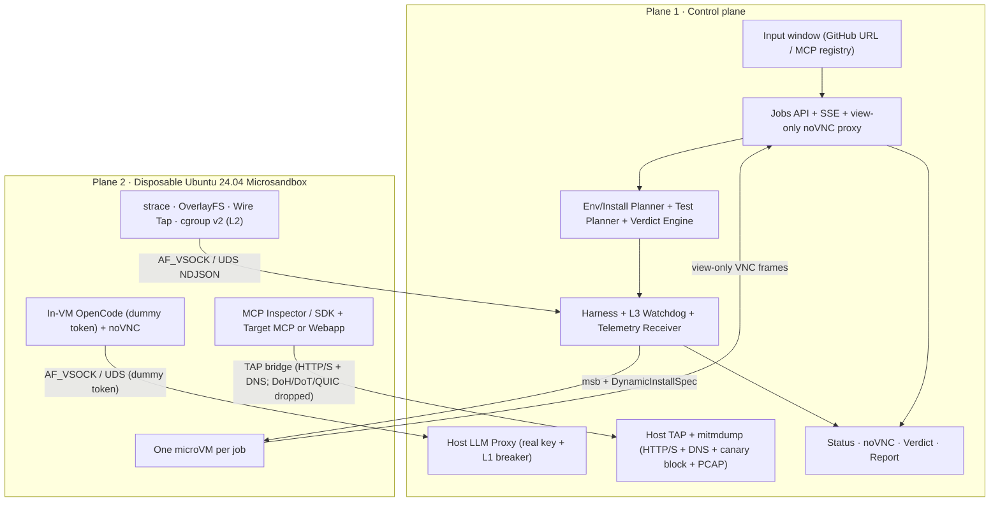
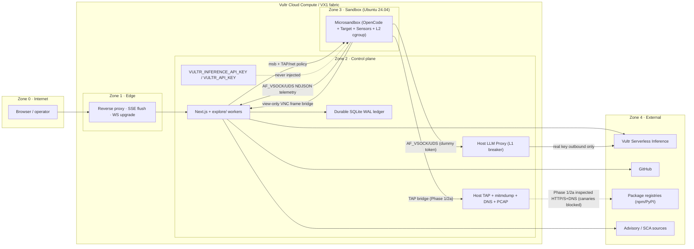
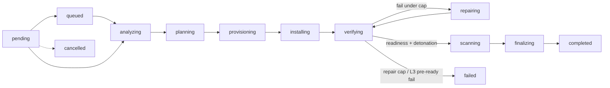
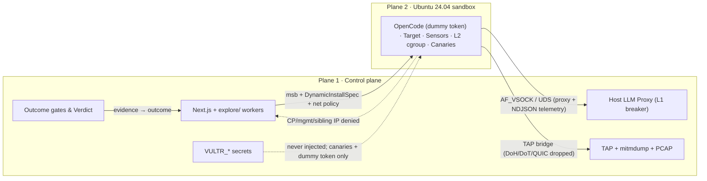
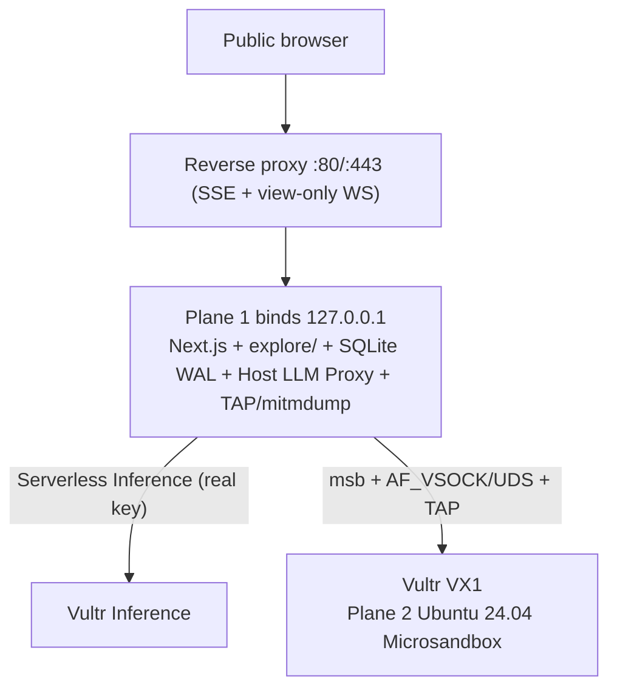

# ARCHITECTURE.md — How the platform is structured

Killhub is a **two-plane** system ([DECISIONS.md](DECISIONS.md) D27–D28, D69–D74):

1. **Control plane** — Next.js (UI, Jobs API/SSE, authenticated view-only `noVNC` proxy) plus same-host Python workers (`explore/`: ledger, Environment/Install Planner, Test Planner, Cite-Checked Vuln Reviewer & Verdict Synthesizer, Host LLM Proxy, `msb` harness, host-side TAP/`mitmdump` collector, and `AF_VSOCK`/UDS telemetry receiver).
2. **Disposable Microsandbox** — one Ubuntu 24.04 microVM per job on Vultr VX1 for **explore, detonation, and test** (never two separate VMs).

| Doc | Purpose |
|-----|---------|
| [PRODUCT.md](PRODUCT.md) | What and why |
| [AGENTS.md](AGENTS.md) | Rules for every AI agent (incl. R2 inline doc & module frontmatter) |
| [DECISIONS.md](DECISIONS.md) | Agreed technical decisions (`D1`–`D74`) |
| [DATABASE.md](DATABASE.md) | Data model, `schemas/*.json`, and rules |
| [API.md](API.md) | How components communicate |
| [ALIGNMENT_PLAN.md](ALIGNMENT_PLAN.md) | Reconciliation plan, model-selection plan, mitigations, teammate handoffs |
| [IMPLEMENTATION_PLAN.md](IMPLEMENTATION_PLAN.md) | Implementation index |
| [plan/README.md](plan/README.md) | Agent-sized build steps (one per session) |

| Plane | Implementation docs |
|------:|---------------------|
| 1 Control plane | [IMPLEMENTATION_NEXTJS.md](IMPLEMENTATION_NEXTJS.md) · [IMPLEMENTATION_EXPLORE_SANDBOX.md](IMPLEMENTATION_EXPLORE_SANDBOX.md) |
| 2 Disposable Microsandbox | [IMPLEMENTATION_TEST_VM.md](IMPLEMENTATION_TEST_VM.md) |

---

## Two planes

```
┌──────────────────────────────────────────────────────────────────────────────────┐
│  PLANE 1 — Control plane (Next.js + explore/ workers on Vultr host)              │
│  UI · Jobs API/SSE · view-only noVNC WS proxy · Ledger (SQLite WAL)              │
│  Env/Install Planner · Test Planner · Cite-Checked Reviewer · Verdict Engine     │
│  Host LLM Proxy (holds real VULTR_INFERENCE_API_KEY; Layer 1 circuit breaker)    │
│  Host TAP bridge + mitmdump (HTTP/S + DNS, DoH/DoT/QUIC drop, canary block, PCAP)│
│  Layer 3 hypervisor wall-clock watchdog + AF_VSOCK/UDS NDJSON telemetry receiver │
└──────────┬──────────────────────────────▲─────────────────────────▲──────────────┘
           │ msb create/exec/copy/destroy │ AF_VSOCK / UDS / mgmt0  │ TAP bridge
           │ + view-only VNC frame bridge │ (LLM Proxy + NDJSON     │ (mitmdump +
           ▼                              │  sensor telemetry)      │  tcpdump)
┌─────────────────────────────────────────┴─────────────────────────┴──────────────┐
│  PLANE 2 — Disposable Ubuntu 24.04 Microsandbox (one microVM per job on VX1)     │
│  Read-only rootfs + OverlayFS · /workspace (capped) + canaries (.env/.ssh/.aws)  │
│  In-VM victim OpenCode (dummy token → Host LLM Proxy) + noVNC display            │
│  @modelcontextprotocol/inspector · Python MCP SDK · Target MCP / webapp / demo   │
│  Guest sensors: strace · OverlayFS upperdir · MCP wire tap · cgroup v2 (Layer 2) │
└──────────────────────────────────────────────────────────────────────────────────┘
```



| Plane | What it is | Owns |
|-------|------------|------|
| **1. Control plane** | Next.js + `explore/` workers on the same durable host | UI; **Jobs API/SSE**; authenticated **view-only `noVNC`** proxy; durable ledger; Environment/Install Planner; Test Planner; Cite-Checked Vuln Reviewer & Detonation Verdict synthesizer; **Host LLM Proxy** (real `VULTR_INFERENCE_API_KEY` + L1 circuit breaker); Host **TAP + `mitmdump` + DNS + PCAP** interceptor; L3 watchdog & `AF_VSOCK`/UDS telemetry collector |
| **2. Disposable Microsandbox** | One Ubuntu 24.04 Microsandbox microVM per job | Untrusted clone/dynamic install/run; **in-VM victim OpenCode** (dummy bearer token only); `noVNC` server; `@modelcontextprotocol/inspector` + SDK discovery; readiness & detonation target; guest sensors (`strace`, OverlayFS `upperdir`, MCP wire tap, cgroup v2 L2 caps); optional Playwright stills; containment probes |

There is **no** separate Explore VM vs Test VM.

---

## Trust zones and boundary matrix (D42)

Finer zones live inside the two planes. Every row must have an enforcement point in code or deploy config.



| From → to | Allowed? | Enforced by |
|-----------|----------|-------------|
| Internet → control plane | Only via edge proxy; Next.js, `explore/`, Host LLM Proxy, and `noVNC` proxy bind `127.0.0.1` on demo (D46) | Reverse proxy + bind address |
| Internet → `noVNC` WebSocket | Only authenticated, **view-only** session scoped to `job_id` (RFB input messages dropped) | Plane 1 `noVNC` WS proxy (D71) |
| Browser → secrets | Never | No secrets in client bundles; D19 |
| Control plane → sandbox | Harness `msb` create/exec/copy/destroy + `AF_VSOCK`/UDS control channel | D23, D38, D60, D71 |
| Sandbox → control plane Jobs API / `msb` management / sibling VMs | **Never** — general IP traffic to Plane 1, `msb` mgmt, or siblings denied | D39 TAP firewall + `network_probe` (D65) |
| Sandbox → Plane 1 Host LLM Proxy & telemetry receiver | **Only** via hypervisor-constrained IPC (`AF_VSOCK` or UDS/`mgmt0`), authenticated with per-job ephemeral dummy token | D71 IPC listener + Host LLM Proxy token check |
| Sandbox → DoH / DoT / QUIC / raw DNS bypass | **Never** — UDP/443, TCP/853, and known DoH endpoints dropped on host TAP firewall | D70 firewall rules |
| Sandbox → external internet (Phase 1 Install) | Package/git egress via host TAP + `mitmdump` (CP/mgmt/siblings denied) | D39, D43, D70 |
| Sandbox → external internet (Phase 2a Monitored Detonation) | Inspected HTTP/S + DNS via TAP + `mitmdump` with **real-time canary blocking** + optional PCAP | D43, D44, D70 |
| Sandbox → external internet (Phase 2b Offline Containment) | **Never** — deny-all remaining egress (guest loopback only) | D43 Phase 2b firewall drop |
| Real Killhub secrets (`VULTR_*`) → sandbox | **Never** — guest holds only randomized canaries and ephemeral dummy proxy token | D19, D44, D71 |
| Agent / harness → arbitrary host paths | Never — `copy_in`/`copy_out` via allowlisted roots & per-job artifact dirs only | D60 |
| Agent narrative → readiness / verdict / terminal gates | Never overrides evidence | D47, D66, D37, D73 |
| `vuln_review` claim without finding cite | Dropped / non-authoritative | D48 |
| Advisory / SCA registry fetch | Plane 1 (or prefetched DB); never guest after Phase 2b | D43, D63 |

---

## Plane 1 — Control plane

**Role:** User surface, durable orchestration, security telemetry collection, and inference key isolation. Next.js owns the **public** Jobs API, SSE edge, and authenticated **view-only `noVNC`** WebSocket proxy ([DECISIONS.md](DECISIONS.md) D28, D71), proxying job requests to the Python `explore/` sidecar, which **owns the durable SQLite WAL ledger, planners/reviewers, Host LLM Proxy, `msb` harness, TAP/`mitmdump` controller, and `AF_VSOCK`/UDS telemetry receiver** (D52, D70, D71). Still Plane 1, not a disposable VM.

### Windows

| Window | Contents |
|--------|----------|
| **Input** | Public GitHub URL or MCP registry target (`npm:`, `pypi:`, pinned fixture ID — D15) + start |
| **Status** | Live `status`, `progress`, `current_step`, execution log, **authenticated view-only `noVNC` live stream** of in-VM OpenCode, live sensor telemetry (`mitmdump` HTTP/S+DNS, `strace`, wire tap, kill-switch), and optional Playwright still timeline |
| **Report** | **Intake dossier / receipt + Detonation Verdict** (D49, D73): profile, `DynamicInstallSpec`, `TestScenarioPlan`, readiness proof, `package_sha256_before`/`after`, `t0_tools_sha256`/`final_tools_sha256`/`tool_diffs`, SCA + cite-checked `vuln_review` + active detonation findings mapped to 16 MITRE ATLAS tactics (`AML.TA0000`–`AML.TA0015`) & OWASP MCP Top 10 (`MCP01:2025`–`MCP10:2025`), 3-layer kill-switch & containment evidence, sandbox lifecycle, gated outcome |

### Responsibilities

- Serve `POST/GET/DELETE /api/jobs…`, `/api/jobs/{id}/verdict`, `/api/jobs/{id}/telemetry`, `/api/jobs/{id}/novnc`, and SSE from Plane 1
- Run Plane-1 **pre-flight** before bootstrap create when applicable (D45)
- Run **Environment/Install Planner** (`environment_profile.json` + `DynamicInstallSpec`), **Test Planner** (`TestScenarioPlan` from Discovery JSON), and **Cite-Checked Vuln Reviewer & Verdict Synthesizer** (`DetonationVerdict`) via Vultr Serverless Inference (`https://api.vultrinference.com/v1` — D25, D73, D74)
- Operate **Host LLM Proxy** (injects `VULTR_INFERENCE_API_KEY` only on Plane 1 outbound calls; enforces Layer 1 circuit breaker: `max_turns=12`, `max_tokens=60000`, oscillation→429 — D71, D72)
- Operate host-side **TAP bridge + `mitmdump`** (HTTP/S + DNS interception, DoH/DoT/QUIC drop, real-time canary blocking, optional `tcpdump` PCAP — D70) and `AF_VSOCK`/UDS/`mgmt0` NDJSON telemetry receiver
- Apply **deterministic outcome gates**; agents advise/explain only (D47, D66)
- Never put control-plane secrets in browser bundles or Plane 2 microVMs
- Never execute untrusted repo install/run on the control-plane host — only via harness into Plane 2
- Persist the job **receipt** and **Detonation Verdict** in the durable ledger so they outlive the sandbox (D41, D49, D73)

### Host LLM Proxy & Key Isolation Demonstration (D71)

`VULTR_INFERENCE_API_KEY` and `VULTR_API_KEY` **never** enter Plane 2:

```
Plane 2 (Ubuntu 24.04 microVM)                       Plane 1 (Control Plane Host)
──────────────────────────────                       ────────────────────────────
/home/agent/.config/opencode/                        Host LLM Proxy (:port / AF_VSOCK / UDS)
/home/agent/.local/share/opencode/opencode.db        - Validates per-job dummy token
  └─ baseURL = http://proxy.killhub.local/v1         - Enforces L1 breaker (12 turns / 60k tok / 429)
     apiKey  = "kh_proxy_<job_id>_<nonce>"           - Strips dummy token, injects real
  └─ IPC: AF_VSOCK (or UDS / mgmt0 fallback) ──────►   VULTR_INFERENCE_API_KEY
                                                     - Calls https://api.vultrinference.com/v1
```

**How key isolation is demonstrated and verified in automated tests & live demos:**
1. **Guest environment audit:** Inspecting `/proc/*/environ` inside Plane 2 confirms `VULTR_INFERENCE_API_KEY` and `VULTR_API_KEY` are completely absent from every guest process.
2. **OpenCode config & SQLite inspection:** Reading `/home/agent/.config/opencode/` and `/home/agent/.local/share/opencode/opencode.db` inside Plane 2 shows only the per-job ephemeral dummy bearer token (`kh_proxy_<job_id>_<nonce>`) and proxy IPC endpoint.
3. **Wire / `mitmdump` & Proxy log trace:** Host-side `mitmdump` and Host LLM Proxy logs confirm Plane 2 emits only the dummy bearer token over IPC, while the real `VULTR_INFERENCE_API_KEY` header is attached exclusively by Plane 1 on outbound TLS to `api.vultrinference.com`.
4. **Scenario 4 canary exfiltration proof:** When a malicious MCP tool attempts to exfiltrate credentials from OpenCode config, `opencode.db`, `/workspace/.env`, `.ssh`, or `.aws`, it recovers only the dummy token or planted canary secrets — and any outbound exfil attempt over HTTP/S or DNS is blocked in real time by `mitmdump` / DNS interception (D44, D70).

### Job snapshot (always available to the UI)

```json
{
  "job_id": "...",
  "status": "installing",
  "progress": 55,
  "current_step": "pip install -r requirements.txt",
  "steps_completed": ["analyzing", "planning", "provisioning"],
  "updated_at": "...",
  "error": null,
  "sandbox_id": "...",
  "destroyed_at": null
}
```

---

## Agent, Discovery & Detonation Pipeline (Plane 1 → Plane 2)

```
IN:  GitHub HTTPS URL or MCP registry target (npm:/pypi:/fixture)
       │
       ▼
┌───────────────────────────────────────────────────────────────────────────┐
│  Plane 1 Control Loop + Plane 2 Ubuntu 24.04 Detonation MicroVM           │
│  −1. Pre-flight (URL/registry · admission · cheap risk) — D15, D40, D45   │
│   0. Provision Ubuntu 24.04 microVM (D36, D69) + mounts/seeds/canaries    │
│      + TAP/mitmdump/DoH-DoT-QUIC drop (D70) + AF_VSOCK/UDS IPC (D71)      │
│      + Layer 2 cgroup v2 caps (D72)                                       │
│   1. Inspect repo/package inside Plane 2; persist resolved_commit (D62)   │
│   2. Env/Install Planner emits runtime environment_profile.json (D51)     │
│      + DynamicInstallSpec (replace VM only on explicit custom OCI — D36)  │
│   3. Phase 1 Install (TAP+mitmdump): install deps, record                 │
│      package_sha256_before / package_sha256_after, start strace/wire-tap  │
│   4. Discovery: @modelcontextprotocol/inspector --cli --format json       │
│      (initialize, tools/list, resources/list, prompts/list + Python SDK   │
│      fallback) → t0_tools_sha256 → Plane 1 Test Planner (TestScenarioPlan)│
│   5. Phase 2a Monitored Detonation + Readiness (D43, D70, D72):           │
│      Launch built checkout (D62); run in-VM OpenCode (view-only noVNC)    │
│      through scenarios under L1/L2/L3 kill switch + mitmdump canary block │
│      Record final_tools_sha256, tool_diffs, readiness + verification.kind │
│   6. Phase 2b Strict Offline Containment Verify (loopback only — D43/D58) │
│   7. Plane-1 SCA + cite-checked vuln_review + DetonationVerdict (16 ATLAS │
│      tactics + 10 OWASP MCP classes) + JobReceipt → L3 telemetry flush    │
│      → confirmed msb stop/remove + TAP/iptables/overlay teardown          │
└───────────────────────────────────────────────────────────────────────────┘
       │
       ▼
OUT: profile revision + TestScenarioPlan + readiness + DetonationVerdict + JobReceipt
```

| Step | What the agent / harness does |
|------|---------------------|
| **−1. Pre-flight** | URL/MCP registry validation + admission + cheap risk checks; hard-fail without creating a sandbox when possible (D15, D45) |
| **0. Provision** | Harness creates Plane 2 from the pre-baked **Ubuntu 24.04 detonation base** (D69); mounts OverlayFS + tmpfs `/run/mcp-package-cache` + capped `/workspace`; seeds canaries (`.env`, `.ssh`, `.aws`), `mitmproxy` CA + TLS env vars, and victim OpenCode (`opencode.db`, `.config/opencode/`, `.gitconfig` → Host LLM Proxy); attaches TAP+`mitmdump`+DoH/DoT/QUIC drop (D70) and `AF_VSOCK`/UDS IPC (D71); applies L2 cgroup v2 caps (D72); records sandbox **generation** (D64) |
| **1–2. Inspect & Plan** | Clone/resolve target inside Plane 2; persist **`resolved_commit`** (D62); **Environment/Install Planner** produces validated `environment_profile.json` (`schemas/environment_profile.v1.json`) and `DynamicInstallSpec` (`schemas/dynamic_install_spec.v1.json`); decide `git_mcp` \| `webapp` \| `demo` (D34). Replace VM only if an explicit custom `oci_image` override is required (still one live VM; re-apply sensors, CA, mounts, canaries, IPC — D36) |
| **3. Phase 1 Install** | Execute `DynamicInstallSpec` / `install_commands` via TAP+`mitmdump` install egress (**no allowlist** — flag failures, D29); capture `package_sha256_before` and `package_sha256_after` |
| **4. Discovery → Test Planner** | For MCP targets, run `@modelcontextprotocol/inspector --cli --format json` (`initialize`, `tools/list`, `resources/list`, `prompts/list`, with Python MCP SDK fallback for large tool lists), record `t0_tools_sha256`, and invoke the Plane 1 **Test-Planner Agent** to emit `TestScenarioPlan` (`schemas/test_scenario_plan.v1.json` — D73) |
| **5. Phase 2a Detonation & Readiness** | For `original_application` launch the **built checkout** (D62); verify readiness (`mcp_handshake` over `stdio`/`streamable_http`, HTTP, or command — D30, D51). Run `TestScenarioPlan` scenarios via **in-VM victim OpenCode** (viewable via authenticated **view-only `noVNC`**) with `strace`, OverlayFS `upperdir` diff, MCP wire tap, cgroup v2 monitors, `mitmdump` HTTP/S+DNS interception + real-time canary blocking + optional `tcpdump` PCAP, under the **3-Layer Kill Switch** (D72). Record `final_tools_sha256`, `tool_diffs`, `readiness`, and `verification.kind` (D37, D54). Do **not** destroy on readiness alone |
| **6–7. Offline Verify & Finalize** | Enter Phase 2b strict offline (loopback only) for static containment matrix with positive controls (D43, D58, D65); run Plane-1 SCA on copied lockfiles + cite-checked `vuln_review` (D48, D63) + **`DetonationVerdict`** (`schemas/detonation_verdict.v1.json`, mapping all 16 MITRE ATLAS tactics and 10 OWASP MCP classes — D73); capture D60 artifacts; **persist receipt + verdict, flush telemetry (L3), confirm destroy + TAP/iptables/overlay teardown**, and set terminal status per D66 (D49, D57, D61, D72) |

### `environment_profile.json` (schema_version `1` — D51)

Full field rules: [DATABASE.md](DATABASE.md) and `schemas/environment_profile.v1.json` (alongside `schemas/dynamic_install_spec.v1.json`). Example:

```json
{
  "schema_version": "1",
  "intent": "git_mcp",
  "oci_image": "ubuntu-24.04-killhub",
  "os_image": "ubuntu-24.04",
  "runtime": "node",
  "workdir": "/workspace/repo",
  "summary": "Build and verify the pinned MCP filesystem server over stdio inside the Ubuntu 24.04 detonation microVM.",
  "verification_target": "original_application",
  "source": {
    "type": "github_repo",
    "url": "https://github.com/modelcontextprotocol/servers",
    "ref": "main",
    "commit": "0123456789abcdef0123456789abcdef01234567"
  },
  "services": [],
  "packages": [],
  "commands": {
    "install": [
      { "argv": ["npm", "ci"], "cwd": "/workspace/repo", "timeout_seconds": 600 },
      { "argv": ["npm", "run", "build"], "cwd": "/workspace/repo/src/filesystem", "timeout_seconds": 600 }
    ],
    "run": []
  },
  "processes": [
    {
      "name": "mcp",
      "command": {
        "argv": ["node", "dist/index.js", "/workspace/repo"],
        "cwd": "/workspace/repo/src/filesystem",
        "timeout_seconds": 30
      },
      "supervise": "restart",
      "ready_probe": "mcp_tools"
    }
  ],
  "probes": [
    {
      "name": "mcp_tools",
      "type": "mcp_handshake",
      "timeout_seconds": 60
    }
  ],
  "mcp": {
    "transport": "stdio",
    "entrypoint": "src/filesystem",
    "launch_command": {
      "argv": ["node", "dist/index.js", "/workspace/repo"],
      "cwd": "/workspace/repo/src/filesystem",
      "timeout_seconds": 60
    },
    "readiness": { "type": "mcp_handshake", "transport": "stdio", "timeout_seconds": 60 },
    "security_assessment": {
      "enabled": true,
      "discovery_method": "mcp_inspector_cli",
      "run_detonation_scenarios": true,
      "allow_empty_tools": false,
      "max_scenarios": 6
    }
  },
  "network_mode": "monitored_detonation",
  "cgroup_limits": {
    "memory_max": "512M",
    "memory_swap_max": "0",
    "pids_max": 64,
    "cpu_max": "100000 100000"
  }
}
```

`source.commit` is required for GitHub sources. For `original_application`, launch the **built checkout** (or pinned `DynamicInstallSpec` artifact for MCP registry targets) — do not use unpinned `npx -y <package>` (D62).

### Prompt pack

- `discover_environment` — inspect → intent + draft `environment_profile.json` + `DynamicInstallSpec`
- `validate_environment_spec` — schema + readiness requirements
- `repair_from_errors` — capped retry after provision/launch failure
- `plan_mcp_tests` — **Test-Planner Agent**: consumes Discovery JSON (`initialize`, `tools/list`, `resources/list`, `prompts/list`) to generate `TestScenarioPlan` targeting `AML.TA0000`–`AML.TA0015` and `MCP01:2025`–`MCP10:2025`
- `vuln_review` — summarize SCA, detonation sensor telemetry, canary blocks, kill-switch events, and containment probes into `DetonationVerdict` + `VulnReport` with **citations to finding ids** (D48)

### Harness

| Concern | Behavior |
|---------|----------|
| **Control** | `msb` / SDK create · replace · exec · copy · stop · remove on VX1 + `AF_VSOCK`/UDS control channel |
| **Base & Mounts** | Pre-baked Ubuntu 24.04 detonation image (D69); custom-OCI replace re-applies sensors/CA/mounts/IPC (D36); generations + revisions (D64) |
| **Copy paths** | Host sources/destinations restricted to helpers + per-job artifact dirs (D60) |
| **Network** | Host TAP bridge + `mitmdump` (HTTP/S + DNS interception, DoH/DoT/QUIC drop, optional `tcpdump` PCAP); Phase 1 install → Phase 2a monitored detonation → Phase 2b offline containment (D39, D43, D70) |
| **Canaries** | Plant randomized canaries (`.env`, `.ssh`, `.aws`, env) on create/replace; **real-time blocking** in `mitmdump`/DNS + post-run scan; exclude deliberate probes (D44, D65, D70) |
| **Kill Switch** | L1 Host LLM Proxy breaker (12 turns / 60k tokens / oscillation→429), L2 guest cgroup v2 (`512M` / `0` swap / `64` pids / `100000 100000`), L3 host watchdog flush + hard kill + TAP/iptables/overlay teardown (D72) |
| **Report** | Structured SSE + durable `DetonationVerdict` + `JobReceipt` before terminal status (D49, D61, D73) |
| **Secrets** | `VULTR_INFERENCE_API_KEY` & `VULTR_API_KEY` stay on Plane 1; in-VM OpenCode gets ephemeral dummy token → Host LLM Proxy (D71) |
| **Agent tools** | Plane 1 planners locked down to job-scoped harness tools (D38, D60); Plane 2 victim OpenCode runs isolated in-guest with view-only `noVNC` |
| **Gates** | Deterministic table decides outcomes; agents advise/explain (D47, D66) |

---

## Plane 2 — Disposable Microsandbox (Ubuntu 24.04 Detonation VM)

**Role:** The only place untrusted repo/registry code, MCP servers, and victim OpenCode run. One Ubuntu 24.04 microVM per job for inspect, install, discovery, detonation, and containment test. See [Vultr agent sandboxing](https://docs.vultr.com/how-to-set-up-agent-sandboxing-on-vultr-cloud-compute) and D22/D27/D69.

### Base Image, Mount & Seed Checklist (D69)

| Component | Specification | Purpose |
|-----------|---------------|---------|
| **Base OS & Toolchain** | Ubuntu 24.04 microVM (`python`, `pip`, `uv`, Node 22+, `git`, `strace`, `OpenCode`, `@modelcontextprotocol/inspector`, `noVNC`/Xvfb/VNC server) | Uniform runtime + pre-baked discovery, observation, and UI tools |
| **Rootfs & OverlayFS** | Read-only rootfs + writable OverlayFS (`upperdir` tracked per job) | Prevents persistent image corruption; `upperdir` diff detects filesystem tamper (Scenario 3) |
| **TLS & CA Trust** | Baked `mitmproxy` root CA + `SSL_CERT_FILE`, `REQUESTS_CA_BUNDLE`, `NODE_EXTRA_CA_CERTS` | Enables transparent HTTPS interception in `mitmdump` without modifying target code |
| **`/workspace` & `.env`** | Size-capped writable `/workspace` seeded with randomized `.env` canary tokens | Holds cloned repo / installed target; detects secret harvesting (Scenario 4) |
| **Home Canaries** | Seeded `/home/agent/.ssh/` and `/home/agent/.aws/` canary credentials | Detects filesystem credential exfiltration (Scenario 4) |
| **In-VM OpenCode Seeds** | Pre-seeded `/home/agent/.local/share/opencode/opencode.db`, `/home/agent/.config/opencode/`, and `.gitconfig` pointing to Plane 1 Host LLM Proxy with ephemeral dummy bearer token | Runs victim OpenCode without `VULTR_INFERENCE_API_KEY` (D71) |
| **Package Cache** | Writable `/run/mcp-package-cache` `tmpfs` | Fast bounded cache for npm/PyPI/uv installs during Phase 1 |
| **IPC Channel** | Isolated `/dev/vsock` (`AF_VSOCK` control + NDJSON telemetry) or UDS/`mgmt0` fallback | Hypervisor-constrained channel for telemetry stream & Host LLM Proxy (D71) |

### Guest Sensors & Integrity Hashing

| Sensor / Artifact | What it captures |
|-------------------|------------------|
| **`strace`** | Syscalls (`execve`, `openat`, `connect`, `socket`, `clone`, `ptrace`) for target MCP & child processes |
| **OverlayFS `upperdir` diff** | Files created/modified outside expected build paths (post-install tamper, persistence) |
| **MCP Wire Tap** | Full JSON-RPC request/response stream over `stdio` or `streamable_http` |
| **Package Integrity (`package_sha256_before` / `after`)** | Pre- and post-install/detonation hashes of resolved package/checkout trees (Scenario 3) |
| **Tool Surface Integrity (`t0_tools_sha256` / `final_tools_sha256` / `tool_diffs`)** | Snapshot at `t0` Discovery vs final state to detect rug pulls and tool drift/shadowing (Scenarios 2 & 5) |
| **cgroup v2 Counters** | `memory.events` (`oom`, `oom_kill`), `pids.events` (`max`), CPU throttling stats (Scenario 6) |

### 3-Layer Kill Switch (D72)

| Layer | Enforcement Point | Caps & Trigger | Action |
|-------|-------------------|----------------|--------|
| **Layer 1** | Plane 1 Host LLM Proxy | `max_turns=12`, `max_tokens=60000`, repeated/oscillating tool-call detector | Returns HTTP `429` to in-VM OpenCode; emits `kill_switch` / `finding` event |
| **Layer 2** | Guest cgroup v2 (target workload slice) | `memory.max=512M`, `memory.swap.max=0`, `pids.max=64`, `cpu.max=100000 100000` (inside `2Gi`–`4Gi` microVM headroom) | Kernel OOM/PID/CPU enforcement; streams `memory.events`/`pids.events` |
| **Layer 3** | Host hypervisor wall-clock watchdog | `JOB_TIMEOUT_SECONDS` / detonation timer | Bounded graceful NDJSON telemetry flush over `AF_VSOCK`/UDS → hard `msb stop` + `msb remove` → TAP/iptables/OverlayFS teardown |

### Lifecycle

1. Create Ubuntu 24.04 microsandbox (`MSB_DEFAULT_IMAGE` / detonation base) with mounts, seeds, canaries, TAP+`mitmdump`+DoH/DoT/QUIC drop, `AF_VSOCK`/UDS IPC, and Layer 2 cgroup v2 caps (D36, D39, D44, D69, D70, D71, D72) — only after pre-flight (D45); record generation 0/1 (D64).
2. Clone `source` (or resolve MCP registry target via `DynamicInstallSpec`); persist **`resolved_commit`**; inspect/discover (D62).
3. If an explicit custom `oci_image` override is required → **replace** (destroy prior generation, create new image with re-layered sensors/CA/mounts/canaries/IPC, re-clone **same SHA**; inherit `expires_at`) — one live VM (D36, D64).
4. **Phase 1 (Install):** run `DynamicInstallSpec` / `install_commands` via TAP+`mitmdump`; record `package_sha256_before`/`after`; flag failures (D29, D43, D63).
5. **Discovery → Test-Planner:** run `@modelcontextprotocol/inspector --cli --format json` (`initialize`, `tools/list`, `resources/list`, `prompts/list`, Python MCP SDK fallback) to capture `t0_tools_sha256`, then generate `TestScenarioPlan` on Plane 1 (D73).
6. **Phase 2a (Monitored Detonation & Readiness):** launch built checkout (`original_application`, D62); verify readiness (`mcp_handshake` / HTTP / command — D37, D51, D54); run `TestScenarioPlan` scenarios via in-VM OpenCode (observable via view-only `noVNC`) under `mitmdump` HTTP/S+DNS interception + DoH/DoT/QUIC drop + **real-time canary blocking** + optional `tcpdump` PCAP, guest sensors, and 3-layer kill switch; capture `final_tools_sha256` & `tool_diffs` (D70, D72, D73).
7. **Phase 2b (Strict Offline Containment):** drop remaining guest egress (loopback only) for static containment matrix with positive controls (D43, D58, D65).
8. **Plane-1 SCA & Verdict:** run Plane-1 SCA on copied lockfiles + cite-checked `vuln_review` + `DetonationVerdict` (`AML.TA0000`–`AML.TA0015`, `MCP01:2025`–`MCP10:2025` — D48, D63, D73); optional Playwright stills inside Plane 2 via D60 `copy_out`.
9. Persist **receipt & verdict** → Layer 3 telemetry flush → `msb stop` + `msb remove` + TAP/iptables/overlay teardown in finally; set job-level `destroyed_at` **only if current generation confirmed** else `destroy_failed` (D57, D61, D72); emit lifecycle evidence (D49).

### Network phases (D43, D70)

```mermaid
stateDiagram-v2
  [*] --> Created: msb create + TAP/mitmdump + DoH/DoT/QUIC drop + canaries
  Created --> Installing: Phase 1 package/git via TAP+mitmdump; CP/mgmt/siblings denied
  Installing --> MonitoredDetonation: Phase 2a HTTP/S+DNS mitmdump + real-time canary block + PCAP
  MonitoredDetonation --> OfflineContainment: Phase 2b deny-all remaining egress (loopback only)
  OfflineContainment --> Observed: containment matrix + telemetry flush
  Observed --> Destroyed: receipt + verdict then destroy + TAP/overlay teardown
  Installing --> Destroyed: failure / cancel / L3 watchdog
  MonitoredDetonation --> Destroyed: kill-switch / failure / cancel / L3 watchdog
  Destroyed --> [*]
```



| Phase | Guest egress | Interception & Blocking | Tooling / SCA |
|-------|--------------|-------------------------|---------------|
| **Phase 1 — Install/provision** | Package/git allowed through host TAP + `mitmdump`; CP/mgmt/siblings denied (probe with positive controls — D65) | DoH/DoT/QUIC dropped; optional PCAP active | Ubuntu 24.04 tools pre-baked; `package_sha256_before`/`after` captured |
| **Phase 2a — Monitored Detonation** | Inspected HTTP/S + DNS via host TAP + `mitmdump`; CP/mgmt/siblings still denied | **Real-time canary exfiltration blocking** + DoH/DoT/QUIC drop + optional `tcpdump` PCAP | In-VM OpenCode → Plane 1 Host LLM Proxy (`AF_VSOCK`/UDS); `strace` + wire tap + OverlayFS + cgroup v2 |
| **Phase 2b — Strict Offline Containment** | **Deny-all remaining egress** except guest loopback | All outbound packets dropped & logged as evidence | Static containment probes (D58/D65); optional Playwright stills |
| **SCA** | N/A in guest after Phase 2b | — | Plane 1 reads copied lockfiles / advisory APIs (D43, D63) |

### Constraints

- No Killhub control-plane API keys (`VULTR_API_KEY`, `VULTR_INFERENCE_API_KEY`) in Plane 2; dummy proxy token + randomized canaries only (D19, D44, D71)
- Inter-sandbox sibling traffic denied by default
- General IP egress to Plane 1 control-plane destinations and Microsandbox management endpoints **denied and probe-tested** with positive controls (D39, D65)
- DoH, DoT (TCP/853), and QUIC (UDP/443) dropped at the host TAP firewall so traffic cannot bypass `mitmdump` (D70)
- Resource/time caps (L1/L2/L3 kill switch) + absolute `expires_at` inherited on replace (host reaper; `msb touch` cannot extend — D41, D64); prefer non-root; no Docker socket from control plane

---

## End-to-end flow

```
Plane 1 (control)                         Plane 2 (one Ubuntu 24.04 microVM)
─────────────────                         ──────────────────────────────────
Submit URL/MCP ref → admit (D40) → ledger
Provision VM ───────────────────────────► msb create (Ubuntu 24.04 + mounts/canaries/TAP)
Env/Install Planner (DynamicInstallSpec)► clone + resolve SHA + Phase 1 install (pkg SHA)
Discovery → Test Planner ───────────────► Inspector/SDK (t0_tools_sha256)
Host LLM Proxy + view-only noVNC ◄──────► In-VM OpenCode executes TestScenarioPlan
Host TAP/mitmdump + AF_VSOCK telemetry ◄─ Phase 2a sensors (strace/OverlayFS/wire-tap/cgroup)
Phase 2b offline containment ───────────► loopback-only probes (D58/D65)
SCA + cite-checked review + Verdict ────► lockfiles / PCAP / shots copy_out (D60)
completed/fail/cancel/L3 → teardown ────► flush telemetry → msb stop/remove + TAP/overlay clean
```

---

## Job lifecycle

```
pending → [queued] → analyzing → planning → provisioning → installing
       → verifying ⇄ repairing
       → scanning → finalizing → completed | failed | cancelled
```

- **analyzing / planning** — provision Ubuntu 24.04 VM → inspect → validated **runtime** `environment_profile.json` + `DynamicInstallSpec` (replace VM only on custom OCI override)
- **provisioning / installing** — Phase 1 install (`package_sha256_before`/`after`) → MCP Discovery (`t0_tools_sha256`) → Plane 1 Test Planner (`TestScenarioPlan`)
- **verifying** — launch built checkout + readiness probe (`readiness` set on pass — D37) + Phase 2a monitored detonation under `noVNC`, `mitmdump` canary blocking, guest sensors, and 3-layer kill switch (`final_tools_sha256`, `tool_diffs`)
- **scanning / finalizing** — Phase 2b offline containment matrix + Plane-1 SCA + cite-checked `vuln_review` + `DetonationVerdict` (`16` ATLAS + `10` OWASP MCP); persist `JobReceipt`; flush telemetry + destroy sandbox + teardown TAP/overlay; then terminal status
- Repair capped by `MAX_REPAIR_ATTEMPTS`
- Jobs are **server-owned** on Plane 1 (durable SQLite WAL ledger — D41)



---

## API and realtime (owned by Plane 1)

| Method | Path | Purpose |
|--------|------|---------|
| `POST` | `/api/jobs` | Create job (`{ github_url }` or MCP registry target) → `{ job_id }` (`429`/`503` on admission — D40) |
| `GET` | `/api/jobs/{id}` | Snapshot (incl. `detonation_verdict`, `novnc` metadata when active) |
| `GET` | `/api/jobs/{id}/events` | SSE (replays contiguous window + live tail) |
| `GET` | `/api/jobs/{id}/verdict` | Full **Detonation Verdict JSON** (`schemas/detonation_verdict.v1.json`) |
| `GET` | `/api/jobs/{id}/telemetry` | Bounded runtime sensor counters + redacted NDJSON telemetry slice |
| `GET` | `/api/jobs/{id}/pcap` | Captured TAP bridge PCAP (`application/vnd.tcpdump.pcap`) when enabled |
| `GET / WS` | `/api/jobs/{id}/novnc` | Authenticated **view-only `noVNC`** WebSocket/HTTP proxy (active VM only) |
| `GET` | `/api/jobs/{id}/screenshots` | Timeline (may be empty) |
| `GET` | `/api/jobs/{id}/screenshots/{shot_id}` | Image bytes |
| `DELETE` | `/api/jobs/{id}` | Cancel + destroy sandbox |
| `GET` | `/health` | Control-plane liveness |

SSE: `status` · `progress` · `log` · `screenshot` · `error` · `span` · `finding` · `containment` · `lifecycle` · `gap` · `[v2]` `telemetry` · `tool_diff` · `kill_switch` · `novnc` (+ structured `log.kind` values for `mitmdump_http`, `mitmdump_dns`, `doh_dot_quic_drop`, `canary_block`, `strace`, `overlayfs`, `mcp_wire_tap`, `cgroup_v2`, `llm_proxy_429`, `kill_switch`, `tool_diff`, `novnc`, `discovery`, `test_planner`; keep-alives — D49, D50, D67).

Target intake: public HTTPS `github.com` URLs or validated MCP registry targets (`npm:`, `pypi:`, pinned fixture IDs — D15); else `400`. Pre-flight may reject before sandbox create (D45).

---

## Visual observation (`noVNC` + optional screenshots)

- **Live `noVNC` (view-only):** When in-VM OpenCode is active inside Plane 2, Plane 1 proxies its VNC framebuffer over an authenticated, **view-only** WebSocket endpoint (`/api/jobs/{id}/novnc`). Client input events are dropped at the Plane 1 proxy; streams terminate automatically when the VM is destroyed (D71).
- **Optional Playwright stills (D31, D38):** Prefer browser stills for HTTP webapp verify; **Playwright runs inside Plane 2**; Plane 1 stores copied stills under `MAX_SCREENSHOTS_PER_JOB` + disk budgets (D40). Missing stills never invalidate readiness or block `completed`. Persistent full-session video recordings remain out of scope (D18).

---

## Admission (public demo)

Anonymous `POST /api/jobs` is gated by D40: global concurrency, bounded queue, request throttling, inference budgets (`INFERENCE_BUDGET_TOKENS_PER_JOB` + Layer 1 proxy `max_turns=12`/`max_tokens=60000`), and disk/log/PCAP caps. Rejections: `429` / `503` with explicit error codes ([API.md](API.md)).

---

## Security boundaries

See the **trust-zone boundary matrix** above (D42). Summary:



- Browser never receives control-plane secrets; `noVNC` proxy is authenticated and **view-only**
- Demo deploy: edge proxy faces internet; Next.js, `explore/`, Host LLM Proxy, and `noVNC` proxy bind `127.0.0.1` (D46)
- Plane 1 planners locked down (no host shell); Plane 2 victim OpenCode isolated in-VM; repo/MCP inputs untrusted (D38, D71)
- Plane 2 must not reach Plane 1 Jobs API, management APIs, or siblings — TAP firewall + `network_probe` (D39, D65)
- Phase 1 install → Phase 2a monitored detonation (TAP+`mitmdump` HTTP/S+DNS, DoH/DoT/QUIC drop, real-time canary blocking) → Phase 2b strict offline containment (D43, D70)
- 3-Layer Kill Switch (L1 LLM proxy 429, L2 cgroup v2 `512M`/`64` pids, L3 host watchdog flush + teardown — D72)
- Containment probes run **only** in Plane 2 with positive controls; record all 4 axes (D58, D65); visible in receipt/verdict/stream before destroy (D26, D49)
- Cancel: request → freeze ordinary workers → finalizer (receipt + verdict + telemetry flush + destroy) → terminal `cancelled` (D61)
- SSE clients hydrate `event_cursor` then subscribe; expired/pruned cursors force re-snapshot; retention is contiguous with `gap` events (D55, D67)
- Agents explain; deterministic gates decide (D47, D66)
- Harness copy paths restricted (D60); resolved commit required (D62)

---

## Deployment topology



| Environment | Plane 1 | Plane 2 | Inference |
|-------------|---------|---------|-----------|
| **Local dev** | `docker-compose` (bind `127.0.0.1:8100` for `explore/`) | Ubuntu 24.04 Microsandbox on reachable VX1 (`MSB_HOST`) | Vultr Serverless Inference (Host LLM Proxy) |
| **Public / demo** | Vultr Cloud Compute behind reverse proxy; apps on `127.0.0.1` (D46) | Ubuntu 24.04 Microsandbox on Vultr VX1 + TAP/`mitmdump` | Vultr Serverless Inference only |

Control plane and VX1 may be the same Vultr host or split; sandboxes never run inside the Next.js process address space as shared-kernel containers substituting for Microsandbox.

---

## Proposed repo layout

```
killhub/
├── frontend/                 # Plane 1 — Next.js (UI + Jobs API/SSE + view-only noVNC proxy)
├── explore/                  # Plane 1 — planners, Host LLM Proxy, harness, telemetry, ledger
├── schemas/                  # JSON Schema Draft 2020-12 contracts (D51, D73)
│   ├── environment_profile.v1.json
│   ├── dynamic_install_spec.v1.json
│   ├── test_scenario_plan.v1.json
│   └── detonation_verdict.v1.json
├── prompts/                  # Environment/Install Planner, Test Planner, Vuln Reviewer prompts
├── storage/                  # ledger/ + profiles/ + artifacts/ (PCAP/strace) + screenshots/
├── docker-compose.yml        # Local control plane; Plane 2 via Microsandbox on VX1
├── PRODUCT.md … ALIGNMENT_PLAN.md
└── README.md
```

Plane 2 is **not** a checked-in app folder — it is an ephemeral Ubuntu 24.04 Microsandbox microVM per job.

### Key configuration

| Variable | Purpose |
|----------|---------|
| `VULTR_API_KEY` | VX1 host ops (Plane 1 server only; never in sandboxes) |
| `VULTR_INFERENCE_BASE_URL` | Default `https://api.vultrinference.com/v1` |
| `VULTR_INFERENCE_API_KEY` | Serverless Inference key (Plane 1 + Host LLM Proxy only; never in Plane 2) |
| `VULTR_INFERENCE_MODEL` | Default Vultr model slug fallback |
| `VULTR_INFERENCE_MODEL_PLANNER` / `_TESTER` / `_VICTIM` / `_REVIEW` | Per-agent model selection (D74; see [ALIGNMENT_PLAN.md](ALIGNMENT_PLAN.md)) |
| `LLM_PROXY_HOST` / `LLM_PROXY_PORT` / `LLM_PROXY_MAX_TURNS` / `LLM_PROXY_MAX_TOKENS` | Plane 1 Host LLM Proxy & L1 circuit breaker (`12` turns / `60000` tokens — D71, D72) |
| `OPENCODE_*` | Trusted Plane 1 config path (D38); guest uses pre-seeded `/home/agent/.config/opencode/` → proxy |
| `MSB_HOST` / `MSB_DEFAULT_IMAGE` / CPU·memory | Ubuntu 24.04 detonation base image + harness defaults (`2` CPUs, `2Gi`–`4Gi` VM — D36, D69) |
| `MSB_NET_POLICY` / `TAP_BRIDGE` / `MITMDUMP_PORT` / `CAPTURE_PCAP` | TAP bridge, `mitmdump` HTTP/S+DNS interception, DoH/DoT/QUIC drop, PCAP toggle (D39, D70) |
| `VM_IPC_MODE` / `VSOCK_TELEMETRY_PORT` / `NOVNC_PROXY_BIND` | `AF_VSOCK` / UDS / `mgmt0` IPC & view-only `noVNC` proxy binding (D71) |
| `CGROUP_MEM_MAX` / `CGROUP_PIDS_MAX` / `CGROUP_CPU_MAX` | Layer 2 target slice caps (`512M`, swap `0`, `64` pids, `100000 100000` — D72) |
| Reverse proxy / bind `127.0.0.1` | Demo edge (D46) |
| `JOB_TIMEOUT_SECONDS` | Layer 3 hypervisor wall-clock watchdog |
| `ENV_TTL_SECONDS` / `expires_at` | Absolute sandbox expiry (D41; not extended by touch) |
| `MAX_REPAIR_ATTEMPTS` | Repair loop cap |
| `MAX_CONCURRENT_JOBS` / `MAX_QUEUED_JOBS` / rate limits | Admission (D40) |
| `INFERENCE_BUDGET_*` | Per-job / rolling inference caps (`200000` job total — D40) |
| `MAX_JOB_LOG_BYTES` / disk caps | Event and artifact budgets (D40) |
| `LEDGER_URL` / ledger path | Durable SQLite WAL job/event store (D41) |
| `VULN_SCAN_*` | SCA & detonation verdict settings |
| `MAX_SCREENSHOTS_PER_JOB` | Optional Playwright still cap |
| `SCREENSHOT_STORAGE` | Artifact store |

---

## Out of scope (v1)

- Private GitHub repos / OAuth
- Multi-user auth / billing
- Long-lived customer sandboxes beyond job TTL
- GPU workloads
- Auto-patching vulnerabilities (report only)
- Weaponizing CVEs against non-target infrastructure / generic web exploit suites (SCA + Discovery → Test-Planner → Monitored MCP Detonation + containment probes are in scope — D33, D35, D73)
- Non-Vultr clouds for control plane (demo) or sandboxes
- Persistent full-session video recordings (live view-only `noVNC` stream and optional Playwright stills are in scope — D18, D71)
- Alternate LLM providers outside Vultr Serverless Inference
- Separate Explore VM vs Test VM
- Install allowlist that blocks Microsandbox-capable commands (attempt + flag failures)

---

## Related

- [PRODUCT.md](PRODUCT.md) · [AGENTS.md](AGENTS.md) · [DECISIONS.md](DECISIONS.md) · [DATABASE.md](DATABASE.md) · [API.md](API.md) · [ALIGNMENT_PLAN.md](ALIGNMENT_PLAN.md)
- [IMPLEMENTATION_PLAN.md](IMPLEMENTATION_PLAN.md)
- [IMPLEMENTATION_NEXTJS.md](IMPLEMENTATION_NEXTJS.md)
- [IMPLEMENTATION_EXPLORE_SANDBOX.md](IMPLEMENTATION_EXPLORE_SANDBOX.md)
- [IMPLEMENTATION_TEST_VM.md](IMPLEMENTATION_TEST_VM.md)
