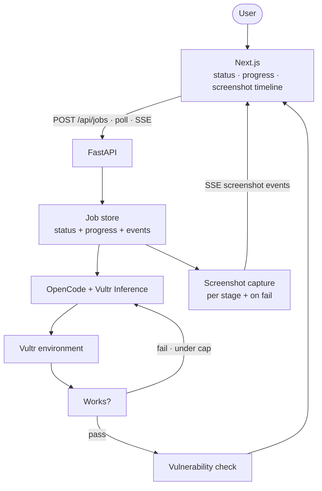
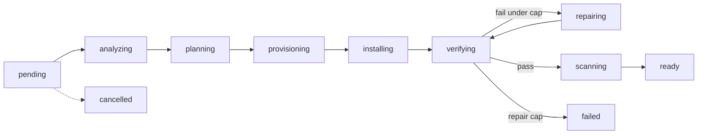
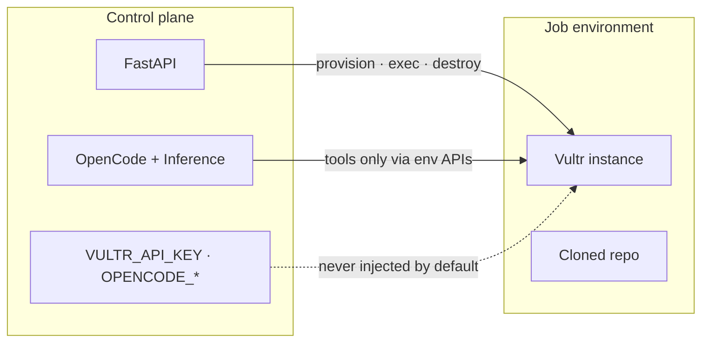

# Killhub — Proposed Architecture

Killhub turns a public GitHub URL into a running Vultr environment: an AI figures out how to run the project, writes setup instructions, provisions and installs automatically, verifies it works, scans for known vulnerabilities, and streams live status, progress, and process screenshots to the UI.

For phased build tasks and milestones, see [IMPLEMENTATION_PLAN.md](IMPLEMENTATION_PLAN.md).

---

## High-level architecture

```
┌─────────────┐  SSE: status·progress·logs·shots  ┌──────────────┐
│  Next.js UI │ ◄───────────────────────────────► │   FastAPI    │
│  (frontend) │   POST /jobs · GET status         │   (backend)  │
└──────┬──────┘                                   └──────┬───────┘
       │ status · docs · report · screenshots            │
       ▼                                                 ▼
┌─────────────┐                                   ┌──────────────┐
│  Job view   │                                   │  Orchestrator│
│  timeline   │                                   │  jobs+agent  │
└─────────────┘                                   └──────┬───────┘
                                                         │
              ┌──────────────────┬───────────────────────┼──────────────┐
              ▼                  ▼                       ▼              ▼
        ┌───────────┐     ┌────────────┐         ┌────────────┐  ┌───────────┐
        │ OpenCode  │     │   Vultr    │         │  Verify +  │  │Screenshot │
        │ + Vultr   │     │  instance  │         │  vuln scan │  │ capture   │
        │ Inference │     │  / env     │         │            │  │(Playwright│
        └───────────┘     └────────────┘         └────────────┘  │ / term)   │
                                                                 └───────────┘
```



**Control plane:** Next.js UI + FastAPI orchestrator (job store, agent, verify, vulnscan, screenshots).  
**Data plane:** Per-job Vultr environment where the repo is installed and run.  
**Inference:** OpenCode + Vultr Inference on the backend host — not inside the job instance.

---

## Component responsibilities

| Component | Role |
|-----------|------|
| **Next.js frontend** | URL input, job view, status/progress UI, live logs, screenshot timeline, setup docs, env status, vuln report |
| **FastAPI (`main.py`)** | HTTP/SSE API; starts background job workers |
| **`jobs.py`** | Job state machine, in-memory store (later Redis/Postgres), event timeline, server-owned lifetime |
| **`agent.py`** | OpenCode client → Vultr Inference; analyze, write setup, repair, vuln review |
| **`vultr.py`** | Provision / wait / remote exec / destroy Vultr environments |
| **`setup.py`** | Clone repo; apply install commands from the run plan |
| **`verify.py`** | Smoke / health checks (HTTP or CLI) |
| **`vulnscan.py`** | Dependency / OS advisory scanners; structured findings |
| **`screenshots.py`** | Browser (Playwright) and terminal stills; store + SSE notify |
| **`config.py` / `models.py`** | Env-based settings; Pydantic schemas |
| **`prompts/`** | Analyze, write setup, repair, vuln review prompt packs |
| **`storage/screenshots/`** | Local/dev artifact store per `job_id` (object storage in prod) |

### Frontend surfaces

- Landing: GitHub URL + start
- Job view (`/jobs/{id}`): status badge, progress bar, `current_step`, SSE log, screenshot timeline, setup docs, env status, vuln report, cancel

### Agent structured plan output

```text
{ runtime, os_image, packages[], install_commands[], run_commands[],
  healthcheck, ports[], summary }
```

---

## End-to-end data flow

1. User submits a public GitHub URL → `POST /api/jobs` → `job_id` returned immediately.
2. Worker sets status `analyzing`; agent inspects the repo and decides how to run it on Vultr; status/progress/screenshot emitted.
3. Agent writes setup instructions (`planning`); docs persisted on the job.
4. Orchestrator provisions a Vultr environment (`provisioning`).
5. Repo is cloned and install commands run inside that environment (`installing`).
6. Verify runs smoke/health checks (`verifying`). On failure → `repairing` (capped) then retry install/verify.
7. Vulnerability scan runs (`scanning`); findings + AI summary attached.
8. Job reaches `ready` with setup docs, env info, vuln report, and full screenshot timeline. UI has been updated throughout via poll + SSE.

Each stage updates `status`, `progress`, and `current_step`, appends log events, and captures screenshots.

---

## Job lifecycle

```
pending → analyzing → planning → provisioning → installing
       → verifying ⇄ repairing
       → scanning → ready | failed | cancelled
```



- **Repair loop:** `verifying → repairing → installing|verifying`, capped by `MAX_REPAIR_ATTEMPTS`, then `failed`.
- **Server-owned jobs:** Closing the tab or dropping SSE does **not** cancel the pipeline. Only `DELETE /api/jobs/{id}` or `JOB_TIMEOUT_SECONDS` stops it. Reopen `/jobs/{id}` to poll, reconnect SSE, and reload screenshots.

---

## API and realtime contracts

| Method | Path | Purpose |
|--------|------|---------|
| `POST` | `/api/jobs` | Create job `{ github_url }` → `{ job_id }` |
| `GET` | `/api/jobs/{id}` | Full snapshot: status, progress, current_step, env, docs, vuln summary, screenshot ids |
| `GET` | `/api/jobs/{id}/events` | SSE: status, progress, logs, screenshots, errors |
| `GET` | `/api/jobs/{id}/screenshots` | Ordered timeline `{ id, step, caption, url, created_at }` |
| `GET` | `/api/jobs/{id}/screenshots/{shot_id}` | Image bytes (or object-storage redirect) |
| `DELETE` | `/api/jobs/{id}` | Cancel + environment cleanup |
| `GET` | `/health` | Backend liveness |

### Status payload

```json
{
  "job_id": "...",
  "status": "installing",
  "progress": 55,
  "current_step": "pip install -r requirements.txt",
  "steps_completed": ["analyzing", "planning", "provisioning"],
  "updated_at": "...",
  "error": null
}
```

Clients may **poll** and/or subscribe to SSE; both must stay consistent. SSE supports reconnect / catch-up from last event id.

### SSE event types

| `type` | Purpose |
|--------|---------|
| `status` | State machine transition |
| `progress` | Numeric progress + `current_step` |
| `log` | Chronological execution / agent message |
| `screenshot` | New still (`screenshot_id`, `step`, `caption`, `url`) |
| `error` | Failure detail (stream stays open until terminal state) |

GitHub URLs must be public HTTPS on `github.com`; invalid URLs → `400`.

---

## Progress and screenshots

| Channel | Client receives |
|---------|-----------------|
| `GET /api/jobs/{id}` | `status`, `progress`, `current_step`, timestamps, latest error |
| SSE `/events` | Live logs, status transitions, progress, screenshot attachments |
| `/screenshots` | Ordered process screenshot timeline |

### Capture policy

| When | What |
|------|------|
| State transition | Terminal frame and/or rendered step summary |
| Environment ready | Console / first session frame when available |
| Install milestones | Terminal screenshot of command output |
| Verify | **Browser screenshot** of the app URL when HTTP; else CLI frame |
| Repair | Before/after failure context |
| Scan complete | Scanner output / summary still when useful |
| Failed | Last useful screen + error annotation |

- Prefer Playwright browser shots when a URL/port exists; otherwise terminal/session stills.
- Store under `storage/screenshots/{job_id}/` (or object storage); cap with `MAX_SCREENSHOTS_PER_JOB`; clean up with job/env TTL.
- Redact secrets from terminal captures when possible.
- Stills only in v1 — no continuous session video.

---

## Security boundaries



- Killhub control-plane secrets stay on the backend; they are **not** injected into the instance `env` by default.
- Agent shell/code tools target the **job environment only**.
- Prefer non-root remote user; no Docker socket or host mounts of Killhub secrets into the instance.
- Destroy removes the Vultr resource (and screenshot artifacts) on complete / fail / cancel / TTL.
- No Killhub API keys in instance logs, `env`, or screenshots.

---

## Proposed repo layout

```
killhub/
├── frontend/                 # Next.js app
│   ├── app/
│   │   ├── page.tsx
│   │   ├── jobs/[id]/page.tsx
│   │   └── layout.tsx
│   ├── components/
│   │   ├── UrlForm.tsx
│   │   ├── ProgressLog.tsx
│   │   ├── StatusBadge.tsx
│   │   ├── ProgressBar.tsx
│   │   ├── ScreenshotTimeline.tsx
│   │   ├── SetupDocs.tsx
│   │   ├── EnvStatus.tsx
│   │   ├── VulnReport.tsx
│   │   └── ErrorBanner.tsx
│   └── lib/
│       └── api.ts
├── backend/
│   ├── main.py
│   ├── agent.py
│   ├── vultr.py
│   ├── setup.py
│   ├── verify.py
│   ├── vulnscan.py
│   ├── screenshots.py
│   ├── jobs.py
│   ├── config.py
│   ├── models.py
│   └── requirements.txt
├── storage/
│   └── screenshots/
├── prompts/
│   ├── analyze_repo.md
│   ├── write_setup.md
│   ├── repair_from_errors.md
│   └── vuln_review.md
├── docker-compose.yml
├── .env.example
├── ARCHITECTURE.md
├── IMPLEMENTATION_PLAN.md
└── README.md
```

### Key configuration

| Variable | Purpose |
|----------|---------|
| `VULTR_API_KEY` | Provisioning (+ inference as configured; host only) |
| `OPENCODE_*` | Agent client settings |
| `VULTR_PLAN` / region / OS | Per-job environment defaults |
| `JOB_TIMEOUT_SECONDS` | Hard wall clock |
| `MAX_REPAIR_ATTEMPTS` | Repair loop cap |
| `ENV_TTL_SECONDS` | Auto-destroy environments |
| `VULN_SCAN_*` | Scanner enablement / severity |
| `MAX_SCREENSHOTS_PER_JOB` | Screenshot cap |
| `SCREENSHOT_STORAGE` | Local path or object storage |

---

## Out of scope (v1)

- Private GitHub repos / OAuth
- Multi-user auth / billing
- Long-lived production hosting beyond job TTL
- GPU workloads
- Auto-patching vulnerabilities (report only)
- Non-Vultr cloud targets
- Full session video / continuous screen recording

---

## Related

- Build order, phases, milestones, and risks: [IMPLEMENTATION_PLAN.md](IMPLEMENTATION_PLAN.md)
