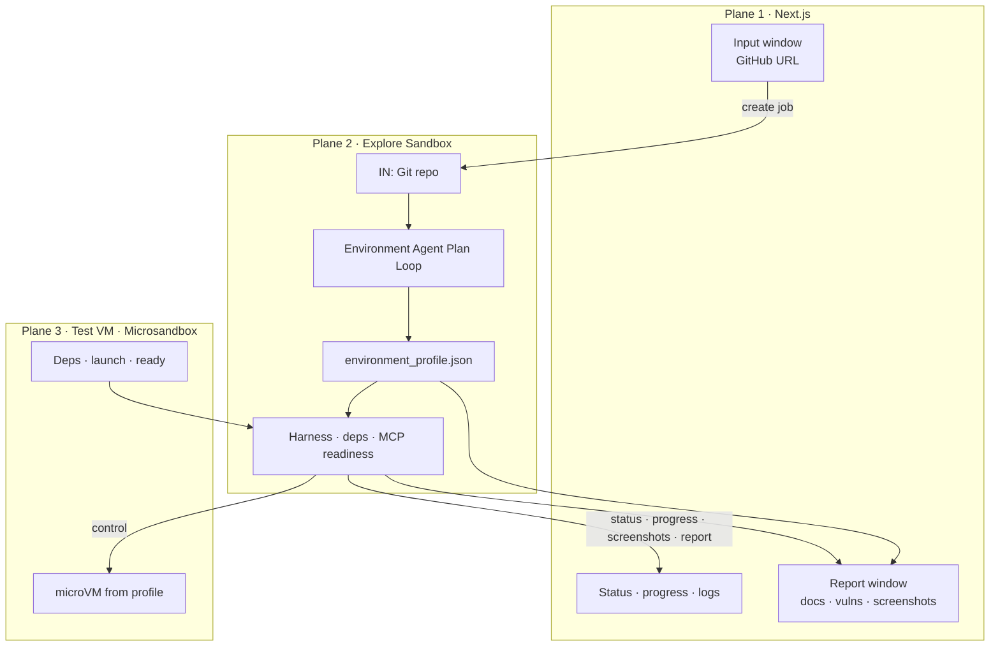
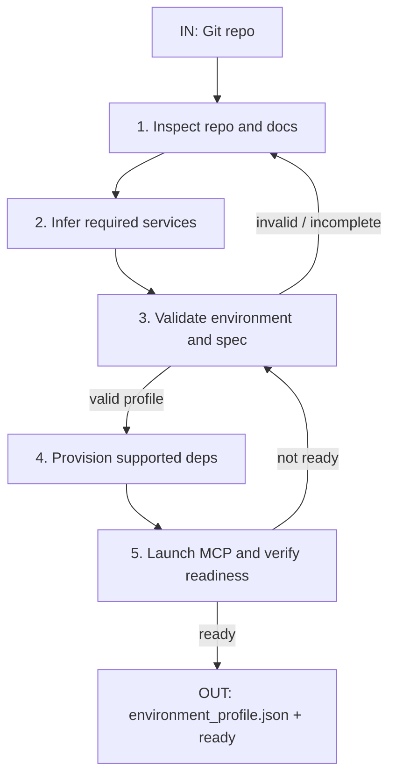
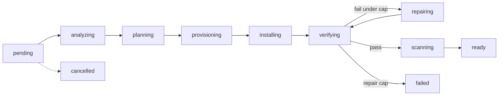
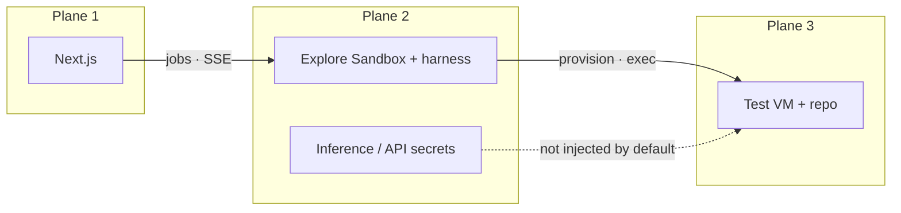

# ARCHITECTURE.md — How the platform is structured

Killhub is a three-plane system: **Next.js** (UI + server), **Explore Sandbox** (Environment Agent Plan Loop + harness), and **Test VM** (ephemeral Microsandbox microVM from `environment_profile.json` on Vultr VX1). Status, progress, screenshots, profile, and vuln reports flow back to the UI over the Jobs API/SSE.

| Doc | Purpose |
|-----|---------|
| [PRODUCT.md](PRODUCT.md) | What and why |
| [AGENTS.md](AGENTS.md) | Rules for every AI agent |
| [DECISIONS.md](DECISIONS.md) | Agreed technical decisions |
| [DATABASE.md](DATABASE.md) | Data model and rules |
| [API.md](API.md) | How components communicate |
| [IMPLEMENTATION_PLAN.md](IMPLEMENTATION_PLAN.md) | Implementation index |

| Plane | Implementation doc |
|------:|--------------------|
| 1 Next.js | [IMPLEMENTATION_NEXTJS.md](IMPLEMENTATION_NEXTJS.md) |
| 2 Explore Sandbox | [IMPLEMENTATION_EXPLORE_SANDBOX.md](IMPLEMENTATION_EXPLORE_SANDBOX.md) |
| 3 Test VM | [IMPLEMENTATION_TEST_VM.md](IMPLEMENTATION_TEST_VM.md) |

---

## Three planes

Killhub is split into three planes with hard boundaries.

```
┌─────────────────────────────────────────────────────────────────────────┐
│  PLANE 1 — Frontend + Server (Next.js)                                  │
│  Input window · status · progress · screenshots · setup docs · report   │
└───────────────────────────────┬─────────────────────────────────────────┘
                                │ jobs API · SSE (status / progress / shots)
                                ▼
┌─────────────────────────────────────────────────────────────────────────┐
│  PLANE 2 — Explore Sandbox                                              │
│  Environment Agent Plan Loop → environment_profile.json                 │
│  inspect → infer services → validate → provision deps → launch MCP      │
└───────────────────────────────┬─────────────────────────────────────────┘
                                │ profile + harness → provision · exec
                                ▼
┌─────────────────────────────────────────────────────────────────────────┐
│  PLANE 3 — Test VM (Microsandbox microVM on Vultr VX1)                  │
│  Created from environment_profile.json · deps · MCP / app readiness     │
└─────────────────────────────────────────────────────────────────────────┘
```



| Plane | What it is | Owns |
|-------|------------|------|
| **1. Frontend + Server** | Next.js app (UI + server) | Input window; status/progress; screenshot timeline; setup docs; vuln report; job create/poll/SSE to the user |
| **2. Explore Sandbox** | Environment Agent Plan Loop + harness | Inspect → infer → validate → provision deps → launch MCP / verify readiness; `environment_profile.json`; report to Plane 1 |
| **3. Test VM** | Disposable Microsandbox microVM on Vultr VX1 | Supported deps + project runtime — created **from** `environment_profile.json` |

---

## Plane 1 — Frontend + Server (Next.js)

**Role:** The only surface the user interacts with. Next.js provides both the UI and the server that accepts jobs and proxies/streams updates from the Explore Sandbox.

### Windows

| Window | Contents |
|--------|----------|
| **Input** | Public GitHub URL + start |
| **Status** | Live `status`, `progress`, `current_step`, execution log, screenshot timeline |
| **Report** | Setup instructions, environment/Test VM status, vulnerability findings, final outcome |

### Responsibilities

- `POST` create job, `GET` job snapshot, SSE events, screenshot list/images, cancel
- Render poll + SSE consistently; reconnect restores status, logs, and screenshots
- Does **not** provision VMs or run agent tools itself — that is Plane 2

### Job snapshot (always available to the UI)

```json
{
  "job_id": "...",
  "status": "installing",
  "progress": 55,
  "current_step": "pip install -r requirements.txt",
  "steps_completed": ["analyzing", "planning", "provisioning"],
  "updated_at": "...",
  "error": null
}
```

---

## Plane 2 — Explore Sandbox

**Role:** Take a Git repository (or package), run the **Environment Agent Plan Loop**, emit **`environment_profile.json`**, provision supported dependencies on the Test VM, and (for MCP intents) launch MCP and verify readiness. Status streams back to Plane 1 throughout.

### Contract

```
IN:  Git repo (URL / cloned tree / package)
       │
       ▼
┌─────────────────────────────────────────────────────────────┐
│  Environment Agent Plan Loop                                │
│  1. Inspect repo and docs                                   │
│  2. Infer required services                                 │
│  3. Validate environment and spec                           │
│  4. Provision supported deps                                │
│  5. Launch MCP and verify readiness                         │
│     (loop on failure → re-inspect / patch profile / retry)  │
└─────────────────────────────────────────────────────────────┘
       │
       ▼
OUT: environment_profile.json  (+ ready MCP / env when applicable)
```

| | |
|--|--|
| **IN** | Submitted Git repository or package |
| **Agent** | Environment Agent (Discover + Plan Loop) |
| **Classify intent** | `git_mcp` or `webapp` (primary v1 intents) |
| **OUT** | `environment_profile.json` — structured environment specification; readiness confirmed when MCP/webapp checks pass |

### Environment Agent Plan Loop

The agent iteratively plans and executes until the environment spec is valid and the target is ready (or the repair/attempt cap is hit).



| Step | What the agent does |
|------|---------------------|
| **1. Inspect repo and docs** | Read tree, README, manifests, lockfiles, Docker/compose, scripts; classify intent `git_mcp` \| `webapp` |
| **2. Infer required services** | Derive runtimes, databases, queues, ports, MCP server entrypoints, and other deps the project needs |
| **3. Validate environment and spec** | Check the draft `environment_profile.json` for completeness, supported deps, and consistency; reject or patch until valid |
| **4. Provision supported deps** | Via harness on Plane 3: install only **supported** packages/services from the profile; skip or flag unsupported ones |
| **5. Launch MCP and verify readiness** | Start MCP (or webapp health endpoint per intent); probe readiness; on failure re-enter the loop (validate → provision → launch) within caps |

Each step emits Plane 1 status/progress/log events and may capture screenshots.

### `environment_profile.json`

Canonical artifact produced and refined during the plan loop; consumed to create/configure the Test VM. Illustrative shape:

```json
{
  "intent": "git_mcp",
  "source": {
    "type": "git",
    "url": "https://github.com/org/repo",
    "ref": "main"
  },
  "runtime": "python",
  "os_image": "ubuntu-24.04",
  "services": [],
  "packages": [],
  "install_commands": [],
  "run_commands": [],
  "mcp": {
    "launch_command": "",
    "readiness": { "type": "mcp_handshake", "timeout_seconds": 60 }
  },
  "healthcheck": { "type": "http", "path": "/", "port": 8000 },
  "ports": [8000],
  "summary": "..."
}
```

- `intent`: `git_mcp` | `webapp`
- `services`: inferred required services from step 2
- `mcp`: present when intent is `git_mcp` (launch + readiness probe)
- Profile is persisted on the job and shown in Plane 1’s report window
- Steps 4–5 run only after step 3 accepts the profile

### Harness (executes steps 4–5 on Plane 3)

| Concern | Behavior |
|---------|----------|
| **Harness** | OpenCode + Vultr Inference; tools limited to sandbox + Test VM APIs |
| **Control** | Create / exec / destroy Plane 3 microsandbox from profile (`msb` / SDK); install supported deps; launch MCP/webapp; readiness probes; repair; vuln scan |
| **Report** | Stream status, progress, logs, screenshots, profile, readiness, and vuln report to Plane 1 |

### Prompt pack

- `discover_environment` — inspect repo/docs; infer services; classify intent; draft `environment_profile.json`
- `validate_environment_spec` — validate profile against supported deps and readiness requirements
- `repair_from_errors` — plan-loop retry after provision/launch/readiness failure
- `vuln_review` — summarize scanner output for the report window

### Security

- Control-plane / inference secrets stay in Plane 2 (or host config), **not** on the Test VM by default
- Environment Agent and harness tools target the Explore Sandbox and/or Test VM APIs only — never Plane 1 host arbitrary shell
- Only **supported** dependencies are provisioned; unsupported deps are recorded on the job, not silently invented

---

## Plane 3 — Test VM

**Role:** A disposable **Microsandbox microVM** on a Vultr VX1 host, created **from `environment_profile.json`**. The plan loop provisions **supported deps** here, launches MCP (or webapp), and verifies readiness. See [Vultr agent sandboxing](https://docs.vultr.com/how-to-set-up-agent-sandboxing-on-vultr-cloud-compute) and [DECISIONS.md](DECISIONS.md) D22.

### Lifecycle

1. Plan loop validates profile → harness creates microsandbox (OCI image + CPU/memory from profile)
2. Clone repo into the sandbox (`source` from profile)
3. Provision supported deps (`packages` / `services` / `install_commands`)
4. Launch MCP or app (`run_commands` / `mcp.launch_command`); verify readiness
5. Vulnerability scan against what is installed
6. Stop + remove sandbox when the agent finishes instructions + all tests (`ready`), or on fail / cancel / TTL (host may remain pooled)

### Constraints

- No Killhub control-plane API keys in sandbox `env` by default
- Outbound only as needed (git, package registries); inter-sandbox traffic denied by default
- Resource/time caps at create time; automatic sandbox cleanup
- Prefer non-root user; no Docker socket mount of the control plane; untrusted code never as privileged host processes

---

## End-to-end flow across planes

```
Plane 1          Plane 2 (Explore Sandbox)              Plane 3 (Test VM)
───────          ─────────────────────────              ─────────────────
Enter URL   →    IN: Git repo
Status…     ←    Plan loop: inspect repo and docs
            ←    Infer required services
            ←    Validate environment and spec
Report      ←    environment_profile.json
            ←    Provision supported deps ───────────►  microVM + deps
            ←    Launch MCP / verify readiness ◄─────  Ready or retry
            ←    (loop on failure, capped)
            ←    Vuln scan ──────────────────────────►  Scan target
Report      ←    Final profile + readiness + findings
Ready/cancel/TTL → Destroy ──────────────────────────►  sandbox removed
```

1. User pastes GitHub URL in Plane 1 input window.
2. Environment Agent Plan Loop inspects the repo/docs and infers required services.
3. Loop validates the environment spec and writes `environment_profile.json`.
4. Supported deps are provisioned on the Test VM from the profile.
5. MCP (or webapp) is launched and readiness is verified; failures re-enter the loop within caps.
6. Vulnerability checks run; Plane 1 shows progress, screenshots, profile, and findings.
---

## Job lifecycle

```
pending → analyzing → planning → provisioning → installing
       → verifying ⇄ repairing
       → scanning → ready | failed | cancelled
```

- **analyzing / planning** — Plan loop steps 1–3 → validated `environment_profile.json`
- **provisioning / installing / verifying** — Plan loop steps 4–5 on Plane 3 (deps, MCP launch, readiness)
- **scanning** — vuln scan after readiness (or best-effort after partial failure per policy)
- **Repair:** `verifying → repairing → installing|verifying`, capped by `MAX_REPAIR_ATTEMPTS`
- Jobs are **server-owned** (Plane 1/2). Closing the browser does not cancel; only explicit cancel or timeout does



---

## API and realtime (Plane 1 ↔ Plane 2)

| Method | Path | Purpose |
|--------|------|---------|
| `POST` | `/api/jobs` | Create job `{ github_url }` → `{ job_id }` |
| `GET` | `/api/jobs/{id}` | Status, progress, docs, vuln summary, screenshot ids |
| `GET` | `/api/jobs/{id}/events` | SSE: status, progress, logs, screenshots, errors |
| `GET` | `/api/jobs/{id}/screenshots` | Ordered timeline |
| `GET` | `/api/jobs/{id}/screenshots/{shot_id}` | Image bytes |
| `DELETE` | `/api/jobs/{id}` | Cancel + destroy Test VM |

### SSE event types

| `type` | Purpose |
|--------|---------|
| `status` | State machine transition |
| `progress` | Numeric progress + `current_step` |
| `log` | Execution / agent message |
| `screenshot` | New process still |
| `error` | Failure detail |

GitHub URLs: public HTTPS on `github.com` only; invalid → `400`.

---

## Progress and screenshots

Emitted by Plane 2, displayed in Plane 1. Captures cover Explore Sandbox milestones and Test VM activity (terminal stills; Playwright browser shot when the Test VM exposes HTTP).

| When | What |
|------|------|
| Explore / plan transitions | Step / terminal stills |
| Test VM ready | Session / console frame |
| Install milestones | Terminal command output |
| Verify | Browser screenshot of app URL when HTTP; else CLI frame |
| Repair / fail | Failure context stills |
| Scan complete | Scanner / summary still when useful |

Caps: `MAX_SCREENSHOTS_PER_JOB`; cleanup with job/Test VM TTL. Redact secrets from captures. Stills only in v1.

---

## Security boundaries



- Plane 1 never receives control-plane secrets in client bundles
- Plane 2 holds harness + inference credentials
- Plane 3 runs untrusted project code only; destroyed when the job reaches `ready` (or on TTL/cancel/fail)
- No Killhub API keys in Test VM logs, `env`, or screenshots

---

## Proposed repo layout

```
killhub/
├── frontend/                 # Plane 1 — Next.js (UI + server)
│   ├── app/
│   │   ├── page.tsx          # Input window
│   │   ├── jobs/[id]/page.tsx  # Status + report windows
│   │   └── layout.tsx
│   ├── components/
│   │   ├── UrlForm.tsx
│   │   ├── ProgressLog.tsx
│   │   ├── StatusBadge.tsx
│   │   ├── ProgressBar.tsx
│   │   ├── ScreenshotTimeline.tsx
│   │   ├── SetupDocs.tsx
│   │   ├── EnvStatus.tsx
│   │   ├── VulnReport.tsx
│   │   └── ErrorBanner.tsx
│   └── lib/
│       └── api.ts
├── explore/                  # Plane 2 — Explore Sandbox + harness
│   ├── main.py               # API / worker entry
│   ├── discover.py           # Environment Agent Plan Loop
│   ├── agent.py              # OpenCode + Vultr Inference
│   ├── harness.py            # Control surface for Test VM
│   ├── profile.py            # environment_profile.json schema + IO
│   ├── verify.py
│   ├── vulnscan.py
│   ├── screenshots.py
│   ├── jobs.py               # Job state + events → Plane 1
│   ├── config.py
│   ├── models.py
│   └── requirements.txt
├── prompts/
│   ├── discover_environment.md  # IN repo → intent + profile.json
│   ├── repair_from_errors.md
│   └── vuln_review.md
├── storage/
│   ├── screenshots/
│   └── profiles/             # environment_profile.json per job
├── docker-compose.yml        # Plane 1 + Plane 2 locally; Plane 3 via Microsandbox on VX1
├── .env.example
├── AGENTS.md
├── PRODUCT.md
├── ARCHITECTURE.md
├── DECISIONS.md
├── DATABASE.md
├── API.md
├── IMPLEMENTATION_PLAN.md
├── IMPLEMENTATION_NEXTJS.md
├── IMPLEMENTATION_EXPLORE_SANDBOX.md
├── IMPLEMENTATION_TEST_VM.md
└── README.md
```

Plane 3 is **not** a long-lived folder in the repo — it is a Microsandbox microVM per job on a Vultr VX1 host ([agent sandboxing guide](https://docs.vultr.com/how-to-set-up-agent-sandboxing-on-vultr-cloud-compute)).

### Key configuration

| Variable | Purpose |
|----------|---------|
| `VULTR_API_KEY` | VX1 host ops + inference as configured (Plane 2 only; never in sandboxes) |
| `OPENCODE_*` | Agent harness settings |
| `MSB_HOST` / `MSB_DEFAULT_IMAGE` / CPU·memory defaults | Microsandbox harness → Plane 3 |
| `JOB_TIMEOUT_SECONDS` | Hard wall clock |
| `MAX_REPAIR_ATTEMPTS` | Repair loop cap |
| `ENV_TTL_SECONDS` | Auto-destroy Plane 3 sandbox |
| `VULN_SCAN_*` | Scanner settings |
| `MAX_SCREENSHOTS_PER_JOB` | Screenshot cap |
| `SCREENSHOT_STORAGE` | Artifact store |
| `EXPLORE_SANDBOX_URL` | Plane 1 → Plane 2 base URL |

---

## Out of scope (v1)

- Private GitHub repos / OAuth
- Multi-user auth / billing
- Long-lived Test VMs beyond job TTL
- GPU workloads
- Auto-patching vulnerabilities (report only)
- Non-Vultr Test VM providers
- Full session video (stills only)

---

## Related

- [PRODUCT.md](PRODUCT.md) · [AGENTS.md](AGENTS.md) · [DECISIONS.md](DECISIONS.md) · [DATABASE.md](DATABASE.md) · [API.md](API.md)
- Implementation index: [IMPLEMENTATION_PLAN.md](IMPLEMENTATION_PLAN.md)
- Plane 1: [IMPLEMENTATION_NEXTJS.md](IMPLEMENTATION_NEXTJS.md)
- Plane 2: [IMPLEMENTATION_EXPLORE_SANDBOX.md](IMPLEMENTATION_EXPLORE_SANDBOX.md)
- Plane 3: [IMPLEMENTATION_TEST_VM.md](IMPLEMENTATION_TEST_VM.md)
