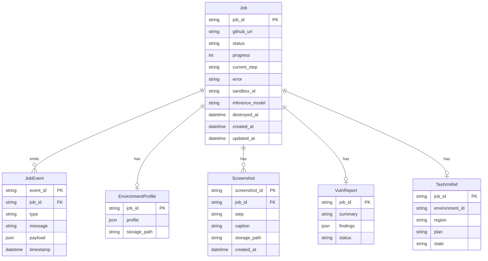

# DATABASE.md — Database structure and rules

v1 persistence is **in-memory job state** in Plane 2 (`explore/jobs.py`) plus **filesystem artifacts** for profiles and screenshots. This document defines the logical model so a later Redis/Postgres migration stays compatible.

Related: [API.md](API.md) · [DECISIONS.md](DECISIONS.md) (D16–D18) · [ARCHITECTURE.md](ARCHITECTURE.md)

---

## Rules

1. **Plane 2 is the source of truth** for jobs, events, profiles, readiness, vulns, and screenshot metadata. Plane 1 is read-only via API.
2. **Plane 3 holds no Killhub database.** It is ephemeral compute; any state needed after destroy must already be copied into Plane 2 artifacts.
3. **Job lifetime ≠ client presence.** Rows/records remain until terminal state + TTL cleanup (or explicit cancel cleanup).
4. **Do not store secrets** (API keys, SSH private keys) in job JSON, event payloads, or screenshot captions. Redact before persist.
5. **Public github.com URLs only** in `source` / create payload validation.
6. When replacing in-memory with a real DB, preserve field names below and document the migration in [DECISIONS.md](DECISIONS.md).

---

## Entities



---

## Job

| Field | Type | Rules |
|-------|------|-------|
| `job_id` | string (UUID) | Immutable PK |
| `github_url` | string | Validated public HTTPS `github.com` |
| `status` | enum | `pending` → `analyzing` → `planning` → `provisioning` → `installing` → `verifying` ⇄ `repairing` → `scanning` → `ready` \| `failed` \| `cancelled` |
| `progress` | int 0–100 | Monotonic non-decreasing except on documented repair resets |
| `current_step` | string | Human-readable label for UI |
| `steps_completed` | string[] | Prior major states |
| `error` | string \| null | Set on failure; cleared on retry entry if applicable |
| `readiness` | object \| null | `{ passed, probe, detail }` |
| `verify_result` | object \| null | Smoke/readiness evidence |
| `sandbox_id` | string \| null | Microsandbox id/name while provisioned; retained after destroy for the report UI |
| `inference_model` | string \| null | Vultr Serverless Inference model id used for this job ([DECISIONS.md](DECISIONS.md) D25) |
| `destroyed_at` | datetime \| null | Set when Plane 3 sandbox is stopped/removed; null while alive |
| `created_at` / `updated_at` | datetime | UTC |

---

## JobEvent

Append-only timeline (SSE source of truth).

| Field | Type | Rules |
|-------|------|-------|
| `event_id` | string | Monotonic per job (for SSE resume) |
| `job_id` | string | FK |
| `type` | enum | `status` \| `progress` \| `log` \| `screenshot` \| `error` |
| `message` | string | Safe for UI |
| `payload` | object | Type-specific; no secrets. For `log`, optional `kind` (`sandbox_create` \| `sandbox_destroy` \| `repair_attempt` \| `containment_probe` \| `agent` \| `harness`), plus `sandbox_id` / `attempt` / `detail` as needed ([API.md](API.md)) |
| `timestamp` | datetime | UTC |

---

## EnvironmentProfile

| Field | Type | Rules |
|-------|------|-------|
| `job_id` | string | PK/FK |
| `profile` | object | Must validate against schema before provisioning Plane 3 |
| `storage_path` | string | e.g. `storage/profiles/{job_id}/environment_profile.json` |

### Profile object (logical schema)

| Key | Required | Notes |
|-----|----------|-------|
| `intent` | yes | `git_mcp` \| `webapp` |
| `source` | yes | `{ type, url, ref }` |
| `runtime` | yes | e.g. `python`, `node` |
| `os_image` | yes | Maps to Test VM image |
| `services` | yes | Inferred required services (may be `[]`) |
| `packages` | yes | Allowlisted only at provision time |
| `install_commands` | yes | Executed on VM |
| `run_commands` | yes | App launch |
| `mcp` | if `git_mcp` | `{ launch_command, readiness }` |
| `healthcheck` | if `webapp` (typical) | `{ type, path, port }` |
| `ports` | yes | Exposed/probed ports |
| `summary` | yes | Human-readable |

Invalid profiles **must not** trigger Plane 3 create.

---

## Screenshot

| Field | Type | Rules |
|-------|------|-------|
| `screenshot_id` | string | PK |
| `job_id` | string | FK |
| `step` | string | Plan-loop / job state label |
| `caption` | string | No secrets |
| `storage_path` | string | `storage/screenshots/{job_id}/{id}.png` |
| `created_at` | datetime | UTC |

Cap: `MAX_SCREENSHOTS_PER_JOB`. Delete with job TTL.

---

## VulnReport

| Field | Type | Rules |
|-------|------|-------|
| `job_id` | string | PK/FK |
| `summary` | string | AI-reviewed plain language |
| `findings` | array | `{ id, severity, package, title, advisory_url? }[]` |
| `status` | enum | `ok` \| `partial` \| `failed` |

Findings do not delete readiness evidence.

---

## TestVmRef

| Field | Type | Rules |
|-------|------|-------|
| `job_id` | string | PK/FK |
| `environment_id` | string | Microsandbox name / id on the VX1 host |
| `image` | string | OCI image used at create |
| `cpus` / `memory` | number / string | Resource caps at create |
| `state` | enum | `provisioning` \| `running` \| `destroyed` \| `failed` |

On destroy, set `state=destroyed`, mirror `Job.destroyed_at`, and ensure the microsandbox is stopped/removed (Plane 3 reaper). `Job.sandbox_id` should match `environment_id` when both are set.

---

## Filesystem layout (v1)

```
storage/
├── profiles/{job_id}/environment_profile.json
└── screenshots/{job_id}/{screenshot_id}.png
```

---

## Cleanup

| Trigger | Action |
|---------|--------|
| Job `ready` (agent instructions + readiness + vuln scan done) | Destroy Plane 3 sandbox immediately; keep job artifacts for the report UI |
| Job `cancelled` / `failed` | Destroy Plane 3 sandbox; delete or expire screenshots/profiles per retention |
| `ENV_TTL_SECONDS` / orphan reaper | Safety-net destroy if sandbox outlives the job or was left running |
| Orphan reaper | Stop/remove sandboxes with no live job reference |
