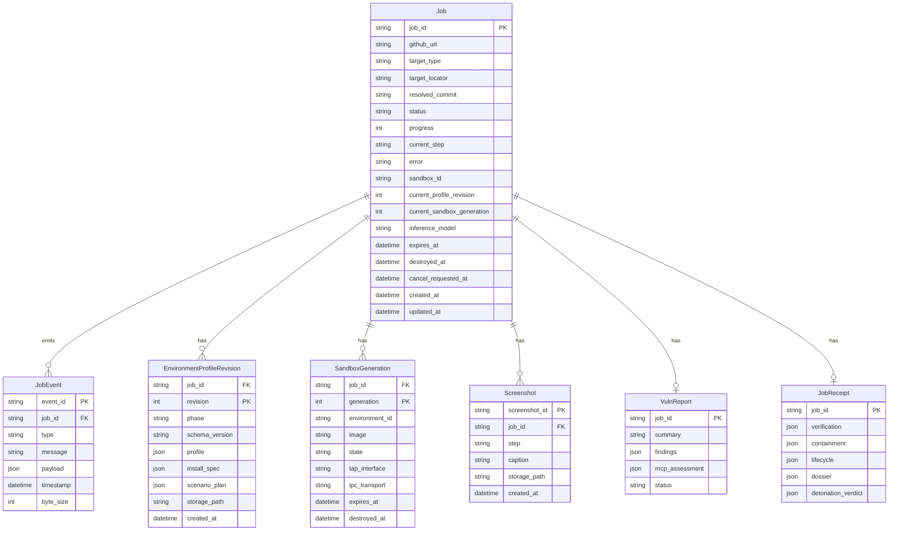

# DATABASE.md — Database structure and rules

v1 persistence is a **durable job/event ledger** owned by the **Python `explore/` sidecar** ([DECISIONS.md](DECISIONS.md) D41, D52) plus **filesystem artifacts** for profiles, dynamic install specs, scenario plans, telemetry/PCAPs, and screenshots (D17, D60). In-memory-only stores are allowed solely for local scaffold before durability lands; **public/demo deploy requires the ledger**.

> **Baseline vs. v2 Migration Note:** `explore/ledger/schema.py` and `explore/models.py` currently implement **Ledger Schema v1** (`schema_version=1`, Step 03). Sections marked **`[v2 target]`** define the aligned migration targets for Steps 06–20 (microVM detonation, dynamic install specs, Discovery→Test-Planner plans, MITRE ATLAS / OWASP MCP coverage, and Detonation Verdict JSON) and must be introduced via backward-compatible migrations.

Related: [API.md](API.md) · [DECISIONS.md](DECISIONS.md) · [ARCHITECTURE.md](ARCHITECTURE.md)

---

## Rules

1. **Plane 1 ledger (Python sidecar) is the source of truth** for jobs, events, profile revisions, install specs, scenario plans, readiness, vulns, detonation verdicts, sandbox generations, and screenshot/artifact metadata. Next.js proxies the public Jobs API; it does not own the job dictionary (D52).
2. **Plane 2 (disposable Microsandbox) holds no Killhub database.** It is ephemeral compute; any state needed after destroy (telemetry NDJSON, PCAP, OverlayFS diff, `strace` logs, `opencode.db` audit, lockfiles, stills) must already be copied/streamed into Plane 1 artifacts / receipt before teardown (D49, D60).
3. **Job lifetime ≠ client presence.** Rows/records remain until terminal state + TTL cleanup (or explicit cancel cleanup).
4. **Do not store secrets** (API keys, `VULTR_INFERENCE_API_KEY`, SSH private keys, raw canary plaintext) in job JSON, event payloads, or screenshot captions. Redact before persist. Canaries (D44) are fake credentials tracked by canary ID only.
5. **Target intake validation (D15, D45):** Public `https://github.com/<org>/<repo>` URLs are the primary intake; optional MCP registry targets (`npm_package`, `pypi_package`) and pinned `fixture` targets are admitted when encoded via a validated `DynamicInstallSpec` (`schemas/dynamic_install_spec.v1.json`).
6. When changing ledger engine (SQLite ↔ Postgres) or migrating v1 → v2, preserve field names below and document the migration in [DECISIONS.md](DECISIONS.md). Enable SQLite `PRAGMA journal_mode=WAL` and `PRAGMA busy_timeout=5000` before enabling concurrent proxy/telemetry writers.
7. **Screenshots are optional** (D31); an empty screenshot list is valid. Live in-VM OpenCode observation uses view-only `noVNC` proxied via Plane 1 (no full session video recordings).
8. **Readiness ≠ completion** (D37). `readiness.passed` is probe evidence; terminal success is `status=completed` after report/verdict + cleanup. Destroy the sandbox on terminal states / absolute expiry — **not** merely when readiness passes. Gate outcomes or kill-switch trips may fail/abort the job without clearing readiness (D66).
9. **Bootstrap vs runtime profiles** (D36). A Killhub-owned bootstrap profile may create Plane 2 for inspect. Invalid **runtime** profiles (`schemas/environment_profile.v1.json`) or invalid `DynamicInstallSpec` (`schemas/dynamic_install_spec.v1.json`) must not start provision/install. Image replacement stays one live VM per job. Profiles are stored as **revisions** with a current pointer (D64).
10. **Job-level `destroyed_at` only after confirmed removal of the current sandbox** (D57, D64). Per-generation `destroyed_at` may record a replaced bootstrap VM while a replacement is alive. Cleanup failures are first-class state.
11. **Verification kinds** (D54) must remain distinct: `original_application` vs `generated_demo` vs `setup_failed`.
12. After **`cancel_requested_at`**, reject ordinary worker mutations; **finalizer** writes (cleanup, receipt, detonation verdict flush, lifecycle, then terminal `cancelled`) are authorized (D61).
13. **`resolved_commit` is required** after first successful git clone and must be reused on every re-clone / replace (D62); for package/fixture targets, persist pinned `resolved_ref` and `package_sha256_before` / `package_sha256_after`.
14. **Event byte-budget pruning is contiguous** and must leave a `gap` tombstone — never silent middle holes (D67).

---

## Entities



---

## SQLite Schema Alignment: v1 (`explore/ledger/schema.py`) vs. v2 Migration Targets

`explore/ledger/schema.py` currently creates 8 tables (`ledger_meta.schema_version = "1"`): `jobs`, `job_events`, `environment_profile_revisions`, `sandbox_generations`, `screenshots`, `vuln_reports`, `job_receipts`, `ledger_meta`.

| Table | Implemented v1 Columns (`schema_version=1`) | v2 Migration Targets (`schema_version=2`) | Backward-Compatibility Strategy |
|-------|---------------------------------------------|-------------------------------------------|----------------------------------|
| `jobs` | `job_id`, `github_url`, `resolved_commit`, `status`, `progress`, `current_step`, `steps_completed`, `error`, `readiness`, `verification`, `verify_result`, `sandbox_id`, `current_profile_revision`, `current_sandbox_generation`, `inference_model`, `inference_usage`, `event_cursor`, `expires_at`, `cleanup`, `destroyed_at`, `cancel_requested_at`, `created_at`, `updated_at` | Add `target_type TEXT NOT NULL DEFAULT 'github_repo'`, `target_locator TEXT`, `telemetry_summary TEXT` (JSON) | Keep `github_url` populated for `github_repo` (and canonical locator string or synthetic fixture URL during transition) so existing queries/snapshots never break |
| `job_events` | `job_id`, `event_id`, `type`, `message`, `payload`, `timestamp`, `byte_size` | Preserve columns; expand `EventType` (`telemetry`, `tool_diff`, `kill_switch`, `novnc`) in `explore/models.py` & UI | Until `EventType` expands, emit structured payloads under `type='log'` with `payload.kind` (`mitmdump_http`, `canary_block`, `kill_switch`, etc.) |
| `environment_profile_revisions` | `job_id`, `revision`, `phase`, `schema_version`, `profile`, `storage_path`, `created_at` | Add `install_spec TEXT` (JSON matching `schemas/dynamic_install_spec.v1.json`) and `scenario_plan TEXT` (JSON matching `schemas/test_scenario_plan.v1.json`) | Persist files under `storage/specs/{job_id}/` and `storage/plans/{job_id}/` immediately; attach JSON columns in v2 |
| `sandbox_generations` | `job_id`, `generation`, `environment_id`, `image`, `cpus`, `memory`, `expires_at`, `state`, `destroyed_at` | Add `tap_interface TEXT`, `ipc_transport TEXT`, `vsock_cid INTEGER`, `novnc_port INTEGER`, `pcap_path TEXT` | Optional metadata columns nullable until TAP/`AF_VSOCK`/`noVNC` runtime lands |
| `vuln_reports` | `job_id`, `summary`, `findings`, `mcp_assessment`, `status` | Extend `findings[]` item JSON with `atlas_tactic`, `owasp_mcp`, `sensor`, `evidence`, `blocked`, `cited_by_review` | Stored inside existing `findings` TEXT JSON array; no DDL change strictly required |
| `job_receipts` | `job_id`, `verification`, `containment`, `lifecycle`, `dossier` | Add `detonation_verdict TEXT` (JSON matching `schemas/detonation_verdict.v1.json`) | In v1/transition, store `detonation_verdict` inside `job_receipts.dossier.detonation_verdict` and mirror to top-level column in v2 |
| `screenshots` | `screenshot_id`, `job_id`, `step`, `caption`, `storage_path`, `created_at` | Unchanged | N/A |
| `ledger_meta` | `key`, `value` (`engine=sqlite`, `schema_version=1`) | Bump `schema_version` to `"2"` upon DDL migration | Check `schema_version` at startup |

---

## Job

| Field | Type | Rules |
|-------|------|-------|
| `job_id` | string (UUID) | Immutable PK |
| `github_url` | string | Validated public HTTPS `github.com` URL (or canonical target URL when `target_type=github_repo`) |
| `target_type` `[v2]` | enum | `github_repo` \| `npm_package` \| `pypi_package` \| `fixture` (default `github_repo`) |
| `target_locator` `[v2]` | string \| null | Raw locator (GitHub URL, `npm:<pkg>@<ver>`, `pypi:<pkg>==<ver>`, or `fixture:<id>`) |
| `resolved_commit` | string \| null | Full git SHA after first successful clone (D62), or pinned version/fixture revision hash |
| `status` | enum | `pending` → `queued`? → `analyzing` → `planning` → `provisioning` → `installing` → `verifying` ⇄ `repairing` → `scanning` → `finalizing` → `completed` \| `failed` \| `cancelled` |
| `progress` | int 0–100 | Monotonic non-decreasing except on documented repair resets |
| `current_step` | string | Human-readable label for UI |
| `steps_completed` | string[] | Prior major states |
| `error` | string \| null | Set on failure; cleared on retry entry if applicable |
| `readiness` | object \| null | `{ passed, probe, detail, at }` — set when probe succeeds; **not** a destroy trigger (D37); never cleared by findings/gates (D66) |
| `verification` | object \| null | `{ kind, original_failure? }` — D54 |
| `verify_result` | object \| null | Smoke/readiness evidence (includes MCP stdio/Inspector discovery summary when applicable) |
| `sandbox_id` | string \| null | **Current** generation’s Microsandbox id/name; retained after final destroy for the report UI |
| `current_profile_revision` | int \| null | Pointer to latest accepted `EnvironmentProfileRevision` (D64) |
| `current_sandbox_generation` | int \| null | Pointer to current `SandboxGeneration` (D64) |
| `inference_model` | string \| null | Primary Vultr Serverless Inference model id (D25; per-agent models recorded in `inference_usage`) |
| `inference_usage` | object \| null | Plane 1 + Layer 1 Host LLM Proxy turns/tokens/model breakdown toward budgets (D40, D72) |
| `event_cursor` | string \| null | Last **retained** durable `event_id` (snapshot→SSE handoff — D55, D67) |
| `expires_at` | datetime | Absolute sandbox/job expiry; **not** extended by `msb touch` or image replace (D41, D64) |
| `cleanup` | object | `{ status, attempts, last_error?, updated_at }` — D57 |
| `destroyed_at` | datetime \| null | Set **only** when the **current** Plane 2 removal is confirmed; null while any live generation exists or on `destroy_failed` |
| `cancel_requested_at` | datetime \| null | Set when cancel requested; freezes ordinary writers; terminal `cancelled` comes after finalizer + receipt (D61) |
| `created_at` / `updated_at` | datetime | UTC |

### `verification` (D54)

| Field | Values / rules |
|-------|----------------|
| `kind` | `original_application` \| `generated_demo` \| `setup_failed` |
| `original_failure` | Required when `kind=generated_demo` if original install/launch/readiness failed; `{ step, summary, detail? }` — must remain visible in the receipt/UI |

### `cleanup.status` (D57)

`pending` \| `destroying` \| `destroyed` \| `destroy_failed`

`queued` is optional when admission queues a job (D40).

---

## JobEvent

Append-only timeline (SSE source of truth). **Must be durable** in the ledger (D41). Retained per `EVENT_RETENTION` (D55) with contiguous byte-budget pruning (D67).

| Field | Type | Rules |
|-------|------|-------|
| `event_id` | string | Monotonic integer string per job (for SSE resume) |
| `job_id` | string | FK |
| `type` | enum | **v1 (`explore/models.py`):** `status` \| `progress` \| `log` \| `screenshot` \| `error` \| `span` \| `finding` \| `containment` \| `lifecycle` \| `gap` (D49, D67). **v2 additions:** `telemetry` \| `tool_diff` \| `kill_switch` \| `novnc` |
| `message` | string | Safe for UI (never raw canary secrets or API keys) |
| `payload` | object | Type-specific; see `log.kind` and detonation event shapes below. For `gap`: `{ pruned_before_event_id, pruned_count?, bytes_freed }` |
| `timestamp` | datetime | UTC |
| `byte_size` | int | UTF-8 serialized event byte length (for `MAX_JOB_LOG_BYTES` pruning) |

### `log.kind` and Detonation Event Payloads

During v1 compatibility (and as structured detail in v2), `JobEvent` carries detonation telemetry via `type="log"` with `payload.kind` (or dedicated v2 `type`s):

| Event `type` (v2) / `log.kind` (v1) | Payload fields | Source sensor / layer |
|-------------------------------------|----------------|-----------------------|
| `telemetry` / `mitmdump_http` | `{ method, host, port, path, status_code, tls_intercepted, canary_blocked, finding_id? }` | Host `mitmdump` on TAP |
| `telemetry` / `mitmdump_dns` | `{ qname, qtype, rcode, canary_blocked, doh_dot_quic_dropped }` | Host `mitmdump` DNS + nftables/iptables |
| `telemetry` / `strace` | `{ pid, syscall, path_or_addr, blocked, category }` | Guest `strace` via `AF_VSOCK`/UDS |
| `telemetry` / `overlayfs` | `{ modified_paths[], created_paths[], package_sha256_before?, package_sha256_after?, integrity_tampered }` | OverlayFS `upperdir` diff |
| `telemetry` / `mcp_wire_tap` | `{ direction, jsonrpc_method, tool_name?, message_bytes }` | Guest MCP stdio/HTTP wire tap |
| `telemetry` / `cgroup_v2` | `{ memory_current_bytes, oom_kill_count, pids_current, pids_max_events, cpu_throttled_usec }` | Guest cgroup v2 (`memory.events`/`pids.events`) |
| `tool_diff` / `tool_diff` | `{ t0_tools_sha256, final_tools_sha256, diffs: [{ tool_name, change_type, detail }] }` | Inspector / SDK capability diff |
| `kill_switch` / `kill_switch` | `{ layer: "layer1_llm_proxy" \| "layer2_cgroup_v2" \| "layer3_watchdog", reason, http_status?, flushed_events }` | 3-Layer Kill Switch (D72) |
| `novnc` / `novnc` | `{ available, ws_path, view_only: true, state: "ready" \| "closed" }` | Plane 1 `noVNC` proxy |
| Existing v1 `log.kind`s | `sandbox_create` \| `sandbox_replace` \| `sandbox_destroy` \| `repair_attempt` \| `mcp_assessment` \| `mcp_stdio_verify` \| `containment_probe` \| `network_probe` \| `agent` \| `harness` \| `admission` \| `cancel` | Harness / Plane 1 workers |

### Retention / pruning (D67)

Cap retained event bytes per job via `MAX_JOB_LOG_BYTES` (D40):

1. When over budget, delete a **contiguous prefix** of the oldest retained events (never middle holes).
2. Insert exactly one durable `type=gap` event at the new start of the retained sequence documenting what was pruned.
3. Never drop the sole remaining terminal `status` / destroy `lifecycle` / `receipt`-critical evidence without first ensuring the receipt row itself holds that dossier (including `detonation_verdict`).
4. Active-job retention means the **current retained window** is complete and replayable — not that every byte since create is forever available once budgets bite.
5. Snapshot `event_cursor` always points at the last retained event; cursors inside a pruned range are expired (D55).

---

## EnvironmentProfileRevision & Canonical JSON Contracts (D51, D64, D69–D73)

| Field | Type | Rules |
|-------|------|-------|
| `job_id` | string | FK |
| `revision` | int | Monotonic per job; composite PK with `job_id` |
| `phase` | enum | `bootstrap` \| `runtime` |
| `schema_version` | string | `"1"` — must match `profile.schema_version` (D51) |
| `profile` | object | Must validate against `schemas/environment_profile.v1.json` (for `runtime`) |
| `install_spec` `[v2]` | object \| null | Validated `DynamicInstallSpec` (`schemas/dynamic_install_spec.v1.json`) |
| `scenario_plan` `[v2]` | object \| null | Validated `TestScenarioPlan` (`schemas/test_scenario_plan.v1.json`) |
| `storage_path` | string | e.g. `storage/profiles/{job_id}/r{revision}.json` |
| `created_at` | datetime | UTC |

`Job.current_profile_revision` points at the latest accepted revision. Repairs that rewrite the runtime profile append a new revision; they do not overwrite history the receipt cites.

### Canonical JSON Schema Files (`schemas/`, Draft 2020-12)

| File | Producer | Purpose |
|------|----------|---------|
| `schemas/environment_profile.v1.json` | Environment Planner | Executable runtime profile (`schema_version`, `intent` [`git_mcp` \| `webapp` \| `demo`], `oci_image` default `ubuntu-24.04-killhub`, `source`, `services`, `commands`, `processes`, `probes`, `mcp` [`stdio` \| `streamable_http`], `security_assessment`, `network_mode` [`install` \| `monitored_detonation` \| `offline_verify`], `cgroup_limits`) |
| `schemas/dynamic_install_spec.v1.json` | Environment/Install Planner Agent | Full Ubuntu 24.04 microVM provisioning contract (`spec_id`, `target` [`github_repo` \| `npm_package` \| `pypi_package` \| `fixture`], `base_image`, `dependencies`, `install_commands` w/ `/run/mcp-package-cache` & `mitmproxy` CA TLS env, `launch`, `mounts_and_seeds` w/ readonly rootfs+OverlayFS, `/workspace` cap, `.env`/`.ssh`/`.aws` canaries, `opencode.db`/`.config/opencode/`/`.gitconfig` proxy seeds, `/dev/vsock` or UDS/`mgmt0`, `network_policy`, `kill_switch_limits`) |
| `schemas/test_scenario_plan.v1.json` | Discovery → Test-Planner Agent | Discovery snapshot (`inspector_method` [`mcp_inspector_cli` \| `python_mcp_sdk_fallback`], `protocol_version`, `server_info`, `t0_tools_sha256`, `tools[]`, `resources[]`, `prompts[]`), `target_atlas_tactics`, `target_owasp_mcp`, and ordered `scenarios[]` (`scenario_id`, `title`, `demo_fixture_id`, `category`, `atlas_tactics[]`, `owasp_mcp[]`, `trigger_steps[]`, `expected_invariants[]`, `catching_sensors[]`, `max_turns`) |
| `schemas/detonation_verdict.v1.json` | Detonation Finalizer / Verdict Aggregator | Canonical Detonation Verdict JSON (`schema_version`, `scan_id`, `target` w/ `package_sha256_before`/`after` & `integrity_tampered`, `verdict`, `containment_proof`, `mcp_capabilities` w/ `t0_tools_sha256`/`final_tools_sha256`/`tool_diffs[]`, `findings[]`, `atlas_coverage_matrix` [all 16 `AML.TA0000`–`AML.TA0015`], `owasp_mcp_coverage` [all 10 `MCP01:2025`–`MCP10:2025`], `telemetry`) |

### `DynamicInstallSpec` Contract Summary (`schemas/dynamic_install_spec.v1.json`)

| Top-level key | Required fields & invariants |
|---------------|------------------------------|
| `schema_version` / `spec_id` | `"1"` / unique spec identifier |
| `target` | `source_type` (`github_repo` \| `npm_package` \| `pypi_package` \| `fixture`), `locator`, `resolved_ref`, `package_name?`, `entrypoint` |
| `base_image` | `"ubuntu-24.04-killhub"` (pre-baked Python, `pip`, `uv`, Node 22+, `git`, `strace`, OpenCode, `@modelcontextprotocol/inspector`, `noVNC`, `mitmproxy` CA) |
| `dependencies` | `python`, `uv`, `node`, `system_packages` |
| `install_commands` | `CommandSpec[]` pinned to `cache_dir="/run/mcp-package-cache"` and TLS env (`SSL_CERT_FILE`, `REQUESTS_CA_BUNDLE`, `NODE_EXTRA_CA_CERTS`) |
| `launch` | `cwd`, `argv[]`, `env_overrides`, `mcp_transport` (`stdio` \| `streamable_http` \| `none`), `http_port?` |
| `mounts_and_seeds` | `rootfs_readonly=true`, `overlayfs` (`lowerdir`/`upperdir`/`workdir`/`merged`), `workspace_size_cap_mb`, `canary_paths` (`/workspace/.env`, `/home/agent/.ssh`, `/home/agent/.aws`), `opencode_seeds` (`/home/agent/.local/share/opencode/opencode.db`, `/home/agent/.config/opencode`, `/home/agent/.gitconfig`, `llm_proxy_url`), `package_cache_tmpfs` (`/run/mcp-package-cache`), `tls_ca`, `ipc` (`af_vsock` \| `uds` \| `mgmt0`) |
| `network_policy` | `mode` (`install` \| `monitored_detonation` \| `offline_verify`), `tap_mitmdump`, `drop_doh_dot_quic=true`, `pcap_enabled`, `canary_blocking`, `deny_control_plane=true`, `deny_siblings=true` |
| `kill_switch_limits` | `layer1_llm_proxy` (`max_turns=12`, `max_tokens=60000`, oscillation→`429`), `layer2_cgroup_v2` (`memory_max="512M"`, `memory_swap_max="0"`, `pids_max=64`, `cpu_max="100000 100000"`, `monitor_events=true`), `layer3_watchdog` (`wall_clock_seconds`, `flush_telemetry_before_kill=true`, `teardown_tap_iptables_overlay=true`) |

### `TestScenarioPlan` Contract Summary (`schemas/test_scenario_plan.v1.json`)

| Key | Purpose |
|-----|---------|
| `discovery` | `inspector_method` (`mcp_inspector_cli` via `@modelcontextprotocol/inspector --cli --format json` or `python_mcp_sdk_fallback` for large schemas), `protocol_version`, `server_info`, `t0_tools_sha256`, `tools[]`, `resources[]`, `prompts[]` |
| `target_atlas_tactics` / `target_owasp_mcp` | Unique subsets of `AML.TA0000`–`AML.TA0015` and `MCP01:2025`–`MCP10:2025` targeted by this plan |
| `scenarios[]` | Ordered scenarios (`scenario_id`, `title`, `demo_fixture_id`, `category`, `atlas_tactics[]`, `owasp_mcp[]`, `trigger_steps[]`, `expected_invariants[]`, `catching_sensors[]`, `max_turns` ≤ 12) |

---

## SandboxGeneration (D64)

| Field | Type | Rules |
|-------|------|-------|
| `job_id` | string | FK |
| `generation` | int | Monotonic per job; composite PK with `job_id` |
| `environment_id` | string | Microsandbox name / id for this generation |
| `image` | string | OCI image at create (default `ubuntu-24.04-killhub`) |
| `cpus` / `memory` | number / string | VM-level caps at create |
| `tap_interface` `[v2]` | string \| null | Host TAP bridge device assigned to this generation |
| `ipc_transport` `[v2]` | enum \| null | `af_vsock` \| `uds` \| `mgmt0` |
| `vsock_cid` `[v2]` | int \| null | Guest CID when `ipc_transport=af_vsock` |
| `novnc_port` `[v2]` | int \| null | Loopback/UDS port for view-only `noVNC` bridge |
| `pcap_path` `[v2]` | string \| null | `storage/artifacts/{job_id}/capture.pcap` when `pcap_enabled=true` |
| `expires_at` | datetime | **Same absolute deadline as `Job.expires_at`** — replace must not extend (D41, D64) |
| `state` | enum | `provisioning` \| `running` \| `replaced` \| `destroying` \| `destroyed` \| `destroy_failed` \| `failed` |
| `destroyed_at` | datetime \| null | Confirmed removal time **for this generation**; set when bootstrap is removed during replace even though the job’s replacement is alive |

---

## Screenshot

| Field | Type | Rules |
|-------|------|-------|
| `screenshot_id` | string | PK |
| `job_id` | string | FK |
| `step` | string | Plan-loop / job state label |
| `caption` | string | No secrets |
| `storage_path` | string | `storage/screenshots/{job_id}/{id}.png` — only via D60 `copy_out` |
| `created_at` | datetime | UTC |

Cap: `MAX_SCREENSHOTS_PER_JOB` and disk budget (D40). Capture in Plane 2 (D38); Plane 1 stores copied stills.

---

## VulnReport

New reports store the full active findings and a cited breakdown by check. To persist retained evidence for historical finalized jobs, run `python -m ledger.import_active_findings` from `explore/` with the deployment ledger configuration. Each report and its receipt update together. Repeated imports skip completed updates.

| Field | Type | Rules |
|-------|------|-------|
| `job_id` | string | PK/FK |
| `summary` | string | Cite-checked AI summary (D48) |
| `findings` | array | Extended finding shape: `{ id, severity, source, atlas_tactic?, owasp_mcp?, sensor?, title, detail?, package?, advisory_url?, evidence?, blocked?, cited_by_review? }` |
| `mcp_assessment` | object \| null | Discovery + scenario detonation summary when MCP pipeline ran (D35, D73) |
| `status` | enum | `ok` \| `partial` \| `failed` |

| `findings[].source` | Meaning |
|---------------------|---------|
| `sca` | Lockfile / advisory scanner — primarily Plane 1 against copied lockfiles (D43, D63) |
| `mcp_assessment` | MCP Inspector/SDK discovery & scenario detonation probes (D35, D73) |
| `activity` | Install-time observations of canary matches, persistence writes, or network tools |
| `mcp_tool_review` | Heuristic warnings about individual MCP tool descriptions |
| `intentional_app` | Intentionally vulnerable application patterns (DVMCP / fixtures) — **not** SCA proof (D53) |
| `canary` | Unexpected canary credential hit / blocked exfiltration (D44, D70); excludes deliberate probe sessions (D65) |
| `network` / `containment` | Policy / isolation evidence (`policy_denied` vs `infra_error` — D65) |
| `runtime_sensor` | Guest/host runtime telemetry anomalies (`strace`, `overlayfs`, `mcp_wire_tap`, `opencode_db_audit`) |
| `kill_switch` | Layer 1/2/3 kill-switch trip event (`llm_proxy`, `cgroup_v2`, `hypervisor_watchdog`) |
| `preflight` | Plane-1 pre-flight rejection/warning before sandbox create (D45) |

---

## JobReceipt & DetonationVerdict (`schemas/detonation_verdict.v1.json`)

Durable dossier outliving the sandbox: profile **revision ids** + snapshots, readiness, `verification`, findings, containment matrix (D58/D65/D71), network probes, sandbox **generation** lifecycle, outcome gates (D66), `vuln_review` citations, cleanup status, and the canonical **`DetonationVerdict`** (`dossier.detonation_verdict` in v1; dedicated `detonation_verdict` JSON column in v2).

Receipt is persisted on **every** terminal path — including cancel and Layer 3 watchdog kill — **before** terminal status is set (D61, D72).

| `DetonationVerdict` Section | Required Contract (`schemas/detonation_verdict.v1.json`) |
|-----------------------------|----------------------------------------------------------|
| `schema_version` / `scan_id` | `"1"` / scan identifier |
| `target` | `source_type`, `locator`, `resolved_ref`, `package_sha256_before` (64-hex), `package_sha256_after` (64-hex \| null), `integrity_tampered` (bool) |
| `verdict` | `status` (`CLEAN` \| `SUSPICIOUS` \| `MALICIOUS` \| `ABORTED` \| `INCONCLUSIVE`), `risk_score` (0–100), `summary`, `kill_switch_triggered` (`{ triggered, layer, reason, timestamp }`) |
| `containment_proof` | 4 D58 axes (`timeout_enforcement`, `host_access_denied`, `sibling_access_denied`, `host_liveness`) + `claim` (`complete` \| `incomplete`) + `key_isolation_verified`, `canary_blocking_verified`, `doh_dot_quic_dropped` |
| `mcp_capabilities` | `discovery_method` (`mcp_inspector_cli` \| `python_mcp_sdk_fallback` \| `none`), `t0_tools_sha256`, `final_tools_sha256`, `tool_diffs[]`, `tools_count_t0`, `tools_count_final`, `resources_count`, `prompts_count` |
| `findings[]` | Array of `DetonationFinding` (`id`, `severity`, `source`, `atlas_tactic`, `owasp_mcp`, `sensor`, `title`, `detail`, `evidence`, `blocked`, `cited_by_review`) |
| `atlas_coverage_matrix` | Object keyed by **all 16** `AML.TA0000`–`AML.TA0015` entries (`tactic_id`, `tactic_name`, `monitored`, `sensors[]`, `triggered`, `finding_ids[]`) |
| `owasp_mcp_coverage` | Object keyed by **all 10** `MCP01:2025`–`MCP10:2025` entries (`category_id`, `name`, `monitored`, `sensors[]`, `triggered`, `finding_ids[]`) |
| `telemetry` | `http_requests`, `https_intercepted`, `dns_queries`, `doh_dot_quic_blocked`, `canary_blocks`, `strace_syscalls_flagged`, `overlayfs_modified_paths[]`, `mcp_wire_messages`, `cgroup_events` (`oom`, `pid_max`, `cpu_throttled`), `llm_proxy_turns`, `llm_proxy_tokens`, `llm_proxy_429_blocks`, `pcap_artifact_path`, `ndjson_events_count` |

---

## Normative Coverage Mapping Tables

### MITRE ATLAS 16 Tactics (`AML.TA0000`–`AML.TA0015`) → Sensors & Triggers

| Tactic ID | Tactic Name | Catching Sensors (`SensorId`) | Trigger Conditions / Detection Rules |
|-----------|-------------|-------------------------------|--------------------------------------|
| `AML.TA0000` | AI Model Access | `llm_proxy`, `opencode_db_audit`, `mcp_wire_tap` | Unauthorized model proxy probe, token extraction attempt from `opencode.db`, or non-proxy LLM API endpoint dial blocked at TAP |
| `AML.TA0001` | AI Attack Adaptation | `mcp_wire_tap`, `inspector_diff`, `llm_proxy` | Dynamic prompt/tool-description mutation mid-session or adversarial payload shaping detected across turns |
| `AML.TA0002` | Reconnaissance | `strace`, `mcp_wire_tap`, `mitmdump_dns` | Enumeration of `/etc/passwd`, `~/.ssh`, `~/.aws`, network interfaces, or MCP host metadata probing |
| `AML.TA0003` | Resource Development | `mitmdump_http`, `mitmdump_dns`, `overlayfs` | Fetching external second-stage scripts/packages or staging binaries in `/tmp` or `/workspace` post-install |
| `AML.TA0004` | Initial Access | `mcp_wire_tap`, `inspector_diff`, `opencode_db_audit` | Malicious MCP server returning indirect prompt injection payload (e.g., Scenario 1 GitHub issue) or poisoned tool schema |
| `AML.TA0005` | Execution | `strace`, `mcp_wire_tap`, `cgroup_v2` | Unexpected `execve`/`fork`/`clone` from MCP or OpenCode tool calls, shell metacharacter injection, or rogue subprocess spawn |
| `AML.TA0006` | Persistence | `overlayfs`, `strace` | Post-install modification of installed package files (`package_sha256_after != package_sha256_before`, Scenario 3), `~/.bashrc`, cron, or `opencode.db` tampering |
| `AML.TA0007` | Defense Evasion | `mitmdump_dns`, `mitmdump_http`, `strace` | Attempted DoH/DoT/QUIC bypass (`tcp/853`, `udp/443`, known DoH endpoints dropped), cert-pinning bypass, or clearing logs/`upperdir` artifacts |
| `AML.TA0008` | Discovery | `strace`, `inspector_diff`, `mcp_wire_tap` | Tool-list drift/shadowing (`final_tools_sha256 != t0_tools_sha256`, Scenarios 2 & 5), internal port scanning, or `env` dumping |
| `AML.TA0009` | Collection | `strace`, `opencode_db_audit`, `canary_monitor` | `openat`/`read` of canary files (`/workspace/.env`, `/home/agent/.ssh/*`, `/home/agent/.aws/*`, `opencode.db`) by untrusted process (Scenario 4) |
| `AML.TA0010` | Exfiltration | `mitmdump_http`, `mitmdump_dns`, `canary_monitor`, `tcpdump_pcap` | Canary token matched in outbound HTTP/S headers/body or DNS subdomain query; **blocked in real time** by `mitmdump` |
| `AML.TA0011` | Impact | `cgroup_v2`, `llm_proxy`, `hypervisor_watchdog` | Resource exhaustion / infinite agent loop (Scenario 6) tripping L1 `429` (`max_turns=12` / `max_tokens=60000` / oscillation), L2 cgroup (`512M` / `64` pids), or L3 watchdog |
| `AML.TA0012` | Privilege Escalation | `strace`, `cgroup_v2` | `setuid`/`sudo`/capability elevation attempts, `/proc`/cgroup escape probes, or host filesystem access outside `/workspace` |
| `AML.TA0013` | Credential Access | `canary_monitor`, `strace`, `opencode_db_audit` | Reading `.env`, `.ssh`, `.aws`, `.gitconfig`, or `opencode.db` tokens; verifying `VULTR_INFERENCE_API_KEY` absence (`key_isolation_verified`) |
| `AML.TA0014` | Lateral Movement | `mitmdump_http`, `tcpdump_pcap`, `strace` | Attempted connection from Plane 2 to Plane 1 control plane, `msb` management endpoints, or sibling sandboxes (`host_access_denied` / `sibling_access_denied`) |
| `AML.TA0015` | Command and Control | `mitmdump_http`, `mitmdump_dns`, `tcpdump_pcap`, `mcp_wire_tap` | Repeated beaconing, reverse-shell socket `connect()` in `strace`, or unauthorized C2 channel over HTTP/S/DNS |

### OWASP MCP Top 10 (`MCP01:2025`–`MCP10:2025`) → Sensors & Triggers

| Category ID | Name | Catching Sensors (`SensorId`) | Trigger Conditions / Detection Rules |
|-------------|------|-------------------------------|--------------------------------------|
| `MCP01:2025` | Token Mismanagement & Secret Exposure | `canary_monitor`, `mitmdump_http`, `mitmdump_dns`, `opencode_db_audit`, `strace` | Reading or exfiltrating `.env`/`.ssh`/`.aws` canaries or `opencode.db` proxy tokens; `mitmdump` real-time block (Scenario 4) |
| `MCP02:2025` | Privilege Escalation via Scope Creep | `inspector_diff`, `mcp_wire_tap`, `strace` | Tool gains undeclared filesystem/network capabilities after `t0`, or accesses paths outside declared `/workspace` scope |
| `MCP03:2025` | Tool Poisoning | `inspector_diff`, `mcp_wire_tap`, `llm_proxy` | Hidden instructions in tool `description`/`inputSchema`, delayed rug-pull mutation (`t0_tools_sha256 != final_tools_sha256`), or shadowing (Scenarios 2 & 5) |
| `MCP04:2025` | Software Supply Chain Attacks & Dependency Tampering | `overlayfs`, `sca_scanner`, `mitmdump_http` | Post-install package modification (`package_sha256_before != package_sha256_after`, Scenario 3), install-hook network calls, or vulnerable lockfile dependencies |
| `MCP05:2025` | Command Injection & Execution | `strace`, `mcp_wire_tap` | Unsanitized tool arguments spawning `sh -c`/`bash`/subprocesses observed via `strace` `execve` |
| `MCP06:2025` | Prompt Injection via Contextual Payloads | `mcp_wire_tap`, `llm_proxy`, `canary_monitor` | External resource/tool output (e.g., GitHub issue body, Scenario 1) hijacking victim OpenCode into unauthorized tool calls |
| `MCP07:2025` | Insufficient Authentication & Authorization | `inspector_diff`, `mcp_wire_tap`, `mitmdump_http` | Streamable HTTP MCP endpoint accepting unauthenticated calls or missing origin/session validation |
| `MCP08:2025` | Lack of Audit and Telemetry | `mcp_wire_tap`, `llm_proxy`, `cgroup_v2`, `hypervisor_watchdog` | Missing telemetry stream or tamper attempt against `/dev/vsock` / NDJSON logging / `opencode.db` audit |
| `MCP09:2025` | Shadow MCP Servers | `strace`, `mitmdump_http`, `mcp_wire_tap` | Target spawns an undeclared background MCP listener/subprocess not declared in `DynamicInstallSpec.launch` |
| `MCP10:2025` | Context Injection & Over-Sharing | `opencode_db_audit`, `mcp_wire_tap`, `llm_proxy` | Cross-tool context contamination, leaking prior prompt/session context or `opencode.db` history across tool boundaries |

---

## Filesystem layout (v1 + detonation artifacts)

```
storage/
├── ledger/                 # durable job/event DB — D41 (Python sidecar)
├── profiles/{job_id}/
│   ├── r1.json
│   ├── r2.json
│   └── environment_profile.json   # optional pointer/copy of current revision
├── specs/{job_id}/
│   └── install_spec.json          # validated DynamicInstallSpec
├── plans/{job_id}/
│   └── scenario_plan.json         # Discovery + TestScenarioPlan
├── artifacts/{job_id}/     # lockfiles, telemetry.ndjson, strace.log, overlay_diff.json, capture.pcap, verdict.json — D60
└── screenshots/{job_id}/{screenshot_id}.png

explore/helpers/            # allowlisted copy_in sources — D60
schemas/
├── environment_profile.v1.json
├── dynamic_install_spec.v1.json
├── test_scenario_plan.v1.json
└── detonation_verdict.v1.json
```

---

## Durability and reconciliation (D41)

| Concern | Behavior |
|---------|----------|
| **Ledger** | Persist Job, JobEvent, EnvironmentProfileRevision, SandboxGeneration, readiness, verification, VulnReport, receipt + DetonationVerdict, ownership |
| **Startup** | Load ledger; list live sandboxes; adopt/resume; destroy orphans / past `expires_at`; retry `destroy_failed`; clean orphaned TAP/iptables/OverlayFS mounts |
| **Host reaper** | VX1-side destroy when `now >= expires_at` even if Plane 1 is down |
| **Touch** | Keep-alive only while `now < expires_at`; never moves `expires_at` |

---

## Cleanup

| Trigger | Action |
|---------|--------|
| Job reaching finalizer for `completed` / `failed` / `cancelled` | Enter `cleanup.status=destroying`; flush remaining guest telemetry (Layer 3 grace window); confirm remove of **current** generation + TAP/iptables/OverlayFS teardown; then generation + job `destroyed` + `destroyed_at` — or `destroy_failed` with error (D57, D61, D72) |
| Absolute `expires_at` / Layer 3 host watchdog / host reaper | Same flush-then-destroy + confirm-only semantics |
| Image replace | Prior generation destroyed/replaced; job-level `destroyed_at` unchanged while replacement live (D64) |
| Orphan reaper | Stop/remove sandboxes and TAP/OverlayFS resources with no live job/generation reference |
