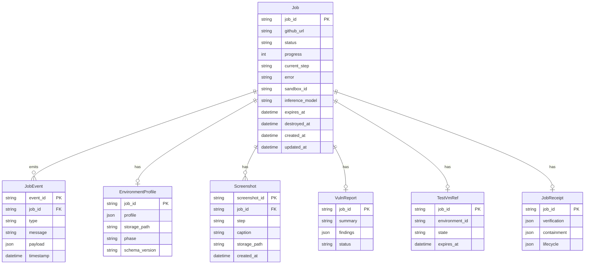

# DATABASE.md — Database structure and rules

v1 persistence is a **durable job/event ledger** owned by the **Python `explore/` sidecar** ([DECISIONS.md](DECISIONS.md) D41, D52) plus **filesystem artifacts** for profiles and screenshots (D17). In-memory-only stores are allowed solely for local scaffold before durability lands; **public/demo deploy requires the ledger**.

Related: [API.md](API.md) · [DECISIONS.md](DECISIONS.md) · [ARCHITECTURE.md](ARCHITECTURE.md)

---

## Rules

1. **Plane 1 ledger (Python sidecar) is the source of truth** for jobs, events, profiles, readiness, vulns, and screenshot metadata. Next.js proxies the public Jobs API; it does not own the job dictionary (D52).
2. **Plane 2 (disposable Microsandbox) holds no Killhub database.** It is ephemeral compute; any state needed after destroy must already be copied into Plane 1 artifacts / receipt (D49).
3. **Job lifetime ≠ client presence.** Rows/records remain until terminal state + TTL cleanup (or explicit cancel cleanup).
4. **Do not store secrets** (API keys, SSH private keys) in job JSON, event payloads, or screenshot captions. Redact before persist. Canaries (D44) are fake credentials tracked separately.
5. **Public github.com URLs only** in `source` / create payload validation.
6. When changing ledger engine (SQLite ↔ Postgres), preserve field names below and document the migration in [DECISIONS.md](DECISIONS.md).
7. **Screenshots are optional** (D31); an empty screenshot list is valid.
8. **Readiness ≠ completion** (D37). `readiness.passed` is probe evidence; terminal success is `status=completed` after report + cleanup. Destroy the sandbox on terminal states / absolute expiry — **not** merely when readiness passes.
9. **Bootstrap vs runtime profiles** (D36). A Killhub-owned bootstrap profile may create Plane 2 for inspect. Invalid **runtime** profiles must not start provision/install. Image replacement stays one VM per job.
10. **`destroyed_at` only after confirmed removal** (D57). Cleanup failures are first-class state.
11. **Verification kinds** (D54) must remain distinct: original application vs generated demo vs setup failed.
12. After **cancel** is committed, reject non-cleanup worker mutations (D56).

---

## Entities



---

## Job

| Field | Type | Rules |
|-------|------|-------|
| `job_id` | string (UUID) | Immutable PK |
| `github_url` | string | Validated public HTTPS `github.com` |
| `status` | enum | `pending` → `queued`? → `analyzing` → `planning` → `provisioning` → `installing` → `verifying` ⇄ `repairing` → `scanning` → `finalizing` → `completed` \| `failed` \| `cancelled` |
| `progress` | int 0–100 | Monotonic non-decreasing except on documented repair resets |
| `current_step` | string | Human-readable label for UI |
| `steps_completed` | string[] | Prior major states |
| `error` | string \| null | Set on failure; cleared on retry entry if applicable |
| `readiness` | object \| null | `{ passed, probe, detail, at }` — set when probe succeeds; **not** a destroy trigger (D37) |
| `verification` | object \| null | `{ kind, original_failure? }` — D54 |
| `verify_result` | object \| null | Smoke/readiness evidence (mirrors / extends readiness detail; includes MCP stdio transcript summary when applicable) |
| `sandbox_id` | string \| null | Microsandbox id/name while provisioned; retained after destroy for the report UI |
| `inference_model` | string \| null | Vultr Serverless Inference model id (D25) |
| `inference_usage` | object \| null | Tokens / wall-clock toward budgets (D40) |
| `event_cursor` | string \| null | Last durable `event_id` (for snapshot→SSE handoff — D55) |
| `expires_at` | datetime | Absolute sandbox/job expiry; **not** extended by `msb touch` (D41) |
| `cleanup` | object | `{ status, attempts, last_error?, updated_at }` — D57 |
| `destroyed_at` | datetime \| null | Set **only** when Plane 2 removal is confirmed; null while alive or on `destroy_failed` |
| `cancel_requested_at` | datetime \| null | Set when cancel committed; freezes non-cleanup writes (D56) |
| `created_at` / `updated_at` | datetime | UTC |

### `verification` (D54)

| Field | Values / rules |
|-------|----------------|
| `kind` | `original_application` \| `generated_demo` \| `setup_failed` |
| `original_failure` | Required when `kind=generated_demo` if original install/launch/readiness failed; `{ step, summary, detail? }` — must remain visible in the receipt/UI |

### `cleanup.status` (D57)

`pending` \| `destroying` \| `destroyed` \| `destroy_failed`

`queued` is optional when admission queues a job (D40).

---

## JobEvent

Append-only timeline (SSE source of truth). **Must be durable** in the ledger (D41). Retained per `EVENT_RETENTION` (D55).

| Field | Type | Rules |
|-------|------|-------|
| `event_id` | string | Monotonic per job (for SSE resume) |
| `job_id` | string | FK |
| `type` | enum | `status` \| `progress` \| `log` \| `screenshot` \| `error` \| `span` \| `finding` \| `containment` \| `lifecycle` (D49) |
| `message` | string | Safe for UI |
| `payload` | object | Type-specific; no real secrets. For `log`, optional `kind` (`sandbox_create` \| `sandbox_replace` \| `sandbox_destroy` \| `repair_attempt` \| `mcp_assessment` \| `mcp_stdio_verify` \| `containment_probe` \| `network_probe` \| `agent` \| `harness` \| `admission` \| `cancel`), plus ids/detail as needed |
| `timestamp` | datetime | UTC |

Cap retained event bytes per job via `MAX_JOB_LOG_BYTES` (D40); drop oldest `log` payloads first, never drop terminal `status` / `error` / `lifecycle` destroy evidence.

---

## EnvironmentProfile

| Field | Type | Rules |
|-------|------|-------|
| `job_id` | string | PK/FK |
| `phase` | enum | `bootstrap` \| `runtime` |
| `schema_version` | string | e.g. `1` — must match `profile.schema_version` (D51) |
| `profile` | object | Must validate against versioned schema for its phase |
| `storage_path` | string | e.g. `storage/profiles/{job_id}/environment_profile.json` |

Canonical JSON Schema: `schemas/environment_profile.v1.json` (ship with explore workers).

### Bootstrap profile (D36)

Killhub-owned, schema-valid, used **only** to create the inspect sandbox: `intent: bootstrap`, `MSB_DEFAULT_IMAGE`, clone-only (`install_commands` / `run_commands` empty), minimal services/ports.

### Runtime profile — executable contract (D51)

| Key | Required | Notes |
|-----|----------|-------|
| `schema_version` | yes | `1` for v1 |
| `intent` | yes | `git_mcp` \| `webapp` \| `demo` (D34) |
| `source` | yes | `{ type: "git", url, ref, commit? }` — fixtures pin `commit` (D53) |
| `runtime` | yes | e.g. `python`, `node` |
| `os_image` | yes | Logical OS hint |
| `oci_image` | recommended | If ≠ bootstrap → harness replaces VM (D36) |
| `workdir` | yes | Default guest cwd for commands (absolute or repo-relative) |
| `services` | yes | Array of service specs (may be `[]`) — see below |
| `packages` | yes | Attempted at provision; failures flagged |
| `install_commands` | yes | `CommandSpec[]` |
| `run_commands` | yes | `CommandSpec[]` — app / demo launch |
| `processes` | yes | Supervision plan for long-running targets |
| `mcp` | if `git_mcp` | Transport + launch + readiness + optional assessment |
| `healthcheck` / `probes` | if `webapp` or `demo` (typical) | Explicit probe objects |
| `ports` | yes | Exposed/probed ports |
| `summary` | yes | Human-readable |
| `verification_target` | yes | `original_application` \| `generated_demo` — what readiness claims to prove (D54) |

#### `CommandSpec`

| Field | Required | Notes |
|-------|----------|-------|
| `argv` or `shell` | yes | Prefer `argv[]`; `shell` only when necessary |
| `cwd` | no | Defaults to profile `workdir` |
| `env` | no | Merged env; never Killhub secrets by default |
| `timeout_seconds` | yes | Hard cap per invocation |

#### `services[]`

| Field | Required | Notes |
|-------|----------|-------|
| `name` | yes | Unique within profile |
| `kind` | yes | e.g. `postgres` \| `redis` \| `mongodb` \| `custom` |
| `image` / `package` | one of | How to obtain the service in-guest |
| `ports` | yes | Guest ports |
| `env` | no | |
| `healthcheck` | yes | Probe before dependents start |
| `depends_on` | no | Other service names |
| `optional` | no | If true, failure is flagged but may not hard-fail provision |

Fixture policies may forbid certain `kind`s (e.g. controlled fail forbids inventable datastores — D53).

#### `processes[]` (supervision)

| Field | Required | Notes |
|-------|----------|-------|
| `name` | yes | |
| `command` | yes | `CommandSpec` |
| `supervise` | yes | `oneshot` \| `restart` |
| `stop_signal` | no | Default `SIGTERM` |
| `ready_after_seconds` | no | Delay before probe |
| `ready_probe` | no | Reference to a named probe |

#### Probes

| `type` | Use | Pass criteria |
|--------|-----|---------------|
| `http` | webapp / demo | Status in allowlist (default 200–399), optional body match |
| `tcp` | port open | Connect success within timeout |
| `command` | scripted verify | Exit 0 + logged stdout/stderr evidence |
| `mcp_handshake` | git_mcp | Transport-specific — see MCP |

#### MCP block (`intent=git_mcp`)

| Key | Required | Notes |
|-----|----------|-------|
| `transport` | yes | `stdio` \| `streamable_http` (D51) |
| `launch_command` | yes | `CommandSpec` — for `stdio`, the subprocess the verify helper launches |
| `cwd` | no | Overrides workdir for launch |
| `entrypoint` | recommended | Package/path pin (fixtures **must** set — D53 filesystem server) |
| `url` | if `streamable_http` | Base URL inside guest network namespace |
| `readiness` | yes | `{ type: "mcp_handshake", transport, timeout_seconds }` |
| `security_assessment` | no | D35 |

**`stdio` verification (in-guest helper):** copy/run Killhub `mcp_stdio_verify` inside Plane 2. It must:

1. Start `launch_command` as a subprocess (`cwd` / env from profile)
2. Write newline-delimited JSON-RPC to stdin: `initialize` → `notifications/initialized` → `tools/list`
3. Read stdout JSON-RPC responses; treat stderr as logs only
4. Pass iff `tools/list` returns a JSON-RPC result with a `tools` array (may be empty only if explicitly allowed; default require `len(tools) >= 1` for fixtures)
5. Emit evidence (`log.kind=mcp_stdio_verify` / readiness detail): protocol version, tool names, timings — **not** a process-alive or HTTP ping

**`streamable_http` verification:** HTTP(S) MCP transport handshake/list-tools against `mcp.url` after process supervision says ready — still must list tools (D30), not merely TCP connect.

#### `mcp.security_assessment` (optional — D35)

Unchanged semantics: optional Inspector/SDK after readiness; must not invalidate readiness or gate `completed`.

**Invalid runtime profiles must not trigger provision/install.** Bootstrap create uses the trusted bootstrap profile only.

---

## Screenshot

| Field | Type | Rules |
|-------|------|-------|
| `screenshot_id` | string | PK |
| `job_id` | string | FK |
| `step` | string | Plan-loop / job state label |
| `caption` | string | No secrets |
| `storage_path` | string | `storage/screenshots/{job_id}/{id}.png` |
| `created_at` | datetime | UTC |

Cap: `MAX_SCREENSHOTS_PER_JOB` and disk budget (D40). Capture in Plane 2 (D38); Plane 1 stores copied stills.

---

## VulnReport

| Field | Type | Rules |
|-------|------|-------|
| `job_id` | string | PK/FK |
| `summary` | string | Cite-checked AI summary (D48) |
| `findings` | array | `{ id, severity, package?, title, advisory_url?, source, detail? }[]` |
| `mcp_assessment` | object \| null | When D35 ran |
| `status` | enum | `ok` \| `partial` \| `failed` |

| `findings[].source` | Meaning |
|---------------------|---------|
| `sca` | Lockfile / advisory scanner (dependency advisories — D53) |
| `mcp_assessment` | MCP Inspector/SDK probe when planned |
| `intentional_app` | Intentionally vulnerable application patterns (if reported) — **not** SCA proof |
| `canary` | Canary credential hit (D44) |
| `network` / `containment` | Policy / isolation evidence |

Findings do not delete readiness evidence. Report generation is bounded in `scanning` / `finalizing` before `completed` (D37).

---

## TestVmRef

| Field | Type | Rules |
|-------|------|-------|
| `job_id` | string | PK/FK |
| `environment_id` | string | Microsandbox name / id |
| `image` | string | OCI image at create |
| `cpus` / `memory` | number / string | Caps at create |
| `expires_at` | datetime | Absolute; host reaper ignores touch past this (D41) |
| `state` | enum | `provisioning` \| `running` \| `replaced` \| `destroying` \| `destroyed` \| `destroy_failed` \| `failed` |

On image replace (D36): prior ref `replaced`; one live VM. On destroy success: `destroyed` + set `Job.destroyed_at`. On destroy failure: `destroy_failed`; **do not** set `destroyed_at` (D57).

---

## JobReceipt (D49)

Durable dossier outliving the sandbox: profiles, readiness, `verification`, findings, containment matrix (D58), network probes, sandbox lifecycle, outcome gates, `vuln_review` citations, cleanup status.

---

## Filesystem layout (v1)

```
storage/
├── ledger/                 # durable job/event DB — D41 (Python sidecar)
├── profiles/{job_id}/environment_profile.json
└── screenshots/{job_id}/{screenshot_id}.png

schemas/
└── environment_profile.v1.json
```

---

## Durability and reconciliation (D41)

| Concern | Behavior |
|---------|----------|
| **Ledger** | Persist Job, JobEvent, readiness, verification, VulnReport, TestVmRef, receipt, ownership |
| **Startup** | Load ledger; list live sandboxes; adopt/resume; destroy orphans / past `expires_at`; retry `destroy_failed` |
| **Host reaper** | VX1-side destroy when `now >= expires_at` even if Plane 1 is down |
| **Touch** | Keep-alive only while `now < expires_at`; never moves `expires_at` |

---

## Cleanup

| Trigger | Action |
|---------|--------|
| Job `completed` / `failed` / `cancelled` | Enter `cleanup.status=destroying`; confirm remove; then `destroyed` + `destroyed_at` — or `destroy_failed` with error (D57) |
| Absolute `expires_at` / host reaper | Same confirm-only semantics |
| Orphan reaper | Stop/remove sandboxes with no live job reference |
