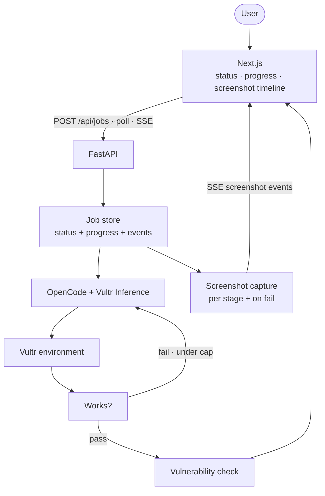

# Killhub — Implementation Plan

Turn a public GitHub repository into a running environment on Vultr: AI figures out how to run it, writes setup instructions, provisions and installs automatically, verifies it works, then checks for known vulnerabilities.

## Goal

Given a GitHub URL, Killhub:

1. Accepts a public repository link
2. Uses an AI (OpenCode + Vultr Inference) to determine how the project should run on Vultr
3. Produces concrete setup instructions
4. Automatically provisions the target environment on Vultr
5. Clones/installs the repository into that environment
6. Verifies the project actually runs (smoke / health checks)
7. Scans for known vulnerabilities and reports findings
8. Streams **progress and status** to the frontend throughout (poll + SSE)
9. Captures **screenshots of the process** at each major stage and surfaces them live

## User flow

```
1. Enter GitHub link
       ↓
2. AI analyzes repo → how to run on Vultr          [status + screenshot]
       ↓
3. AI writes setup instructions                    [status + screenshot]
       ↓
4. Auto-provision environment on Vultr             [status + screenshot]
       ↓
5. Install / clone repo into that environment      [status + screenshot]
       ↓
6. Verify it works (smoke tests · health checks)   [status + screenshot]
       ↕ fail → AI repairs / retries (capped)
       ↓
7. AI scans for known vulnerabilities              [status + screenshot]
       ↓
   Ready: status · setup docs · vuln report · screenshot timeline
```

## Progress, status & screenshots (product requirement)

Every job must continuously return:

| Channel | What the client gets |
|---------|----------------------|
| `GET /api/jobs/{id}` | Current `status`, `progress` (0–100 or step index), `current_step`, timestamps, latest error |
| `GET /api/jobs/{id}/events` (SSE) | Live log lines, status transitions, progress updates, screenshot attachments |
| `GET /api/jobs/{id}/screenshots` | Ordered timeline of process screenshots for the job |

**Screenshot policy:** capture at each state transition and on verify/repair/fail. Prefer a real browser shot of the running app when a URL/port is available (Playwright); otherwise capture a terminal/session still (or annotated step card rendered for the timeline) so the UI always has a visual of “what just happened.”

## Architecture overview

```
┌─────────────┐  SSE: status·progress·logs·shots  ┌──────────────┐
│  Next.js UI │ ◄───────────────────────────────► │   FastAPI    │
│  (frontend) │   POST /jobs · GET status         │   (backend)  │
└──────┬──────┘                                   └──────┬───────┘
       │ status · docs · report · screenshots            │
       ▼                                                 ▼
┌─────────────┐                                   ┌──────────────┐
│  Job view   │                                   │  Orchestrator│
│  timeline   │                                   │  jobs+agent  │
└─────────────┘                                   └──────┬───────┘
                                                         │
              ┌──────────────────┬───────────────────────┼──────────────┐
              ▼                  ▼                       ▼              ▼
        ┌───────────┐     ┌────────────┐         ┌────────────┐  ┌───────────┐
        │ OpenCode  │     │   Vultr    │         │  Verify +  │  │Screenshot │
        │ + Vultr   │     │  instance  │         │  vuln scan │  │ capture   │
        │ Inference │     │  / env     │         │            │  │(Playwright│
        └───────────┘     └────────────┘         └────────────┘  │ / term)   │
                                                                 └───────────┘
```

**Data flow:** User submits URL → job created → each stage emits status + progress + optional screenshot via SSE → agent analyzes → setup instructions → Vultr provisioned → repo installed → verification (repair loop) → vulnerability scan → final status, docs, report, and screenshot timeline returned to UI.



## Proposed repo structure

```
killhub/
├── frontend/                 # Next.js app
│   ├── app/
│   │   ├── page.tsx          # URL input + Start
│   │   ├── jobs/[id]/page.tsx
│   │   └── layout.tsx
│   ├── components/
│   │   ├── UrlForm.tsx
│   │   ├── ProgressLog.tsx
│   │   ├── StatusBadge.tsx
│   │   ├── ProgressBar.tsx
│   │   ├── ScreenshotTimeline.tsx
│   │   ├── SetupDocs.tsx
│   │   ├── EnvStatus.tsx
│   │   ├── VulnReport.tsx
│   │   └── ErrorBanner.tsx
│   └── lib/
│       └── api.ts
├── backend/
│   ├── main.py               # FastAPI endpoints
│   ├── agent.py              # OpenCode + Vultr Inference
│   ├── vultr.py              # Vultr instance / env provisioning
│   ├── setup.py              # Apply install steps in environment
│   ├── verify.py             # Smoke / health checks
│   ├── vulnscan.py           # Known-vulnerability scanning
│   ├── screenshots.py        # Capture + store process screenshots
│   ├── jobs.py               # Job state machine + storage
│   ├── config.py             # Settings (env-based)
│   ├── models.py             # Pydantic schemas
│   └── requirements.txt
├── storage/                  # Local/dev artifact store (screenshots per job)
│   └── screenshots/
├── prompts/
│   ├── analyze_repo.md       # How to run this project on Vultr
│   ├── write_setup.md        # Produce setup instructions
│   ├── repair_from_errors.md # Fix failed install / verify
│   └── vuln_review.md        # Interpret scan findings
├── docker-compose.yml
├── .env.example
└── README.md
```

---

## Phase 0 — Project scaffold

**Objective:** Runnable empty shells for frontend, backend, and local compose so later phases plug in cleanly.

### Tasks

- [ ] Initialize monorepo layout above
- [ ] Scaffold Next.js (App Router, TypeScript) in `frontend/`
- [ ] Scaffold FastAPI app in `backend/` with health check `GET /health`
- [ ] Add `docker-compose.yml` services: `frontend`, `backend`
- [ ] Add `.env.example` for `VULTR_API_KEY`, `OPENCODE_*`, ports, timeouts, resource defaults
- [ ] Document local start: `docker compose up --build`

### Acceptance criteria

- `docker compose up` starts frontend + backend
- Frontend loads; backend `/health` returns `200`
- No secrets committed; keys only via env

---

## Phase 1 — Backend job system

**Objective:** Accept a GitHub URL, create a job, continuously return status/progress, stream events (including screenshots), and expose final environment info, setup docs, vuln report, and screenshot timeline.

### API surface

| Method | Path | Purpose |
|--------|------|---------|
| `POST` | `/api/jobs` | Create job `{ github_url }` → `{ job_id }` |
| `GET` | `/api/jobs/{id}` | Full job snapshot: `status`, `progress`, `current_step`, env, docs, vuln summary, latest screenshot ids |
| `GET` | `/api/jobs/{id}/events` | SSE: status changes, progress, logs, screenshot events |
| `GET` | `/api/jobs/{id}/screenshots` | Ordered list of process screenshots `{ id, step, caption, url, created_at }` |
| `GET` | `/api/jobs/{id}/screenshots/{shot_id}` | Image bytes (or redirect to object storage URL) |
| `DELETE` | `/api/jobs/{id}` | Cancel job + trigger environment cleanup |

### Job status payload (always available)

```json
{
  "job_id": "...",
  "status": "installing",
  "progress": 55,
  "current_step": "pip install -r requirements.txt",
  "steps_completed": ["analyzing", "planning", "provisioning"],
  "updated_at": "...",
  "error": null
}
```

Clients may **poll** `GET /api/jobs/{id}` and/or subscribe to SSE. Both must stay consistent.

### SSE event types

| `type` | Purpose |
|--------|---------|
| `status` | State machine transition (`analyzing` → `planning`, …) |
| `progress` | Numeric progress + `current_step` label |
| `log` | Chronological execution / agent message |
| `screenshot` | New process screenshot available (`screenshot_id`, `step`, `caption`, `url`) |
| `error` | Failure detail without closing the stream until terminal state |

### Job states

```
pending → analyzing → planning → provisioning → installing
       → verifying ⇄ repairing
       → scanning → ready | failed | cancelled
```

Repair loop: `verifying → repairing → installing|verifying`, capped by `MAX_REPAIR_ATTEMPTS`, then `failed`.

### Client disconnect policy

Jobs are **server-owned**. Closing the tab, navigating away, or dropping the SSE connection does **not** cancel or pause the job. The pipeline keeps running until `ready`, `failed`, `cancelled` (explicit `DELETE`), or `JOB_TIMEOUT_SECONDS`. Users resume by reopening `/jobs/{id}` (poll + reconnect SSE + reload screenshot timeline).

### Tasks

- [ ] Implement `jobs.py`: in-memory store first (later Redis/Postgres if needed)
- [ ] Pydantic models: `JobCreate`, `JobStatus`, `JobEvent`, `JobProgress`, `ScreenshotMeta`, `SetupInstructions`, `VulnFinding`
- [ ] Validate GitHub URL (public HTTPS, `github.com` host only)
- [ ] Background worker / asyncio task per job (independent of any HTTP/SSE connection)
- [ ] On every state change: update `status` + `progress` + `current_step`; emit `status` and `progress` SSE events
- [ ] SSE endpoint with reconnect / catch-up from last event id (including past screenshot events)
- [ ] Persist `setup_instructions`, `environment`, `verify_result`, `vuln_report`, `screenshots[]` on success; `error` on failure
- [ ] Do not bind job lifetime to client presence; only `DELETE /api/jobs/{id}` or timeout cancels

### Acceptance criteria

- Creating a job returns `job_id` immediately
- Clients can poll status/progress and subscribe to SSE logs
- Status and progress remain accurate after reconnect
- Invalid URLs rejected with `400`
- Disconnecting mid-job leaves the job running; revisiting `/jobs/{id}` shows current status, logs, and screenshots so far

---

## Phase 2 — Vultr environment provisioning

**Objective:** Create, configure, and destroy isolated Vultr environments per job. API keys for inference stay on the backend host; instance credentials are job-scoped and short-lived.

### Tasks

- [ ] Implement `vultr.py` against Vultr API:
  - `create_environment(job_id, plan) → environment_id`
  - `wait_until_ready(environment_id)`
  - `exec(environment_id, cmd) → { stdout, stderr, exit_code }`
  - `destroy_environment(environment_id)`
- [ ] Map agent “run plan” to instance size / OS image / region defaults
- [ ] Resource and cost caps per job (`VULTR_PLAN`, max lifetime)
- [ ] Network: outbound as required (git, package registries); no host network sharing
- [ ] Timeouts on all remote exec calls
- [ ] Automatic cleanup on job complete/fail/cancel + periodic reaper for orphans
- [ ] Confirm inference / control-plane secrets are **not** injected into the instance env unless explicitly required for the *project* under test

### Security constraints

- All agent tools that execute code/shell must target the job environment only
- Prefer non-root SSH/user where feasible
- No Docker socket or host mounts of Killhub secrets into the instance
- Destroy removes instance and associated DNS/IP mappings within configured TTL

### Acceptance criteria

- Environment provisions and accepts remote `exec`
- Exceeding time/cost/plan limits fails safely
- Destroy removes the Vultr resource
- Killhub API keys are not visible via `env` on the instance by default

---

## Phase 3 — AI agent (analyze + setup instructions)

**Objective:** Agent understands the repo, decides how to run it on Vultr, and writes actionable setup instructions — before any heavy install.

### Tasks

- [ ] Wire OpenCode client to Vultr Inference API in `agent.py`
- [ ] Prompt pack under `prompts/`:
  - **Analyze:** languages, entry points, dependencies, services, ports, how to run on Vultr
  - **Write setup:** ordered install/run instructions (commands + rationale)
  - **Repair:** consume verify/install stderr and patch instructions or commands
  - **Vuln review:** summarize scanner output for the UI
- [ ] Tool interface restricted to: read repo metadata (clone scratch or tarball), sandboxed/file tools as needed, then Vultr env ops after planning
- [ ] Structured agent output for plan stage:
  `{ runtime, os_image, packages[], install_commands[], run_commands[], healthcheck, ports[], summary }`
- [ ] Cap agent turns / tokens / wall-clock per job
- [ ] Stream agent step messages into job events for the UI
- [ ] Persist human-readable setup instructions for `SetupDocs` in the frontend

### Acceptance criteria

- Agent can analyze a simple public repo and produce a plausible Vultr run plan
- Setup instructions are stored on the job and shown in the UI
- Agent cannot invoke tools outside the approved APIs
- Failures emit actionable events and transition job to `failed` or `repairing`

---

## Phase 4 — Install + verify

**Objective:** Apply setup instructions on the provisioned Vultr environment, install the GitHub repo, prove it works, and emit status/progress for every step.

### Tasks

- [ ] `setup.py`: clone repo into environment; run install commands from the plan
- [ ] Capture full stdout/stderr per step into job events; bump `progress` / `current_step` after each command
- [ ] `verify.py`: run healthcheck / smoke commands from the plan (HTTP check, CLI self-test, etc.)
- [ ] On failure: package error context for `repair_from_errors` prompt; re-enter install/verify within `MAX_REPAIR_ATTEMPTS`
- [ ] Record `verify_result` (`passed`, command, samples of output)
- [ ] Trigger screenshot capture hooks on install start/end, verify pass/fail, and each repair attempt (see Phase 5)
- [ ] Do not mark job `ready` until verify passes (scan still required before final ready — see Phase 7)

### Acceptance criteria

- Successful path: clone → install → healthcheck green
- Failed verify triggers at least one repair attempt with error context
- Logs, status, and progress for each step visible via poll + SSE

---

## Phase 5 — Process screenshots

**Objective:** Capture a visual record of the pipeline so the UI can show what happened at each stage—not only text logs.

### Capture rules

| When | What to capture |
|------|-----------------|
| State transition (analyzing → … → ready/failed) | Step still: terminal output frame and/or rendered step summary image |
| Environment ready | Console / MOTD / first successful SSH session frame if available |
| Install steps (key milestones) | Terminal screenshot of command output |
| Verify | **Browser screenshot** of the running app URL when HTTP service exists; else CLI output frame |
| Repair | Before/after failure context screenshots |
| Vuln scan complete | Optional summary card image or scanner UI/output frame |
| Any terminal `failed` | Last useful screen + error banner annotation |

### Tasks

- [ ] Implement `screenshots.py`:
  - `capture_browser(url, job_id, step, caption) → ScreenshotMeta` via Playwright
  - `capture_terminal(output_or_session, job_id, step, caption) → ScreenshotMeta` (PNG of scrolled terminal buffer / annotated panel)
  - Store under `storage/screenshots/{job_id}/` (or object storage in prod)
- [ ] Wire capture into orchestrator on every major stage and on failure
- [ ] Emit SSE `screenshot` events as soon as each file is stored
- [ ] Expose list + image endpoints from Phase 1
- [ ] Cap count/size per job (`MAX_SCREENSHOTS_PER_JOB`, max dimensions); retain until job TTL cleanup
- [ ] Redact secrets from terminal captures when possible (API keys, tokens)

### Acceptance criteria

- A successful job has ≥1 screenshot per major stage (analyzing through scanning/ready)
- Verify of an HTTP app produces a real browser screenshot of the live URL
- Failed jobs still return screenshots captured up to the failure point
- SSE delivers new screenshots without requiring a full page reload

---

## Phase 6 — Frontend (Next.js)

**Objective:** Single-flow UI: enter URL → watch live **status and progress** → browse **process screenshots** → read setup docs → see env status → view vulnerability report or error.

### Tasks

- [ ] Landing page: GitHub URL input + start button
- [ ] On submit: `POST /api/jobs`, navigate to job view
- [ ] Status + progress: poll `GET /api/jobs/{id}` and/or SSE `status` / `progress` events; show badge + progress bar + `current_step`
- [ ] Live log: connect to SSE, render chronological execution log
- [ ] Screenshot timeline: append images as `screenshot` events arrive; also hydrate from `GET .../screenshots` on load
- [ ] On page load of `/jobs/{id}`, fetch current status + reconnect SSE + load screenshots so far
- [ ] Loading / intermediate states mapped to job status
- [ ] Show setup instructions when available
- [ ] Show environment status (provisioning / running / destroyed) and connection details as appropriate
- [ ] Show vulnerability report when `scanning` completes
- [ ] Error banner for validation failures, agent failures, provision/install failures
- [ ] Cancel / retry controls; cancel is explicit only
- [ ] Proxy or CORS config so browser talks to FastAPI cleanly in compose

### Acceptance criteria

- Happy path: empty input → ready job with live status/progress, docs, vuln report, and screenshot timeline
- Status, progress, logs, and screenshots update live without full page refresh
- Leaving and returning to `/jobs/{id}` restores status, progress, logs, and all screenshots so far
- Errors are human-readable; start button disabled while a job is in flight from that session

---

## Phase 7 — Vulnerability scanning

**Objective:** After the environment works, AI-assisted check for known vulnerabilities (dependencies / OS / common misconfig signals) and attach a clear report to the job.

### Tasks

- [ ] `vulnscan.py`: run dependency / advisory scanners appropriate to detected stack (e.g. language lockfiles, OS packages where available)
- [ ] Feed raw findings into agent `vuln_review` prompt for prioritization and plain-language summary
- [ ] Persist structured `VulnFinding[]` + summary on the job
- [ ] Emit scan progress and high-severity counts via SSE; capture a scan-complete screenshot when useful
- [ ] Scanning failures (tool crash) should not erase a successful verify; mark report as `partial` / `failed` with reason
- [ ] Job reaches `ready` when verify passed and scan finished (even if findings exist — findings are reported, not an automatic hard fail unless configured)

### Acceptance criteria

- At least one supported stack produces real advisory hits or a clean bill on a fixture repo
- UI shows severity-grouped findings
- High-severity items are obvious without reading raw scanner JSON

---

## Phase 8 — Integration & hardening

**Objective:** Full pipeline wired; cleanup, isolation, recovery, progress fidelity, and screenshot retention verified on real public repos.

### Tasks

- [ ] Wire phases 1–7 into one job orchestration pipeline in `main.py` / `jobs.py`
- [ ] End-to-end tests with several public repos (simple Python service, Node app, mixed README-driven setup)
- [ ] Assert SSE emits status/progress/screenshot events in order for the happy path
- [ ] Chaos checks: kill instance mid-job, bad URL, dependency install failure, infinite agent loop prevention
- [ ] Verify environment isolation (cross-job, no secret leakage)
- [ ] Verify automatic error recovery path (install fail → repair → re-verify)
- [ ] Cleanup screenshots with job/env TTL
- [ ] Document ops: Vultr plan sizing, cleanup intervals, rate limits, scan tool versions, screenshot storage

### Acceptance criteria

- At least 3 different public repos reach `ready` with setup docs, vuln report, and a complete screenshot timeline
- Poll and SSE agree on final status/progress
- Failed/cancelled jobs clean up Vultr resources and screenshot artifacts within the configured TTL
- No Killhub control-plane API keys appear in instance logs, `env`, or screenshots

---

## Cross-cutting concerns

### Configuration

| Variable | Purpose |
|----------|---------|
| `VULTR_API_KEY` | Vultr API (provisioning) + Inference (host/backend only as configured) |
| `OPENCODE_*` | Agent client settings |
| `VULTR_PLAN` / region / OS defaults | Per-job environment defaults |
| `JOB_TIMEOUT_SECONDS` | Hard wall clock |
| `MAX_REPAIR_ATTEMPTS` | Repair loop cap |
| `ENV_TTL_SECONDS` | Auto-destroy running environments |
| `VULN_SCAN_*` | Scanner enablement / severity thresholds |
| `MAX_SCREENSHOTS_PER_JOB` | Cap process screenshots per job |
| `SCREENSHOT_STORAGE` | Local path or object-storage config |

### Observability

- Structured logs with `job_id`
- Job event timeline (status, progress, logs, screenshots) as source of truth for UI
- Poll and SSE must reflect the same status/progress
- Optional metrics later: success rate, time-to-ready, repair count, vuln severity totals, screenshots per job

### Out of scope (v1)

- Private GitHub repos / OAuth
- Multi-user auth / billing
- Long-lived production hosting beyond job TTL
- GPU workloads
- Auto-patching vulnerabilities (report only in v1)
- Non-Vultr cloud targets
- Full session video / continuous screen recording (stills only)

---

## Suggested implementation order

| Order | Phase | Depends on |
|------:|-------|------------|
| 1 | Phase 0 — Scaffold | — |
| 2 | Phase 1 — Jobs API (status, progress, SSE) | Phase 0 |
| 3 | Phase 2 — Vultr environments | Phase 0 |
| 4 | Phase 3 — Agent analyze + setup docs | Phases 1–2 |
| 5 | Phase 4 — Install + verify | Phases 2–3 |
| 6 | Phase 5 — Process screenshots | Phases 1, 4 |
| 7 | Phase 6 — Frontend | Phase 1 (mock status/progress/screenshots OK early) |
| 8 | Phase 7 — Vulnerability scan | Phase 4 |
| 9 | Phase 8 — Integration | All |

Frontend (Phase 6) can start in parallel with Phase 2 using mocked SSE status, progress, and screenshot events.

---

## Milestone checklist

- [ ] **M0:** Compose stack boots (frontend + backend)
- [ ] **M1:** Jobs API returns status/progress; SSE streams stub events
- [ ] **M2:** Vultr provision / exec / destroy with limits
- [ ] **M3:** Agent produces run plan + setup instructions for one fixture repo
- [ ] **M4:** Install + verify green on Vultr for that fixture
- [ ] **M5:** Process screenshots captured per stage and shown live in the UI
- [ ] **M6:** Vulnerability report attached to job; UI shows docs + findings + timeline
- [ ] **M7:** Three public repos succeed end-to-end; isolation and artifact cleanup verified

---

## Risks & mitigations

| Risk | Mitigation |
|------|------------|
| Agent invents wrong setup steps | Verify gate + repair cap + require commands to exit 0 |
| Vultr provision slow or quota-limited | Timeouts, plan defaults, clear quota errors in UI |
| Install hangs or bloats disk | Per-step timeouts, instance size caps, TTL destroy |
| Cost of inference + instances | Turn/token caps; ENV TTL; skip repair on non-actionable errors |
| Vulnerability scanners noisy | Severity grouping; AI summary; don’t hard-fail ready on low issues |
| Secret leakage into instance / screenshots | Never inject Killhub keys; scrub logs/captures; destroy on cancel |
| Screenshot storage growth | Per-job caps, compression, TTL cleanup with job |
| Stale UI after reconnect | Event ids + full status/screenshot hydrate on `/jobs/{id}` load |

---

## Definition of done (v1)

A user can paste a public GitHub URL and, without refreshing, see live **status and progress**, a growing **screenshot timeline** of the process, setup instructions, a verified Vultr environment with the repo installed and running, and an AI-reviewed vulnerability report — with Killhub control-plane secrets never entering the target environment or screenshots, and instances plus screenshot artifacts torn down automatically after TTL or cancel.
