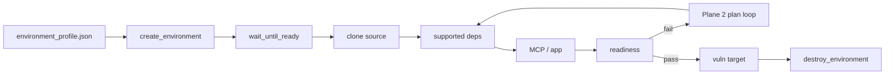

# Plane 3 — Test VM

Implementation plan for the disposable runtime VM created from `environment_profile.json`. Plane 3 does **not** call Plane 1. It is created, controlled, and destroyed **only** by the Explore Sandbox harness (Plane 2).

Architecture: [ARCHITECTURE.md](ARCHITECTURE.md) · Index: [IMPLEMENTATION_PLAN.md](IMPLEMENTATION_PLAN.md) · Plane 1: [IMPLEMENTATION_NEXTJS.md](IMPLEMENTATION_NEXTJS.md) · Plane 2: [IMPLEMENTATION_EXPLORE_SANDBOX.md](IMPLEMENTATION_EXPLORE_SANDBOX.md)

---

## Role

```
IN:  environment_profile.json  (from Plane 2 plan loop)
       │
       ▼
  Provision VM → clone repo → install supported deps
       → launch MCP / webapp → readiness probes
       │
       ▼
OUT: Running environment (or failure stdout/stderr for plan-loop retry)
     Destroy on job complete / fail / cancel / TTL
```

Plane 3 is a **remote resource per job** (Vultr), not a long-lived app folder in the monorepo.

---

## Harness contract (implemented in Plane 2, targets this plane)

| API | Behavior |
|-----|----------|
| `create_environment(job_id, plan) → environment_id` | Create VM from profile (`os_image`, size, region) |
| `wait_until_ready(environment_id)` | Block until SSH/exec available |
| `exec(environment_id, cmd) → { stdout, stderr, exit_code }` | Run install, launch, probes |
| `destroy_environment(environment_id)` | Tear down instance + network aliases |

All calls are initiated by Plane 2. Timeouts on every `exec`.

---

## Lifecycle

1. **Provision** — Map profile → Vultr plan / OS image / region; create instance
2. **Bootstrap** — Non-root user where feasible; outbound for git + package registries only
3. **Clone** — `source.url` / `source.ref` from profile
4. **Provision supported deps** — `packages`, `services`, `install_commands` (allowlisted by Plane 2)
5. **Launch** — `mcp.launch_command` or `run_commands` per intent
6. **Readiness** — MCP handshake or HTTP `healthcheck`; Plane 2 records result
7. **Scan target** — Plane 2 may run vuln tools against this VM / its lockfiles
8. **Destroy** — On `ready` TTL, `failed`, `cancelled`, or `ENV_TTL_SECONDS`



---

## Constraints

| Rule | Detail |
|------|--------|
| No Killhub secrets | Control-plane / inference keys **not** in VM `env` by default |
| Supported deps only | Unsupported services skipped/flagged by Plane 2 — not installed here |
| Isolation | No host network share; no Docker socket mount from control plane |
| Resource caps | Memory/CPU/disk/time per `VULTR_PLAN` and `JOB_TIMEOUT_SECONDS` |
| Cleanup | Destroy removes instance and DNS/IP mappings within TTL |
| Non-root | Prefer non-root SSH/user for exec |

---

## What runs on the VM (examples)

| Intent | Typical workload |
|--------|------------------|
| `git_mcp` | Install MCP server deps; `mcp.launch_command`; handshake readiness |
| `webapp` | Install app deps; `run_commands`; HTTP healthcheck on `ports` |

Plane 2 owns intent classification and profile validation before any of this runs.

---

## Implementation phases

### T0 — Provision / destroy

- [ ] Vultr create instance from plan/image/region defaults
- [ ] `wait_until_ready` (SSH or agent channel)
- [ ] `destroy_environment` + orphan reaper
- [ ] Cost/time caps; fail safely on quota errors

**Done when:** Harness can create and destroy a VM for a job id.

### T1 — Remote exec

- [ ] `exec` with stdout/stderr/exit_code capture
- [ ] Per-call timeouts
- [ ] Confirm Killhub API keys absent from `env` inside the VM

**Done when:** Remote command runs and output returns to Plane 2.

### T2 — Profile-driven bootstrap

- [ ] Clone `source` from profile
- [ ] Apply allowlisted `install_commands` / packages / services
- [ ] Expose / bind ports from profile as required for readiness

**Done when:** Fixture repo cloned and supported deps installed via profile.

### T3 — Launch + readiness surface

- [ ] Start MCP or webapp processes per profile
- [ ] Keep process alive for Plane 2 readiness probes
- [ ] Capture useful failure logs for plan-loop repair

**Done when:** Plane 2 can complete MCP handshake or HTTP healthcheck against the VM.

### T4 — Hardening

- [ ] Cross-job isolation checks
- [ ] Mid-job kill / cancel destroys VM
- [ ] TTL destroy after success
- [ ] No secret leakage in VM logs

**Done when:** Failed/cancelled/TTL paths always reclaim the Vultr resource.

---

## Configuration (Plane 3 via Plane 2)

| Variable | Purpose |
|----------|---------|
| `VULTR_API_KEY` | Provisioning (held by Plane 2) |
| `VULTR_PLAN` / region / OS defaults | Instance shape |
| `ENV_TTL_SECONDS` | Auto-destroy |
| `JOB_TIMEOUT_SECONDS` | Wall clock affecting VM lifetime |

---

## Milestones (Plane 3)

- [ ] **T-M0:** Create + destroy VM
- [ ] **T-M1:** Remote exec with output
- [ ] **T-M2:** Clone + supported deps from profile
- [ ] **T-M3:** MCP/app launch reachable for readiness
- [ ] **T-M4:** Cancel/TTL/fail always destroys VM; no secret leakage

---

## Out of scope (this plane)

- UI / SSE (Plane 1)
- Plan loop / profile generation / vuln AI review (Plane 2)
- Private registries / GPU / long-lived hosting beyond TTL

---

## Definition of done (Plane 3)

From a validated `environment_profile.json`, a Test VM can be provisioned, populated with supported deps, launch MCP or webapp for readiness checks, and be destroyed on completion, failure, cancel, or TTL — without Killhub control-plane secrets in the instance environment or logs.
