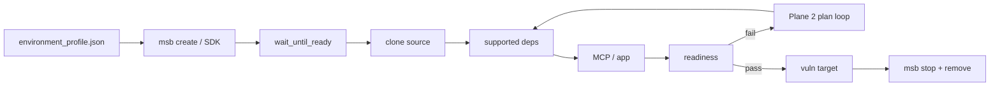

# Plane 3 — Test VM (Microsandbox on Vultr)

Implementation plan for the disposable runtime created from `environment_profile.json`. Plane 3 does **not** call Plane 1. It is created, controlled, and destroyed **only** by the Explore Sandbox harness (Plane 2).

**Runtime:** [Microsandbox on Vultr VX1 Cloud Compute](https://docs.vultr.com/how-to-set-up-agent-sandboxing-on-vultr-cloud-compute) — each job gets a **microVM** (`libkrun` / KVM), not a shared-kernel container and not a full Vultr instance per job.

Architecture: [ARCHITECTURE.md](ARCHITECTURE.md) · Index: [IMPLEMENTATION_PLAN.md](IMPLEMENTATION_PLAN.md) · Plane 1: [IMPLEMENTATION_NEXTJS.md](IMPLEMENTATION_NEXTJS.md) · Plane 2: [IMPLEMENTATION_EXPLORE_SANDBOX.md](IMPLEMENTATION_EXPLORE_SANDBOX.md) · Decision: [DECISIONS.md](DECISIONS.md) D4, D22, D23

---

## Role

```
IN:  environment_profile.json  (from Plane 2 plan loop)
       │
       ▼
  Create microsandbox → clone repo → install supported deps
       → launch MCP / webapp → readiness probes
       │
       ▼
OUT: Running environment (or failure stdout/stderr for plan-loop retry)
     Stop + remove sandbox on job complete / fail / cancel / TTL
```

Plane 3 is a **Microsandbox microVM per job** on a Vultr VX1 host. The host is pooled/long-lived; the sandbox is ephemeral. Nothing under a monorepo `test-vm/` app folder.

---

## Host vs sandbox

| Layer | What | Lifetime |
|-------|------|----------|
| **VX1 host** | Ubuntu 24.04 Vultr VX1 with `/dev/kvm`, `msb` + `libkrunfw` installed (`msb doctor` green) | Pooled; provisioned/ops outside the per-job loop |
| **Plane 3 sandbox** | Named microVM from an OCI image (`msb create` / SDK `Sandbox.create`) | Per job; CPU/memory capped; destroyed with job |

Reference setup: Vultr’s [agent sandboxing guide](https://docs.vultr.com/how-to-set-up-agent-sandboxing-on-vultr-cloud-compute) (kvm group, install script, `msb doctor`, create/exec/stop/remove).

---

## Harness contract (implemented in Plane 2, targets this plane)

| API | Behavior (Microsandbox) |
|-----|-------------------------|
| `create_environment(job_id, plan) → environment_id` | `msb create --name … --cpus … --memory … IMAGE` (or Python/TS SDK); map profile → OCI image + resource limits |
| `wait_until_ready(environment_id)` | Block until sandbox `running` (`msb status` / SDK) |
| `exec(environment_id, cmd) → { stdout, stderr, exit_code }` | `msb exec NAME -- …` (or SDK `sandbox.exec`); timeouts on every call |
| `copy_in` / `copy_out` | `msb copy` host↔`NAME:/path` for profiles, artifacts, logs as needed |
| `destroy_environment(environment_id)` | `msb stop` + `msb remove` (idempotent); reclaim name |

All calls are initiated by Plane 2. Prefer the **SDK** from `harness.py` for structured lifecycle; CLI is fine for ops/debug. OpenCode may register `microsandbox-mcp` as an **optional** agent tool surface — destroy on `ready` / cancel / fail / TTL remains harness-owned ([DECISIONS.md](DECISIONS.md) D23).

---

## Lifecycle

1. **Create sandbox** — Map profile → OCI base image + `--cpus` / `--memory`; `create_environment`
2. **Bootstrap** — Exec allowlisted setup inside the microVM (non-root where feasible)
3. **Clone** — `source.url` / `source.ref` from profile (outbound git from sandbox)
4. **Provision supported deps** — `packages`, `services`, `install_commands` (allowlisted by Plane 2)
5. **Launch** — `mcp.launch_command` or `run_commands` per intent
6. **Readiness** — MCP handshake or HTTP `healthcheck`; Plane 2 records result
7. **Scan target** — Plane 2 may run vuln tools against this sandbox / its lockfiles
8. **Destroy** — When the Environment Agent finishes its instructions and all tests (job reaches `ready` after readiness + vuln scan), stop + remove the sandbox immediately. Also destroy on `failed`, `cancelled`, `ENV_TTL_SECONDS` / orphan reaper as a safety net (`msb touch` only while the job is still active)



---

## Constraints

| Rule | Detail |
|------|--------|
| No Killhub secrets | Control-plane / inference keys **not** in sandbox `env` by default |
| Supported deps only | Unsupported services skipped/flagged by Plane 2 — not installed here |
| Isolation | Separate kernel per sandbox (KVM/libkrun); **inter-sandbox network denied by default**; no Docker socket from control plane |
| Resource caps | CPU/memory at create time; wall clock via `JOB_TIMEOUT_SECONDS` / `ENV_TTL_SECONDS` |
| Cleanup | Destroy removes the microVM; host stays for the next job |
| Non-root | Prefer non-root user for exec inside the sandbox |
| Host hygiene | Host holds `msb` only; untrusted repo code runs **inside** sandboxes, never as privileged host processes |

---

## What runs in the sandbox (examples)

| Intent | Typical workload |
|--------|------------------|
| `git_mcp` | Install MCP server deps; `mcp.launch_command`; handshake readiness |
| `webapp` | Install app deps; `run_commands`; HTTP healthcheck on `ports` |

Plane 2 owns intent classification and profile validation before any of this runs.

---

## Implementation phases

### T0 — Host + create / destroy

- [ ] VX1 host ready: kvm group, `msb` installed, `msb doctor` passes
- [ ] Harness `create_environment` → named sandbox with CPU/memory limits
- [ ] `wait_until_ready` (status running)
- [ ] `destroy_environment` (stop + remove) + orphan reaper for leftover names
- [ ] Cost/time caps; fail safely when host/KVM/quota unavailable

**Done when:** Harness can create and destroy a microsandbox for a job id.

### T1 — Remote exec + copy

- [ ] `exec` with stdout/stderr/exit_code capture (SDK or `msb exec`)
- [ ] Per-call timeouts
- [ ] `msb copy` (or SDK equivalent) for files in/out
- [ ] Confirm Killhub API keys absent from `env` inside the sandbox

**Done when:** Remote command runs and output returns to Plane 2.

### T2 — Profile-driven bootstrap

- [ ] Map profile `os_image` / runtime → OCI image defaults
- [ ] Clone `source` from profile inside the sandbox
- [ ] Apply allowlisted `install_commands` / packages / services
- [ ] Expose / bind ports from profile as required for readiness

**Done when:** Fixture repo cloned and supported deps installed via profile.

### T3 — Launch + readiness surface

- [ ] Start MCP or webapp processes per profile
- [ ] Keep process alive for Plane 2 readiness probes (`msb touch` if idle timeout risks stop)
- [ ] Capture useful failure logs (`msb logs`) for plan-loop repair

**Done when:** Plane 2 can complete MCP handshake or HTTP healthcheck against the sandbox.

### T4 — Hardening + containment

- [ ] Cross-job isolation checks (sibling sandboxes cannot reach each other)
- [ ] Mid-job kill / cancel destroys sandbox
- [ ] TTL destroy after success; CPU/memory caps enforced at create
- [ ] No secret leakage in sandbox logs / metrics
- [ ] **Containment scenarios** ([DECISIONS.md](DECISIONS.md) D26) verified via harness `exec` timeouts / kill:
  - Destructive filesystem command (e.g. `rm -rf /` or equivalent) does not affect VX1 host or Plane 2
  - Infinite loop / busy-wait is killed by per-`exec` timeout
  - Optional memory/CPU bomb stays within sandbox caps
- [ ] Plane 2 receives stdout/stderr/exit evidence for the probe so Plane 1 can show the containment moment

**Done when:** Failed/cancelled/TTL paths always reclaim the microVM on the host; containment probes are absorbed inside the sandbox with observable harness output.

---

## Configuration (Plane 3 via Plane 2)

| Variable | Purpose |
|----------|---------|
| `VULTR_API_KEY` | Host provisioning / ops only (Plane 2); **never** injected into sandboxes |
| `MSB_HOST` / SSH or local path | How harness reaches the VX1 host running `msb` |
| `MSB_DEFAULT_IMAGE` | Default OCI image when profile does not override |
| `MSB_DEFAULT_CPUS` / `MSB_DEFAULT_MEMORY` | Default sandbox resource caps |
| `ENV_TTL_SECONDS` | Auto-destroy sandbox |
| `JOB_TIMEOUT_SECONDS` | Wall clock affecting sandbox lifetime |

---

## Milestones (Plane 3)

- [ ] **T-M0:** Create + destroy microsandbox
- [ ] **T-M1:** Remote exec (+ copy) with output
- [ ] **T-M2:** Clone + supported deps from profile
- [ ] **T-M3:** MCP/app launch reachable for readiness
- [ ] **T-M4:** Cancel/TTL/fail always destroys sandbox; no secret leakage; sibling isolation + containment probes verified

---

## Out of scope (this plane)

- UI / SSE (Plane 1)
- Plan loop / profile generation / vuln AI review (Plane 2)
- Private registries / GPU / long-lived sandboxes beyond TTL
- Building custom OCI images beyond documented Microsandbox defaults (unless product/DECISIONS change)
- Running containment probes on the VX1 host outside a job sandbox

---

## Definition of done (Plane 3)

From a validated `environment_profile.json`, a Microsandbox microVM on the Vultr VX1 host can be created, populated with supported deps, launch MCP or webapp for readiness checks, absorb containment probes without host impact, and be stopped/removed when the agent finishes instructions and all tests (`ready`), or on failure, cancel, or TTL — without Killhub control-plane secrets in the sandbox environment or logs.
