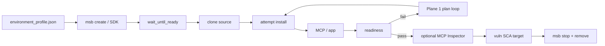

# Plane 2 — Disposable Microsandbox (explore + test)

Implementation plan for the **single disposable runtime** per job. Explore and Test are **not** separate VMs ([DECISIONS.md](DECISIONS.md) D27). Created, controlled, and destroyed **only** by the Plane 1 harness (`explore/harness.py`).

**Runtime:** [Microsandbox on Vultr VX1 Cloud Compute](https://docs.vultr.com/how-to-set-up-agent-sandboxing-on-vultr-cloud-compute) — each job gets a **microVM** (`libkrun` / KVM).

Architecture: [ARCHITECTURE.md](ARCHITECTURE.md) · Index: [IMPLEMENTATION_PLAN.md](IMPLEMENTATION_PLAN.md) · Workers: [IMPLEMENTATION_EXPLORE_SANDBOX.md](IMPLEMENTATION_EXPLORE_SANDBOX.md) · Decisions: D4, D22, D23, D27, D29

---

## Role

```
IN:  environment_profile.json  (from Plane 1 plan loop)
       │
       ▼
  Create microsandbox → clone repo → attempt install/run
       → launch chosen target → readiness probes
       │
       ▼
OUT: Running environment (or failure stdout/stderr for plan-loop retry)
     Stop + remove sandbox on job complete / fail / cancel / TTL
```

One **Microsandbox microVM per job** on a Vultr VX1 host. The host is pooled; the sandbox is ephemeral. Nothing under a monorepo `test-vm/` app folder.

---

## Host vs sandbox

| Layer | What | Lifetime |
|-------|------|----------|
| **VX1 host** | Ubuntu 24.04 Vultr VX1 with `/dev/kvm`, `msb` + `libkrunfw` (`msb doctor` green) | Pooled |
| **Plane 2 sandbox** | Named microVM from an OCI image | Per job; CPU/memory capped; destroyed with job |

Reference: Vultr [agent sandboxing guide](https://docs.vultr.com/how-to-set-up-agent-sandboxing-on-vultr-cloud-compute).

---

## Harness contract (Plane 1 → this plane)

| API | Behavior (Microsandbox) |
|-----|-------------------------|
| `create_environment(job_id, plan) → environment_id` | `msb create` / SDK `Sandbox.create`; map profile → OCI image + limits |
| `wait_until_ready(environment_id)` | Block until `running` |
| `exec(environment_id, cmd) → { stdout, stderr, exit_code }` | `msb exec` / SDK; timeouts on every call |
| `copy_in` / `copy_out` | `msb copy` host↔sandbox |
| `destroy_environment(environment_id)` | `msb stop` + `msb remove` (idempotent) |

Prefer the **SDK** from `harness.py`. Optional `microsandbox-mcp` for agent tools — destroy on ready/cancel/fail/TTL remains harness-owned (D23).

---

## Lifecycle

1. **Create** — OCI image + CPU/memory from profile (any image Microsandbox can boot — D29)
2. **Clone** — `source.url` / `source.ref` inside the sandbox
3. **Provision** — attempt `packages` / `services` / `install_commands`; **flag failures**
4. **Launch** — `mcp.launch_command` or `run_commands`
5. **Readiness** — MCP handshake (list tools) or HTTP healthcheck (Plane 1 `verify.py`)
6. **Optional MCP assessment** — when `mcp.security_assessment.enabled`, run MCP Inspector and/or SDK probes in this guest (D35); does not gate ready
7. **Scan target** — SCA / advisory scanners against this sandbox / lockfiles (D33); not CVE exploit runners
8. **Containment target** — optional adversarial probe absorbed here (D26); isolation proof only
9. **Destroy** — on `ready` / `failed` / `cancelled` / `ENV_TTL_SECONDS` / orphan reaper (`msb touch` while job still active)



---

## Constraints

| Rule | Detail |
|------|--------|
| No Killhub secrets | Control-plane / inference keys **not** in sandbox `env` by default |
| No install allowlist | Attempt profile commands; record failures — do not invent success (D29) |
| Isolation | Separate kernel; **inter-sandbox network denied by default**; no Docker socket from control plane |
| Resource caps | CPU/memory at create; wall clock via `JOB_TIMEOUT_SECONDS` / `ENV_TTL_SECONDS` |
| One VM | Explore + test are this same sandbox (D27) |
| Non-root | Prefer non-root for exec inside the sandbox |

---

## What runs in the sandbox

| Intent | Typical workload |
|--------|------------------|
| `git_mcp` | Install MCP server; launch; **MCP handshake listing tools**; optional MCP Inspector/SDK when profile plans assessment (D35) |
| `webapp` | Install app; `run_commands`; HTTP healthcheck on `ports` |
| `demo` | Agent-invented minimal showcase (D34); `run_commands` + profile probe (typically HTTP) |

---

## Implementation phases

### T0 — Host + create / destroy

- [ ] VX1 host ready: kvm group, `msb` installed, `msb doctor` passes
- [ ] Harness `create_environment` → named sandbox with CPU/memory limits
- [ ] `wait_until_ready`
- [ ] `destroy_environment` + orphan reaper
- [ ] Fail safely when host/KVM/quota unavailable

**Done when:** Harness can create and destroy a microsandbox for a job id.

### T1 — Remote exec + copy

- [ ] `exec` with stdout/stderr/exit_code + per-call timeouts
- [ ] `msb copy` (or SDK) for files in/out
- [ ] Confirm Killhub API keys absent from `env` inside the sandbox

**Done when:** Remote command runs and output returns to Plane 1.

### T2 — Profile-driven bootstrap

- [ ] Map profile `oci_image` / `os_image` / runtime → OCI defaults
- [ ] Clone `source` inside the sandbox
- [ ] Apply `install_commands` / packages / services (attempt; surface failures)
- [ ] Expose / bind ports as required for readiness

**Done when:** Fixture repo cloned and install attempted via profile.

### T3 — Launch + readiness surface (+ optional MCP assessment)

- [ ] Start MCP / webapp / demo processes per profile
- [ ] Keep process alive for Plane 1 probes (`msb touch` if idle timeout risks stop)
- [ ] Capture failure logs (`msb logs`) for repair
- [ ] When `mcp.security_assessment.enabled`: install/run MCP Inspector and/or SDK in-guest; return probe evidence to Plane 1 (D35)

**Done when:** Plane 1 can complete MCP handshake (list tools) or HTTP healthcheck against the sandbox; MCP assessment path works when profile enables it.

### T4 — Hardening

- [ ] Cross-job isolation (sibling sandboxes cannot reach each other)
- [ ] Mid-job cancel destroys sandbox
- [ ] TTL destroy after success/fail
- [ ] No secret leakage in sandbox logs / metrics

**Done when:** Failed/cancelled/TTL paths always reclaim the microVM.

---

## Configuration (via Plane 1 harness)

| Variable | Purpose |
|----------|---------|
| `VULTR_API_KEY` | Host provisioning / ops only (Plane 1); **never** in sandboxes |
| `MSB_HOST` | How harness reaches the VX1 host running `msb` |
| `MSB_DEFAULT_IMAGE` | Default OCI image when profile does not override |
| `MSB_DEFAULT_CPUS` / `MSB_DEFAULT_MEMORY` | Default resource caps |
| `ENV_TTL_SECONDS` | Auto-destroy sandbox |
| `JOB_TIMEOUT_SECONDS` | Wall clock affecting sandbox lifetime |

---

## Milestones

- [ ] **T-M0:** Create + destroy microsandbox
- [ ] **T-M1:** Remote exec (+ copy) with output
- [ ] **T-M2:** Clone + install attempts from profile
- [ ] **T-M3:** MCP/app launch reachable for readiness
- [ ] **T-M4:** Cancel/TTL/fail always destroys sandbox; sibling isolation verified

---

## Out of scope

- UI / SSE (Plane 1)
- Plan loop / profile generation / vuln AI review (Plane 1 workers)
- Private registries / GPU / long-lived sandboxes beyond TTL
- A second “Explore VM” distinct from this sandbox
- Hosting CVE exploit / generic app/web pentest tooling aimed at the submitted application (sandbox is SCA + optional MCP assessment + containment target)

---

## Definition of done

From a validated `environment_profile.json`, one Microsandbox microVM can be created, used for inspect + install + launch/readiness (+ optional MCP Inspector/SDK assessment when planned, + optional containment probe), and stopped/removed on terminal job states — without Killhub control-plane secrets in the sandbox environment or logs, and without weaponizing CVEs against the project.
