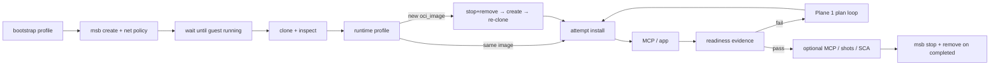

# Plane 2 — Disposable Microsandbox (explore + test)

Implementation plan for the **single disposable runtime** per job. Explore and Test are **not** separate VMs ([DECISIONS.md](DECISIONS.md) D27). Created, controlled, and destroyed **only** by the Plane 1 harness (`explore/harness.py`).

**Runtime:** [Microsandbox on Vultr VX1 Cloud Compute](https://docs.vultr.com/how-to-set-up-agent-sandboxing-on-vultr-cloud-compute) — each job gets a **microVM** (`libkrun` / KVM).

Architecture: [ARCHITECTURE.md](ARCHITECTURE.md) · Index: [IMPLEMENTATION_PLAN.md](IMPLEMENTATION_PLAN.md) · Workers: [IMPLEMENTATION_EXPLORE_SANDBOX.md](IMPLEMENTATION_EXPLORE_SANDBOX.md) · Decisions: D4, D22, D23, D27, D29

---

## Role

```
IN:  bootstrap profile (trusted) then runtime environment_profile.json
       │
       ▼
  Create microsandbox (bootstrap image + net policy)
       → clone / inspect
       → optional replace if runtime oci_image differs (still one live VM)
       → attempt install/run → launch → readiness probes
       → optional Playwright / MCP assessment / SCA target
       │
       ▼
OUT: Running environment (or failure stdout/stderr for plan-loop retry)
     Stop + remove on completed / fail / cancel / absolute expires_at
```

One **Microsandbox microVM per job** on a Vultr VX1 host. The host is pooled; the sandbox is ephemeral. Nothing under a monorepo `test-vm/` app folder.

---

## Host vs sandbox

| Layer | What | Lifetime |
|-------|------|----------|
| **VX1 host** | Ubuntu 24.04 Vultr VX1 with `/dev/kvm`, `msb` + `libkrunfw` (`msb doctor` green) | Pooled |
| **Plane 2 sandbox** | Named microVM from an OCI image | Per job; CPU/memory capped; destroyed with job |

Reference: Vultr [agent sandboxing guide](https://docs.vultr.com/how-to-set-up-agent-sandboxing-on-vultr-cloud-compute).

---

## Harness contract (Plane 1 → this plane)

| API | Behavior (Microsandbox) |
|-----|-------------------------|
| `create_environment(job_id, plan) → environment_id` | `msb create` / SDK `Sandbox.create`; map bootstrap/runtime profile → OCI image + limits + **Killhub network policy** (D39); set absolute `expires_at` |
| `replace_environment(job_id, plan) → environment_id` | Stop+remove current VM; create with new image; same job — never two concurrent (D36) |
| `wait_until_ready(environment_id)` | Block until guest `running` (not job readiness / not `completed`) |
| `exec(environment_id, cmd) → { stdout, stderr, exit_code }` | `msb exec` / SDK; timeouts on every call |
| `copy_in` / `copy_out` | `msb copy` host↔sandbox |
| `destroy_environment(environment_id)` | `msb stop` + `msb remove`; return `{ confirmed }` — false ⇒ `destroy_failed`, do not set `destroyed_at` (D57) |

Prefer the **SDK** from `harness.py`. Agent-facing MCP tools only if allowed by OpenCode lockdown (D38). Destroy on `completed` / cancel / fail / absolute expiry remains harness-owned (D23, D37, D41).

---

## Lifecycle

1. **Bootstrap create** — `MSB_DEFAULT_IMAGE` + CPU/memory defaults + Killhub network policy; absolute `expires_at` (D36, D39, D41)
2. **Clone / inspect** — `source.url` / `source.ref` inside the sandbox
3. **Optional replace** — if runtime `oci_image` differs: destroy bootstrap VM, create new image, re-clone (still one live VM — D36)
4. **Provision** — attempt `packages` / `services` / `install_commands`; **flag failures**
5. **Launch** — `mcp.launch_command` or `run_commands`
6. **Readiness** — MCP handshake (list tools) or HTTP healthcheck (Plane 1 `verify.py`) → `readiness` field only
7. **Optional MCP assessment** — when `mcp.security_assessment.enabled`, run MCP Inspector and/or SDK probes in this guest (D35); does not invalidate readiness
8. **Scan / screenshot target** — SCA against this sandbox; Playwright stills in-guest when useful (D33, D38)
9. **Containment / network probes** — adversarial absorption (D26); prove guest cannot reach Plane 1 or management endpoints (D39)
10. **Destroy** — on `completed` / `failed` / `cancelled` / absolute `expires_at` / orphan reaper. `msb touch` may keep idle guests warm **only while** `now < expires_at` — it must not extend expiry (D41)



---

## Network policy (D39) + phases (D43)

Microsandbox defaults allow public-internet egress and deny host/private/metadata. That is **not** enough when Plane 1 has a public URL.

| Requirement | Behavior |
|-------------|----------|
| Sibling isolation | Inter-sandbox traffic denied |
| Control plane | **Deny** egress to public demo hostname/IPs and Jobs API destinations |
| Management | **Deny** Microsandbox / host management endpoints reachable from the guest |
| Install egress | Allow documented package/git destinations (or tighter allowlist) **during install/provision only** |
| Verify / containment | **Detach or deny remaining egress** after install (D43); denied attempts logged as findings |
| Proof | Harness runs `network_probe` (curl/fetch to Plane 1 URL + management target must fail); stream `log.kind=network_probe` / `finding.source=network` |

Document the concrete SDK / `--net*` / `--net-rule` composition used in create here when implemented (deny-list on `public` vs strict allowlist are both allowed if they satisfy the table).

## Canaries (D44)

| Requirement | Behavior |
|-------------|----------|
| Plant | On every create/replace, write randomized canary env/files (not real Killhub secrets) |
| Scan | After probes / before destroy, check for canary use or exfil indicators |
| Evidence | Hits → high-severity `finding.source=canary` + `containment` event; never log canary plaintext in SSE |

---

## Host-side reaper (D41)

| Concern | Behavior |
|---------|----------|
| Absolute expiry | Each sandbox records `expires_at` at create; host timer/process destroys when `now >= expires_at` |
| Survives Plane 1 death | Reaper runs on VX1 independently of the control-plane process |
| Touch | `msb touch` must not move `expires_at` |
| Orphans | Destroy sandboxes with no ledger job reference after Plane 1 reconciliation |

---

## Constraints

| Rule | Detail |
|------|--------|
| No Killhub secrets | Control-plane / inference keys **not** in sandbox `env` by default; canaries only (D44) |
| No install allowlist | Attempt profile commands; record failures — do not invent success (D29) |
| Network phases | Install egress → offline/deny for verify/containment (D43) |
| Isolation | Separate kernel; **inter-sandbox network denied by default**; no Docker socket from control plane |
| Plane 2 ↛ Plane 1 | Explicit deny + probe (D39) — not only sibling isolation |
| Resource caps | CPU/memory at create; wall clock + absolute `expires_at` |
| One VM | Explore + test are this same sandbox; replace keeps one live (D27, D36) |
| Destroy finally | Emit `lifecycle` on every path including failure/cancel/expiry (D49) |
| Non-root | Prefer non-root for exec inside the sandbox |

---

## What runs in the sandbox

| Intent | Typical workload |
|--------|------------------|
| `git_mcp` | Install MCP server; launch; **MCP handshake listing tools**; optional MCP Inspector/SDK when profile plans assessment (D35) |
| `webapp` | Install app; `run_commands`; HTTP healthcheck on `ports` |
| `demo` | Agent-invented minimal showcase (D34); `run_commands` + profile probe (typically HTTP) |

---

## Implementation phases

### T0 — Host + create / destroy + reaper

- [ ] VX1 host ready: kvm group, `msb` installed, `msb doctor` passes
- [ ] Harness `create_environment` → named sandbox with CPU/memory limits + network policy + canaries + `expires_at`
- [ ] `wait_until_ready` (guest running)
- [ ] `destroy_environment` in finally + Plane 1 orphan reaper + **host-side absolute expiry reaper** (D41); emit `lifecycle`
- [ ] Fail safely when host/KVM/quota unavailable

**Done when:** Harness can create and destroy a microsandbox for a job id; host reaper kills past `expires_at` without Plane 1.

### T1 — Remote exec + copy

- [ ] `exec` with stdout/stderr/exit_code + per-call timeouts
- [ ] `msb copy` (or SDK) for files in/out
- [ ] Confirm Killhub API keys absent from `env` inside the sandbox

**Done when:** Remote command runs and output returns to Plane 1.

### T2 — Bootstrap + runtime provision (+ image replace)

- [ ] Map bootstrap → `MSB_DEFAULT_IMAGE`; map runtime `oci_image` / `os_image` / runtime → OCI
- [ ] Clone `source` inside the sandbox for inspect
- [ ] `replace_environment` when runtime image differs (D36); log `sandbox_replace`; re-plant canaries
- [ ] Apply `install_commands` / packages / services with **install-phase egress** (attempt; surface failures)
- [ ] Transition to **offline/deny-egress** before readiness/containment (D43)
- [ ] Expose / bind ports as required for readiness

**Done when:** Fixture repo cloned under bootstrap; image-change path replaces once; install attempted via runtime profile.

### T3 — Launch + readiness surface (+ optional MCP assessment / Playwright)

- [ ] Start MCP / webapp / demo processes per profile
- [ ] Keep process alive for Plane 1 probes (`msb touch` only while `now < expires_at`)
- [ ] Capture failure logs (`msb logs`) for repair
- [ ] When `mcp.security_assessment.enabled`: install/run MCP Inspector and/or SDK in-guest; return probe evidence to Plane 1 (D35)
- [ ] Ship/run in-guest `mcp_stdio_verify` for `transport=stdio` (D51)
- [ ] Optional Playwright browser in-guest for HTTP stills (D38)

**Done when:** Plane 1 can complete MCP stdio or HTTP handshake (list tools) or HTTP healthcheck; MCP assessment and in-guest screenshot paths work when enabled.

### T4 — Hardening

- [ ] Sibling isolation evidence (`sibling_access_denied`)
- [ ] Host-access deny + control-plane/management deny; `network_probe` + `host_access_denied` (D39, D58)
- [ ] Host-liveness check during adversarial probe (`host_liveness`) — timeout loop alone is not enough (D58)
- [ ] Mid-job cancel destroys sandbox (confirm-only `destroyed_at`)
- [ ] Absolute expiry destroy even if Plane 1 is down / touch is running
- [ ] No secret leakage in sandbox logs / metrics

**Done when:** Failed/cancelled/completed/expiry paths reclaim the microVM when confirmed; containment matrix complete; Plane 2 cannot call Plane 1.

---

## Configuration (via Plane 1 harness)

| Variable | Purpose |
|----------|---------|
| `VULTR_API_KEY` | Host provisioning / ops only (Plane 1); **never** in sandboxes |
| `MSB_HOST` | How harness reaches the VX1 host running `msb` |
| `MSB_DEFAULT_IMAGE` | Bootstrap / discover OCI image (D36) |
| `MSB_DEFAULT_CPUS` / `MSB_DEFAULT_MEMORY` | Default resource caps |
| `MSB_NET_POLICY` / control-plane deny list | Egress policy inputs (D39) |
| `ENV_TTL_SECONDS` | Absolute `expires_at` base (not extended by touch) |
| `JOB_TIMEOUT_SECONDS` | Wall clock affecting sandbox lifetime |

---

## Milestones

- [ ] **T-M0:** Create + destroy microsandbox; host reaper
- [ ] **T-M1:** Remote exec (+ copy) with output
- [ ] **T-M2:** Bootstrap clone + runtime install + image replace
- [ ] **T-M3:** MCP/app launch reachable for readiness; optional in-guest Playwright
- [ ] **T-M4:** Cancel/completed/expiry always destroy; sibling + Plane 1 deny verified

---

## Out of scope

- UI / SSE (Plane 1)
- Plan loop / profile generation / vuln AI review (Plane 1 workers)
- Private registries / GPU / long-lived sandboxes beyond TTL
- A second “Explore VM” distinct from this sandbox
- Hosting CVE exploit / generic app/web pentest tooling aimed at the submitted application (sandbox is SCA + optional MCP assessment + containment target)

---

## Definition of done

From a bootstrap then runtime `environment_profile.json`, one Microsandbox microVM can be created (with Killhub network policy), optionally replaced on image change, used for inspect + install + launch/readiness (+ optional MCP assessment / in-guest Playwright / containment + network probes), and stopped/removed on `completed` / fail / cancel / absolute expiry — without Killhub secrets in the guest, without Plane 2 reaching Plane 1, and without weaponizing CVEs against the project.
