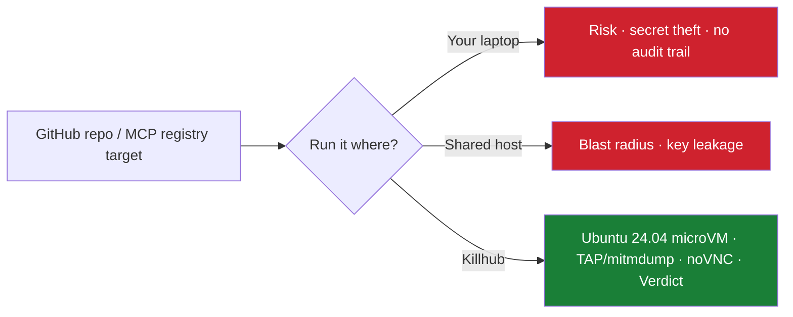
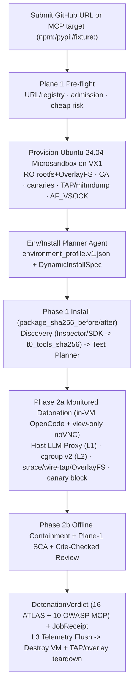
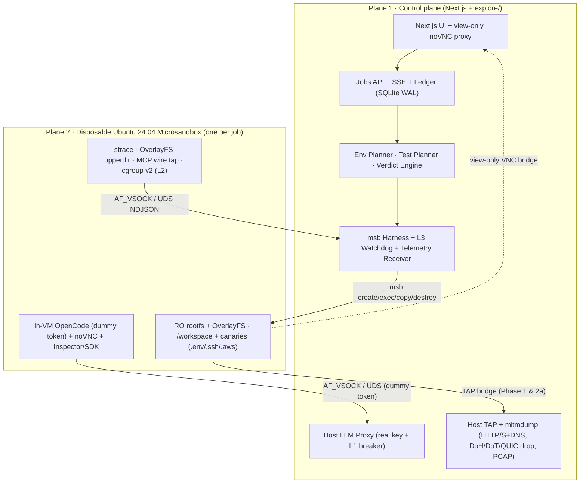
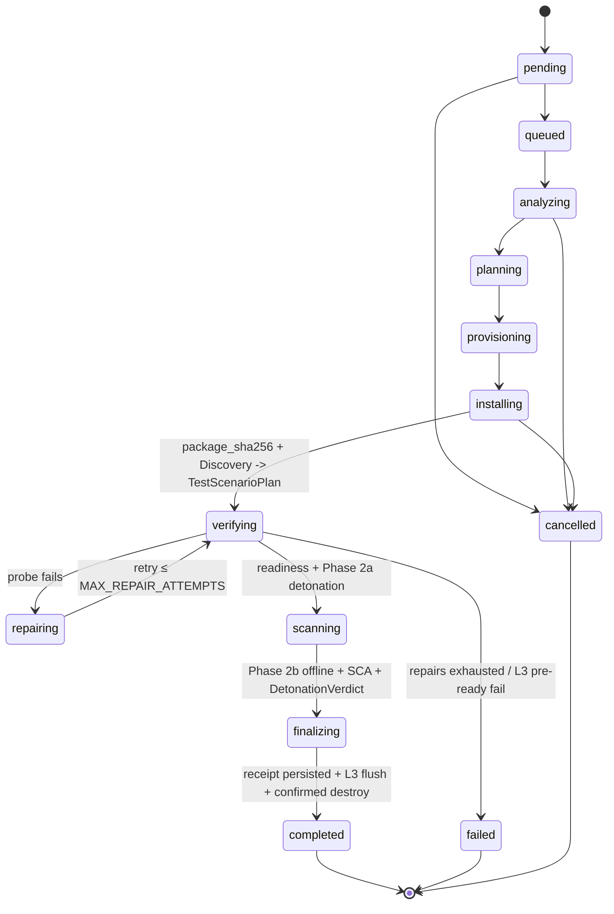

# Killhub

**Paste a public GitHub URL or MCP registry target. Watch live in-VM detonation over view-only `noVNC` — and get a verified environment, a cross-framework `DetonationVerdict`, and a receipt that outlives the sandbox.**

Killhub stands up and detonates untrusted repositories and MCP servers the way a security-minded operator should: understand first, isolate inside an Ubuntu 24.04 microVM, intercept every HTTP/S, DNS, syscall, and MCP JSON-RPC boundary, prove readiness and containment, and destroy the machine while leaving a durable forensic dossier.

Built on **Vultr** end-to-end — Cloud Compute control plane, [Serverless Inference](https://docs.vultr.com/products/serverless/inference/provisioning) (with Plane 1 Host LLM Proxy key isolation), and [Microsandbox](https://docs.vultr.com/how-to-set-up-agent-sandboxing-on-vultr-cloud-compute) microVMs on VX1 for untrusted execution.

---

## The problem

Running a stranger’s GitHub repo or third-party MCP server is slow, brittle, and dangerous on a shared laptop or production host: tool poisoning, indirect prompt injection, post-install backdoors, credential harvesting, and infinite agent loops can compromise keys or exhaust the host.

Killhub exists so you can **understand**, **isolate**, **detonate & observe**, and **leave a receipt** — without trusting the target with your API keys or your machine.

---

## What you get

| Outcome | Meaning |
|---------|---------|
| **Live job & view-only `noVNC`** | Real-time status, progress, sensor telemetry, and an authenticated **view-only `noVNC`** stream of in-VM OpenCode detonation — no refresh required (`D71`) |
| **`environment_profile.json` & `DynamicInstallSpec`** | Versioned runtime & Ubuntu 24.04 provisioning contracts (`schemas/environment_profile.v1.json`, `schemas/dynamic_install_spec.v1.json`) |
| **Discovery & `TestScenarioPlan`** | `@modelcontextprotocol/inspector --cli --format json` (+ Python MCP SDK fallback) feeding the Plane 1 Test-Planner Agent (`schemas/test_scenario_plan.v1.json`, `D73`) |
| **Honest label** | `original_application` · `generated_demo` (with visible `original_failure`) · `setup_failed` (`D54`) |
| **Readiness & integrity hashes** | MCP handshake (`tools/list`, `t0_tools_sha256` vs `final_tools_sha256`, `tool_diffs`) + `package_sha256_before`/`after` + HTTP/command probes (`D30`, `D62`, `D73`) |
| **Canonical `DetonationVerdict` & receipt** | `schemas/detonation_verdict.v1.json` + `JobReceipt`: Plane-1 SCA + cite-checked `vuln_review` + runtime findings mapped across all **16 MITRE ATLAS tactics (`AML.TA0000`–`AML.TA0015`)** and **OWASP MCP Top 10 (`MCP01:2025`–`MCP10:2025`)** |
| **Containment & 3-Layer Kill Switch proof** | L1 LLM Proxy breaker (`12` turns / `60k` tokens / oscillation→`429`), L2 guest cgroup v2 (`512M` / `0` swap / `64` pids), L3 watchdog flush + teardown; 4-axis containment + key-isolation verification (`D58`, `D71`, `D72`) |

Optional Playwright stills run in-guest for HTTP webapps and never gate completion (`D31`).

---

## How it works

One GitHub URL or MCP registry target in. One disposable Ubuntu 24.04 microVM. One durable `DetonationVerdict` + receipt out.

**Jobs are server-owned (`D12`, `D41`).** Close the tab — the pipeline keeps running. Reopen `/jobs/{id}` to resume. Only `DELETE /api/jobs/{id}` or timeout/watchdog stops a job.

---

## Architecture at a glance

Two planes. Hard boundary. Real Vultr secrets never enter Plane 2.

| Plane | What it is | Owns |
|------:|------------|------|
| **1** | Next.js + `explore/` workers on Vultr Cloud Compute | UI, Jobs API/SSE, authenticated view-only `noVNC` proxy, durable SQLite WAL ledger, Env/Install Planner, Test Planner, Cite-Checked Reviewer & Verdict synthesizer, Host LLM Proxy (`VULTR_INFERENCE_API_KEY`), Host TAP/`mitmdump`/PCAP interceptor, L3 watchdog, `AF_VSOCK`/UDS receiver |
| **2** | One Ubuntu 24.04 Microsandbox microVM per job on VX1 | Untrusted clone/install/discovery/detonation/test, victim OpenCode (dummy bearer token only), `noVNC`, `@modelcontextprotocol/inspector` + SDK, guest sensors (`strace`, OverlayFS `upperdir`, MCP wire tap, cgroup v2 L2 caps), optional Playwright stills |

There is **no** separate Explore VM vs Test VM (`D27`).

### Trust zones & Key Isolation (`D42`, `D71`)

- **Control-plane keys stay on Plane 1:** Guest `/proc/*/environ`, `/home/agent/.config/opencode/`, and `/home/agent/.local/share/opencode/opencode.db` hold only a per-job ephemeral dummy bearer token (`kh_proxy_*`) pointing to the Plane 1 Host LLM Proxy over `AF_VSOCK`/UDS/`mgmt0`.
- **Host TAP + `mitmdump`:** Intercepts HTTP/S (`mitmproxy` CA baked in guest) and DNS, drops DoH/DoT/QUIC (`UDP/443`, `TCP/853`), captures optional PCAPs, and **blocks canary exfiltration in real time** (`D70`).
- **Guest → Plane 1 / `msb` mgmt / siblings:** Denied and probe-tested with positive controls (`D39`, `D65`).

---

## Job lifecycle

Readiness is **evidence**, not a destroy trigger (`D37`). The sandbox dies only on `completed` / `failed` / `cancelled` / Layer 3 watchdog / absolute TTL — even if the control plane restarts (`D41`, `D72`).

---

## Baseline golden fixtures & 6 Demo Malicious MCP Scenarios (`D53`, `D73`)

Pinned SHAs and fixture specs live in [plan/10b-pin-fixtures.md](plan/10b-pin-fixtures.md).

### Baseline v1 golden fixtures

| Outcome | Repo |
|---------|------|
| `webapp` → `original_application` | [heroku/node-js-getting-started](https://github.com/heroku/node-js-getting-started) |
| `git_mcp` filesystem (stdio) | [modelcontextprotocol/servers](https://github.com/modelcontextprotocol/servers) |
| Controlled `setup_failed` + SCA | Deliberately broken fixture (not NodeGoat) |

### 6 Demo Malicious MCP Scenarios (DVMCP + targeted fixtures)

| # | Scenario | Catching Sensors & Tactics |
|---|----------|----------------------------|
| **1** | **Indirect prompt injection via GitHub issue** | `mcp_wire_tap`, `mitmdump_http`, `mitmdump_dns`, `canary_monitor` (`AML.TA0004`, `AML.TA0010`; `MCP06:2025`) |
| **2** | **Delayed tool obfuscation / rug pull** | `t0_tools_sha256` ≠ `final_tools_sha256`, `tool_diffs`, `mcp_wire_tap` (`AML.TA0001`, `AML.TA0008`; `MCP03:2025`) |
| **3** | **Post-install modified package backdoor** | `package_sha256_before` ≠ `after`, OverlayFS `upperdir`, `strace`, `mitmdump_http` (`AML.TA0003`, `AML.TA0006`; `MCP04:2025`, `MCP09:2025`) |
| **4** | **Host microVM credential exfiltration via OpenCode tools & `opencode.db`** | `strace` (`openat`), `opencode_db_audit`, `canary_monitor`, `mitmdump` real-time block, Host LLM Proxy key-isolation check (`AML.TA0009`, `AML.TA0010`, `AML.TA0013`; `MCP01:2025`, `MCP05:2025`) |
| **5** | **External manipulation of a clean MCP server via tool drift / shadowing** | `tool_diffs`, `mcp_wire_tap`, `mitmdump_http`/`dns`, `strace` (`AML.TA0008`, `AML.TA0014`, `AML.TA0015`; `MCP03:2025`, `MCP06:2025`) |
| **6** | **Resource exhaustion via infinite agent loop** | **3-Layer Kill Switch:** L1 LLM Proxy (`12` turns / `60k` tokens / oscillation→`429`), L2 cgroup v2 (`512M` / `0` swap / `64` pids), L3 watchdog flush (`AML.TA0011`; `MCP08:2025`, `MCP10:2025`) |

---

## Docs, Schemas & Roadmap

| Doc / Dir | Purpose |
|-----------|---------|
| [PRODUCT.md](PRODUCT.md) | Product intent & non-goals |
| [AGENTS.md](AGENTS.md) | Binding agent rules (incl. R2 inline code docs & module frontmatter) |
| [ARCHITECTURE.md](ARCHITECTURE.md) | Two planes, trust zones, IPC, key isolation, 3-layer kill switch |
| [DECISIONS.md](DECISIONS.md) | Locked technical choices (`D1`–`D74`) |
| [DATABASE.md](DATABASE.md) | SQLite v1/v2 ledger, ATLAS/OWASP mapping tables, `DetonationVerdict` |
| [API.md](API.md) | Jobs API, SSE, `/novnc`, `/verdict`, `/telemetry`, `/pcap`, Host LLM Proxy |
| [ALIGNMENT_PLAN.md](ALIGNMENT_PLAN.md) | Reconciliation matrix, model-selection plan (`D74`), mitigations, teammate handoffs |
| `schemas/*.json` | Draft 2020-12 contracts (`environment_profile`, `dynamic_install_spec`, `test_scenario_plan`, `detonation_verdict`) |
| [IMPLEMENTATION_PLAN.md](IMPLEMENTATION_PLAN.md) | Milestone index & plane map |
| [IMPLEMENTATION_NEXTJS.md](IMPLEMENTATION_NEXTJS.md) | Plane 1 UI, `noVNC` proxy, Verdict/Report UI |
| [IMPLEMENTATION_EXPLORE_SANDBOX.md](IMPLEMENTATION_EXPLORE_SANDBOX.md) | Plane 1 agents, Host LLM Proxy, TAP/`mitmdump`, `AF_VSOCK` telemetry, harness |
| [IMPLEMENTATION_TEST_VM.md](IMPLEMENTATION_TEST_VM.md) | Plane 2 Ubuntu 24.04 microVM spec, mounts/seeds, sensors, 6 demo scenarios |

### API surface

| Method | Path | Purpose |
|--------|------|---------|
| `POST` | `/api/jobs` | Create job (`github_url` or MCP registry/fixture ref) → `{ job_id }` |
| `GET` | `/api/jobs/{id}` | Snapshot (incl. `detonation_verdict`, `novnc`) |
| `GET` | `/api/jobs/{id}/events` | SSE stream (replays contiguous window + live tail) |
| `GET / WS` | `/api/jobs/{id}/novnc` | Authenticated **view-only `noVNC`** stream (`D71`) |
| `GET` | `/api/jobs/{id}/verdict` | Full **`DetonationVerdict`** JSON (`schemas/detonation_verdict.v1.json`) |
| `GET` | `/api/jobs/{id}/telemetry` | Bounded sensor counters & redacted NDJSON slice |
| `GET` | `/api/jobs/{id}/pcap` | Captured TAP bridge PCAP (`application/vnd.tcpdump.pcap`) |
| `GET` | `/api/jobs/{id}/screenshots` | Optional Playwright still timeline |
| `DELETE` | `/api/jobs/{id}` | Cancel + flush + destroy |
| `GET` | `/health` | Control-plane liveness |

Full contracts: [API.md](API.md). Configuration and admission caps: [IMPLEMENTATION_PLAN.md](IMPLEMENTATION_PLAN.md).

---

## Out of scope (v1)

Private repos / OAuth · multi-user billing · long-lived customer sandboxes · GPU · auto-patch CVEs · weaponizing CVEs / generic web exploit suites · non-Vultr clouds · alternate agent LLM providers · persistent full-session video recordings (live view-only `noVNC` and optional Playwright stills are in scope) · separate Explore vs Test VM · install allowlists that block runnable commands

---

## Definition of done (v1)

A user submits a public GitHub URL or MCP registry target and, without refreshing, sees live status, view-only `noVNC` detonation, live `mitmdump`/`strace`/wire-tap/kill-switch telemetry, validated specs (`environment_profile.json`, `DynamicInstallSpec`, `TestScenarioPlan`), verifiable readiness with an honest label, and a durable `JobReceipt` + `DetonationVerdict` mapped across all 16 MITRE ATLAS tactics and OWASP MCP Top 10 — while one Ubuntu 24.04 Microsandbox absorbs the work and is destroyed cleanly without `VULTR_*` keys ever entering Plane 2.
