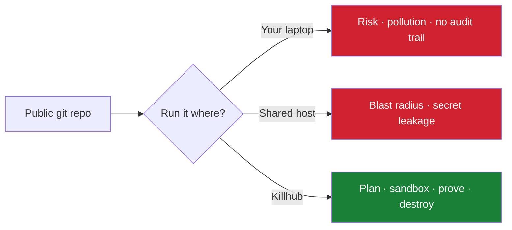
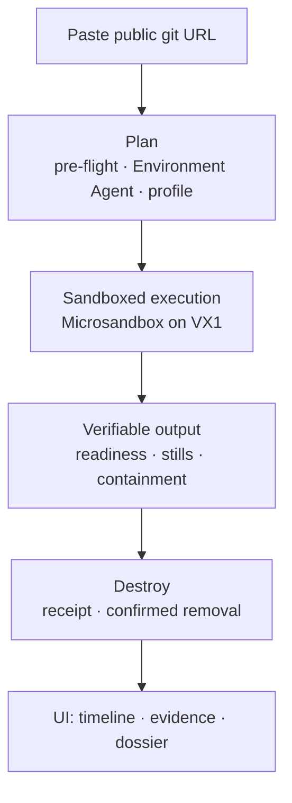
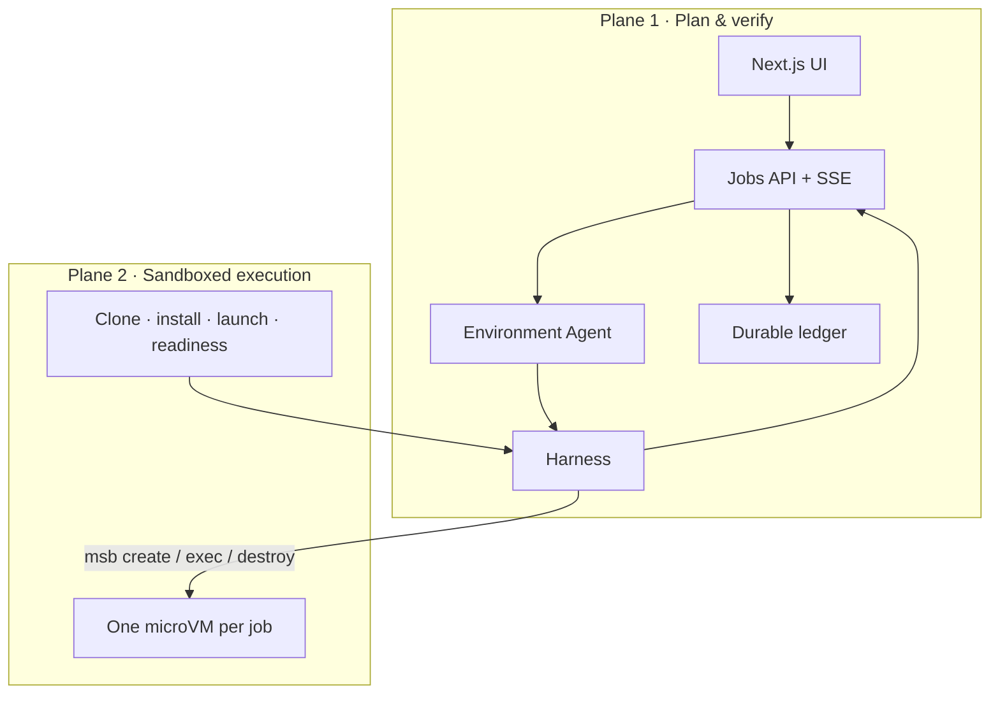
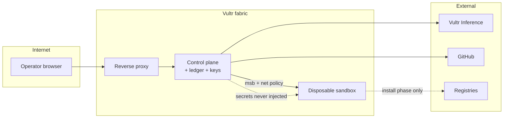
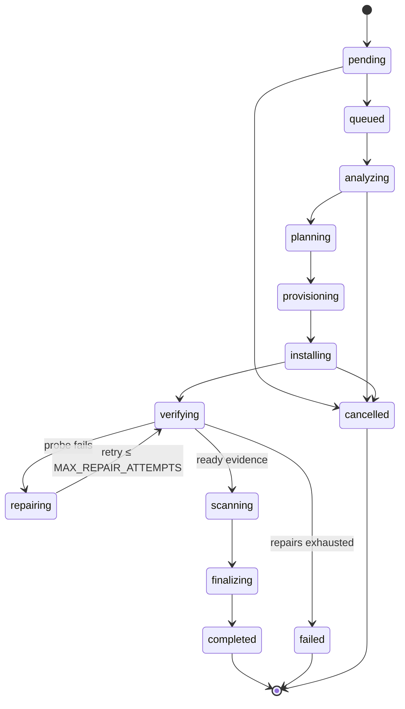
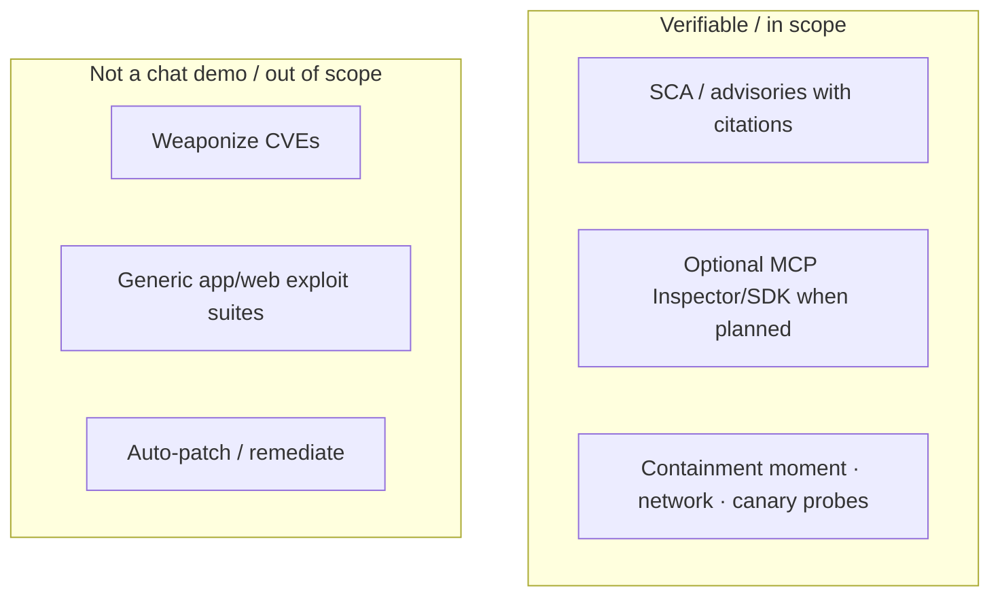

# Killhub

**Plan → sandboxed execution → verifiable output → destroy.**

**Try it live → [https://killhub.pro](https://killhub.pro)**

Paste a public git URL — or for GitHub, open `killhub.pro/{owner}/{repo}`. Killhub’s agent **plans** how to bring the repo up, **executes** real install/launch work inside a disposable Vultr Microsandbox, returns **verifiable output** (readiness, stills, containment), then **destroys** the VM — leaving a durable receipt. An agent that only chats is a demo; an agent that executes safely is a product.

Built on **Vultr** end-to-end — Cloud Compute control plane, [Serverless Inference](https://docs.vultr.com/products/serverless/inference/provisioning) for the agent, [Microsandbox](https://docs.vultr.com/how-to-set-up-agent-sandboxing-on-vultr-cloud-compute) microVMs for untrusted code.

---

## Try Killhub

1. Open **[killhub.pro](https://killhub.pro)**
2. Start a scan either way:
   - Paste a **public** git HTTPS URL (`github.com`, `gitlab.com`, `bitbucket.org`, or `codeberg.org`), or
   - For GitHub, open a short path: `https://killhub.pro/{owner}/{repo}`  
     Example: [killhub.pro/heroku/node-js-getting-started](https://killhub.pro/heroku/node-js-getting-started) → scans `https://github.com/heroku/node-js-getting-started`
3. Watch the Pattern A loop: plan → sandboxed execution → verifiable output → destroy

Public demo is anonymous and admission-limited (rate / concurrency / queue). Prefer small getting-started or MCP repos for a first run.

---

## The problem

Bringing up a stranger’s git repo is slow, brittle, and unsafe on a shared laptop or production host — and a chat agent that only *describes* a run is not proof.



Killhub exists so you can **plan**, **execute in isolation**, **prove**, and **destroy** — without trusting the repo with your keys or your machine.

---

## What you get

| Outcome | Meaning |
|---------|---------|
| **Plan** | Versioned `environment_profile.json` — how Killhub decided to demo the repo |
| **Sandboxed execution** | Real clone / install / launch in one disposable microVM |
| **Verifiable output** | Readiness evidence · optional screenshots · honest `verification.kind` |
| **Containment moment** | ∞ loop / hostile egress absorbed inside the sandbox |
| **Destroy + receipt** | Confirmed VM removal; cited SCA + dossier outlive the sandbox |

Screenshots appear when they add signal. They never gate completion.

---

## How it works

Pattern A on Vultr: one public URL in → real sandboxed work → evidence out → VM gone.



Bootstrap comes **before** runtime-profile discovery ([DECISIONS.md](DECISIONS.md) D36).

**Jobs are server-owned.** Close the tab — the pipeline keeps running. Reopen `/jobs/{id}` to resume. Only cancel or timeout stops a job.

**GitHub short path:** `https://killhub.pro/{owner}/{repo}` (e.g. `/heroku/node-js-getting-started`) client-side starts a scan of `https://github.com/{owner}/{repo}` and lands on `/jobs/{id}`. History stays at `/repos/github.com/{owner}/{repo}`.

---

## Architecture at a glance

Two planes implementing Pattern A. Hard boundary. Secrets stay on the control plane.



| Plane | Pattern A role | Owns |
|------:|----------------|------|
| **1** | Plan + verify + destroy orchestration | Next.js + `explore/` on Vultr Cloud Compute — UI, Jobs API/SSE, agent, harness, receipt, secrets |
| **2** | Sandboxed execution | One Microsandbox microVM per job on VX1 — untrusted clone/install/run (explore and test share the same VM) |

There is **no** separate Explore VM vs Test VM.

### Trust zones



Sandbox → control plane is **denied**. Real Killhub secrets never enter the guest (canaries only). After verifiable output, Plane 1 confirms **destroy** — the dossier stays on the ledger.

---

## Job lifecycle

Statuses map onto the Pattern A loop: **plan** (`analyzing` / `planning`) → **sandboxed execution** (`provisioning` / `installing`) → **verifiable output** (`verifying` ⇄ `repairing` / `scanning`) → **destroy** (`finalizing` → terminal).



Readiness is **verifiable output**, not a destroy trigger. The sandbox dies on `completed` / fail / cancel / absolute TTL — even if the control plane restarts.

---

## Security story (in one picture)

Containment-first: show the sandbox absorbing something unsafe, then destroy it. Chat without execution is out of scope.



Untrusted code never runs as a privileged control-plane process. OpenCode only sees harness tools. Plane 2 network policy is probe-tested. Secrets never enter the guest.

---

## Vultr-native stack

Vultr is the control and execution fabric — not static hosting.

| Layer | Pattern A role | Where |
|-------|----------------|-------|
| Public demo | Plan / verify UI + API | **[https://killhub.pro](https://killhub.pro)** — Vultr Cloud Compute behind HTTPS reverse proxy (app on `127.0.0.1`) |
| Agent reasoning | Plan | Vultr Serverless Inference (`api.vultrinference.com`) |
| Untrusted execution | Sandboxed execution | Microsandbox on Vultr VX1 — one microVM per job |
| Local dev | Plane 1 only | `docker-compose` for control plane; sandboxes still provisioned on VX1 |

---

## Golden fixtures (v1)

Pinned commits live in fixture config ([DECISIONS.md](DECISIONS.md) D53). Use these to demo the full loop end-to-end.

| Verifiable outcome | Repo |
|---------|------|
| `webapp` → `original_application` | [heroku/nodejs-getting-started](https://github.com/heroku/nodejs-getting-started) |
| `git_mcp` filesystem (stdio) | [modelcontextprotocol/servers](https://github.com/modelcontextprotocol/servers) |
| Controlled `setup_failed` + SCA | Deliberately broken fixture (not NodeGoat) |

---

## Who it’s for

Operators, security-minded engineers, and builders of agentic apps who need **executed** bring-up of public git repos (MCP servers, webapps, oddball content) — with a plan, a sandbox, verifiable output, and confirmed destroy — not a narrative that pretends the work ran.

---

## Quick start

**Use the product:** [https://killhub.pro](https://killhub.pro)

**Use it from an MCP client (Cursor / Claude):** stdio `explore/operator_mcp.py` or HTTP `https://killhub.pro/mcp` (D81). Prefer `create_and_wait` / `get_receipt` / `run_fixture`; same public Jobs API as the UI. See [API.md](API.md)#operator-mcp-d81.

```bash
cd explore
.venv/bin/python -m operator_mcp   # KILLHUB_BASE_URL=https://killhub.pro by default
```

**Run / deploy on Vultr:** [SETUP.md](SETUP.md) — local Plane 1, VX1 Microsandbox, inference keys, reverse proxy, and verification.

**Hack on the repo:**

1. Read [PRODUCT.md](PRODUCT.md) — *what* and *why*
2. Read [ARCHITECTURE.md](ARCHITECTURE.md) — planes, trust zones, lifecycle
3. Read [AGENTS.md](AGENTS.md) — agent rules, quality gate, Vultr/`msb` tooling
4. Follow [SETUP.md](SETUP.md) — copy [`.env.example`](.env.example) → `.env` (never commit secrets)

---

## Docs

| Doc | Purpose |
|-----|---------|
| [SETUP.md](SETUP.md) | Run / deploy on Vultr (local + production-style) |
| [PRODUCT.md](PRODUCT.md) | Product intent |
| [AGENTS.md](AGENTS.md) | Rules for AI agents working in this repo |
| [ARCHITECTURE.md](ARCHITECTURE.md) | Two planes, trust zones, data flow |
| [DECISIONS.md](DECISIONS.md) | Locked technical choices |
| [DATABASE.md](DATABASE.md) | Job / receipt model |
| [API.md](API.md) | Jobs API + SSE contracts |
| [explore/fixtures/m7.json](explore/fixtures/m7.json) | Pinned M7 fixture SHAs (D53) |

### API surface

| Method | Path | Purpose |
|--------|------|---------|
| `GET` | `/api/jobs` | Recent job summaries (feed; `?limit=&offset=`) |
| `POST` | `/api/jobs` | Create `{ github_url }` → `{ job_id }` |
| `GET` | `/api/jobs/{id}` | Snapshot |
| `GET` | `/api/jobs/{id}/events` | SSE stream |
| `GET` | `/api/jobs/{id}/events/recent` | Last N durable events (MCP `tail_events`) |
| `GET` | `/api/jobs/{id}/screenshots` | Timeline (may be empty) |
| `DELETE` | `/api/jobs/{id}` | Cancel + destroy |
| `POST`/`GET` | `/mcp` | Operator MCP JSON-RPC (D81) |
| `GET` | `/health` | Liveness |

Full contracts: [API.md](API.md). Config and admission caps: [ARCHITECTURE.md](ARCHITECTURE.md) · [`.env.example`](.env.example).

---

## Out of scope (v1)

Private repos / OAuth · multi-user billing · long-lived customer sandboxes · GPU · auto-patch CVEs · weaponizing exploits · non-Vultr clouds · alternate agent LLM providers · session video · separate Explore vs Test VM · install allowlists that block runnable commands

---

## Definition of done

On **[killhub.pro](https://killhub.pro)** (or a local control plane), a user pastes a public git URL (or opens `/{owner}/{repo}` for GitHub) and sees the Pattern A loop without refreshing: **plan** (profile) → **sandboxed execution** → **verifiable output** (readiness / stills / containment) → **destroy** with a durable receipt — Killhub secrets never enter the guest.
