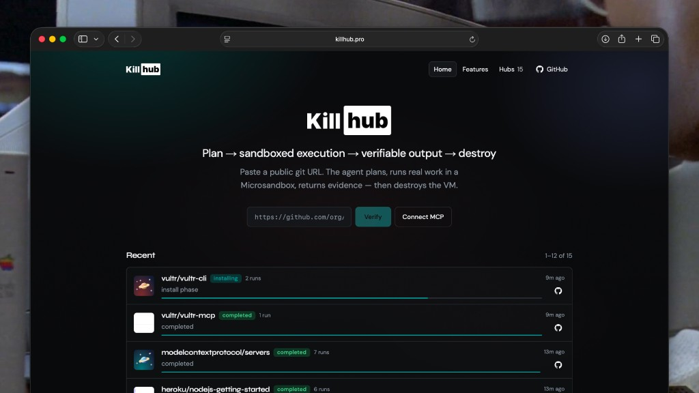
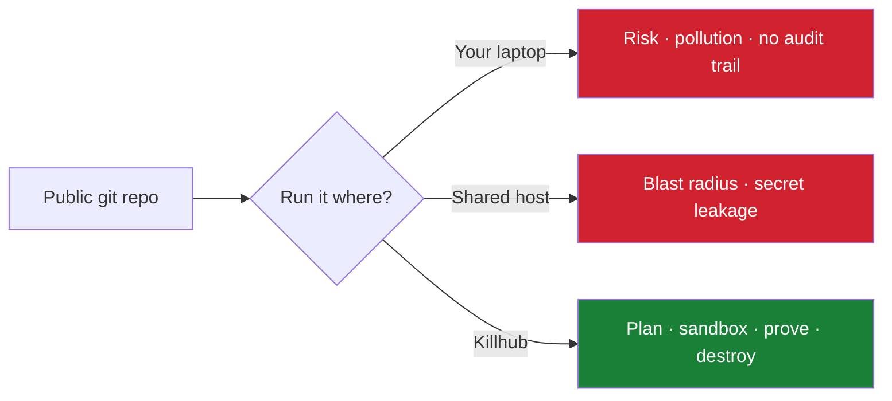
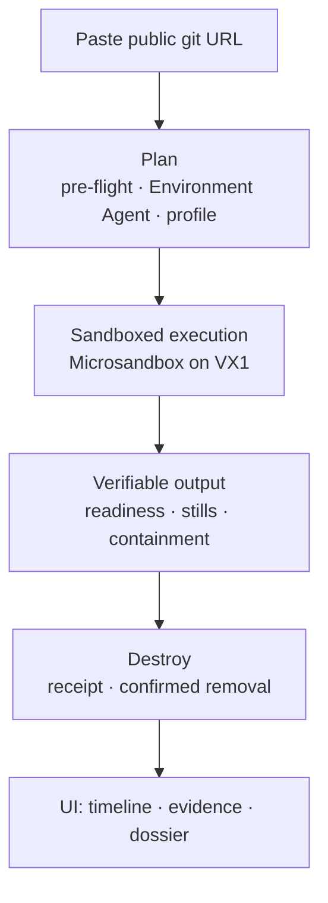
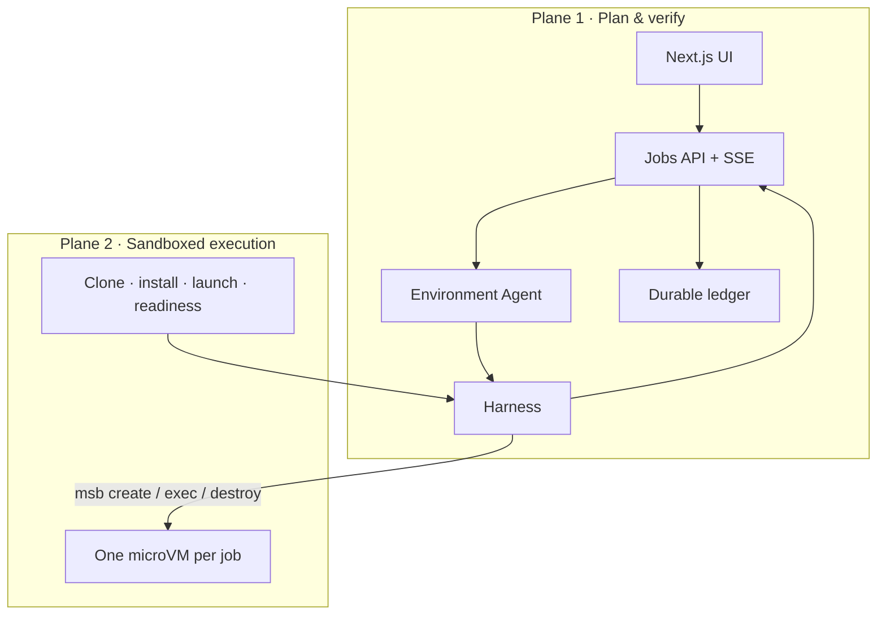

<p align="center">
  <a href="https://killhub.pro">
    
  </a>
</p>

# Killhub

**Plan → sandboxed execution → verifiable output → destroy.**

**Try it live → [https://killhub.pro](https://killhub.pro)**

Paste a public git URL — or for GitHub, open `killhub.pro/{owner}/{repo}`. Killhub’s agent **plans** how to bring the repo up, **executes** real install/launch work inside a disposable Vultr Microsandbox, returns **verifiable output** (readiness, stills, containment), then **destroys** the VM — leaving a durable receipt. An agent that only chats is a demo; an agent that executes safely is a product.

Built on **Vultr** end-to-end — Cloud Compute control plane, [Serverless Inference](https://docs.vultr.com/products/serverless/inference/provisioning) for the agent, [Microsandbox](https://docs.vultr.com/how-to-set-up-agent-sandboxing-on-vultr-cloud-compute) microVMs for untrusted code.

---

## Try Killhub

1. Open **[killhub.pro](https://killhub.pro)**
2. Start a scan either way:
   - Paste a **public** git HTTPS URL (`github.com`, `gitlab.com`, `bitbucket.org`, or `codeberg.org`), or
   - For GitHub, open a short path: `https://killhub.pro/{owner}/{repo}`  
     Example: [killhub.pro/heroku/node-js-getting-started](https://killhub.pro/heroku/node-js-getting-started) → scans `https://github.com/heroku/node-js-getting-started`
3. Watch the Pattern A loop: plan → sandboxed execution → verifiable output → destroy

Public demo is anonymous and admission-limited (rate / concurrency / queue). Prefer small getting-started or MCP repos for a first run.

---

## The problem

Bringing up a stranger’s git repo is slow, brittle, and unsafe on a shared laptop or production host — and a chat agent that only *describes* a run is not proof.



Killhub exists so you can **plan**, **execute in isolation**, **prove**, and **destroy** — without trusting the repo with your keys or your machine.

---

## What you get

| Outcome | Meaning |
|---------|---------|
| **Plan** | Versioned `environment_profile.json` — how Killhub decided to demo the repo |
| **Sandboxed execution** | Real clone / install / launch in one disposable microVM |
| **Verifiable output** | Readiness evidence · optional screenshots · honest `verification.kind` |
| **Containment moment** | ∞ loop / hostile egress absorbed inside the sandbox |
| **Destroy + receipt** | Confirmed VM removal; cited SCA + dossier outlive the sandbox |

Screenshots appear when they add signal. They never gate completion.

---

## How it works

Pattern A on Vultr: one public URL in → real sandboxed work → evidence out → VM gone.



Bootstrap comes **before** runtime-profile discovery ([DECISIONS.md](DECISIONS.md) D36). Jobs are **server-owned** — close the tab and reopen `/jobs/{id}` to resume. Only cancel or timeout stops a job.

**GitHub short path:** `https://killhub.pro/{owner}/{repo}` client-side starts a scan and lands on `/jobs/{id}`. History stays at `/repos/github.com/{owner}/{repo}`.

Planes, trust zones, job status machine, and security story: **[ARCHITECTURE.md](ARCHITECTURE.md)**. Request path and modules: **[docs/CODEMAP.md](docs/CODEMAP.md)**. HTTP/SSE contracts: **[API.md](API.md)**.

---

## Architecture at a glance

Two planes. Hard boundary. Secrets stay on the control plane.



| Plane | Pattern A role | Owns |
|------:|----------------|------|
| **1** | Plan + verify + destroy orchestration | Next.js + `explore/` — UI, Jobs API/SSE, agent, harness, receipt, secrets |
| **2** | Sandboxed execution | One Microsandbox microVM per job — untrusted clone/install/run (explore and test share the same VM) |

There is **no** separate Explore VM vs Test VM. Full trust-zone matrix and lifecycle: [ARCHITECTURE.md](ARCHITECTURE.md).

---

## Vultr-native stack

| Layer | Where |
|-------|-------|
| Public demo | **[https://killhub.pro](https://killhub.pro)** — Vultr Cloud Compute behind HTTPS reverse proxy (app on `127.0.0.1`) |
| Agent reasoning | Vultr Serverless Inference (`api.vultrinference.com`) |
| Untrusted execution | Microsandbox on Vultr VX1 — one microVM per job |
| Local Plane 1 | Native `pnpm dev` + `python -m main`, or `docker compose` (production-style Next) — sandboxes still need `msb` on VX1 |

---

## Golden fixtures (v1)

Pinned commits: [explore/fixtures/m7.json](explore/fixtures/m7.json) (D53).

| Verifiable outcome | Repo |
|---------|------|
| `webapp` → `original_application` | [heroku/nodejs-getting-started](https://github.com/heroku/nodejs-getting-started) (alias `node-js-getting-started`) |
| `git_mcp` filesystem (stdio) | [modelcontextprotocol/servers](https://github.com/modelcontextprotocol/servers) |
| Controlled `setup_failed` + SCA | Deliberately broken fixture (not NodeGoat) |

---

## Quick start

**Use the product:** [https://killhub.pro](https://killhub.pro)

**Use it from an MCP client (Cursor / Claude):** stdio `explore/operator_mcp.py` or HTTP `https://killhub.pro/mcp` (D81). Prefer `create_and_wait` / `get_receipt` / `run_fixture`. See [API.md](API.md)#operator-mcp-d81.

```bash
cd explore
.venv/bin/python -m operator_mcp   # KILLHUB_BASE_URL=https://killhub.pro by default
```

**Hack on the repo (native DX):**

1. Read [PRODUCT.md](PRODUCT.md) · [ARCHITECTURE.md](ARCHITECTURE.md) · [CONTRIBUTING.md](CONTRIBUTING.md)
2. Copy [`.env.example`](.env.example) → `.env` (never commit secrets)
3. Follow [SETUP.md](SETUP.md) §4A + **§5 pipeline flags** — without `MSB_AUTO_CREATE` / `*_ON_CLAIM`, jobs will not progress
4. `cd explore && .venv/bin/python -m main` and `cd frontend && pnpm dev`

`docker compose up --build` is a production-style control-plane path, not the fastest UI iteration loop. Plane 2 still requires Microsandbox/`msb` ([SETUP.md](SETUP.md) §6).

**Deploy on Vultr:** [SETUP.md](SETUP.md).

---

## Docs

| Doc | Purpose |
|-----|---------|
| [PRODUCT.md](PRODUCT.md) | Product intent |
| [ARCHITECTURE.md](ARCHITECTURE.md) | Two planes, trust zones, plan loop, lifecycle |
| [docs/CODEMAP.md](docs/CODEMAP.md) | Where code lives / how a request flows |
| [docs/GLOSSARY.md](docs/GLOSSARY.md) | Shared terms |
| [CONTRIBUTING.md](CONTRIBUTING.md) | Contributor workflow + quality gate |
| [AGENTS.md](AGENTS.md) | Binding rules for AI agents |
| [DECISIONS.md](DECISIONS.md) | Locked technical choices (index at top) |
| [DATABASE.md](DATABASE.md) | Job / receipt model |
| [API.md](API.md) | Jobs API + SSE + Operator MCP |
| [SETUP.md](SETUP.md) | Run / deploy on Vultr |
| [explore/fixtures/m7.json](explore/fixtures/m7.json) | Pinned M7 fixture SHAs (D53) |

Public API cheat sheet and full contracts: [API.md](API.md). Config: [`.env.example`](.env.example).

---

## Out of scope (v1)

Private repos / OAuth · multi-user billing · long-lived customer sandboxes · GPU · auto-patch CVEs · weaponizing exploits · non-Vultr clouds · alternate agent LLM providers · session video · separate Explore vs Test VM · install allowlists that block runnable commands

---

## Definition of done

On **[killhub.pro](https://killhub.pro)** (or a local control plane), a user pastes a public git URL (or opens `/{owner}/{repo}` for GitHub) and sees the Pattern A loop without refreshing: **plan** (profile) → **sandboxed execution** → **verifiable output** (readiness / stills / containment) → **destroy** with a durable receipt — Killhub secrets never enter the guest.
