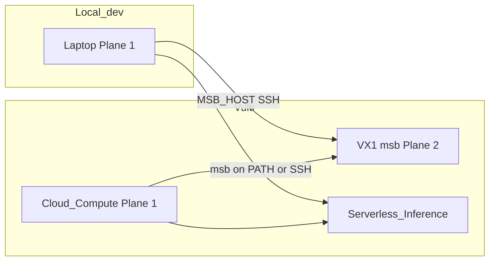

# Killhub setup (Vultr)

Operator runbook for running Killhub yourself. Product overview stays in [README.md](README.md); this page is how to stand up Plane 1 + Plane 2 on Vultr.

Two supported topologies ([ARCHITECTURE.md](ARCHITECTURE.md)):

| Path | Plane 1 (UI + explore) | Plane 2 (Microsandbox) | Inference |
|------|------------------------|------------------------|-----------|
| **Local + remote VX1** | Laptop (`docker-compose` or native) | Vultr VX1 via `MSB_HOST` SSH | Vultr Serverless Inference |
| **Vultr demo host** | Cloud Compute on `127.0.0.1` behind HTTPS (D46) | `msb` on PATH (same host) or SSH to VX1 | Same |

Control plane and VX1 may be the same machine or split. Sandboxes are always real Microsandbox microVMs — never Docker-as-Plane-2 ([DECISIONS.md](DECISIONS.md) D59).



---

## 1. Prerequisites

### Accounts

- **Vultr** account with:
  - Cloud Compute (and/or VX1) for the control plane and/or Microsandbox host
  - [Serverless Inference](https://docs.vultr.com/products/serverless/inference/provisioning) subscription — API key + a chat/text model id (D25)
- Optional: [vultr-cli](https://docs.vultr.com/platform/getting-started/vultr-cli) + Account API key for host inventory/mutations (operator machines only — never inject into sandboxes)

### Plane 2 host (VX1)

Follow Vultr’s guide: [Set up agent sandboxing on Vultr Cloud Compute](https://docs.vultr.com/how-to-set-up-agent-sandboxing-on-vultr-cloud-compute). Confirm:

```bash
msb doctor
```

### Dev / control-plane tooling

| Tool | Version hint |
|------|----------------|
| Node.js | 22 (`frontend/Dockerfile`) |
| pnpm | 11.20.0 (`frontend/package.json`) |
| Python | 3.12 (`explore/Dockerfile`) |
| Docker + Compose | Optional — local Plane 1 only |
| Reverse proxy (Caddy / nginx) | Required for a public demo (D46) |

---

## 2. Accounts and keys

All secrets stay on **Plane 1**. Sandboxes get canaries only (D44). Full catalog: [`.env.example`](.env.example).

| Variable | Where | Notes |
|----------|-------|-------|
| `INTERNAL_API_TOKEN` | Root `.env` **and** `frontend/.env.local` (or frontend env) | Must match both sides (D52) |
| `EXPLORE_BASE_URL` | Frontend env | Local: `http://127.0.0.1:8100`. Compose frontend uses `http://explore:8100` |
| `VULTR_INFERENCE_API_KEY` | Plane 1 env only | Fail-closed without it (D25) |
| `VULTR_INFERENCE_MODEL` | Plane 1 env | Id from `GET {VULTR_INFERENCE_BASE_URL}/models` |
| `VULTR_INFERENCE_BASE_URL` | Plane 1 env | Default `https://api.vultrinference.com/v1` |
| `MSB_HOST` | Plane 1 env | Empty = `msb` on local PATH. Else `user@vx1-host` |
| `MSB_BIN` | Plane 1 env | Absolute path on remote when non-login SSH PATH lacks `msb` |
| `MSB_SSH_KEY` | Plane 1 env | Private key path for `MSB_HOST` SSH |
| `VULTR_API_KEY` | Operator laptop / ops env | For `vultr-cli` / API — **not** required by explore runtime today |
| `GITHUB_TOKEN` | Optional Plane 1 | Raises pre-flight GitHub metadata rate limits (D45) |

Never put `VULTR_*`, `INTERNAL_API_TOKEN`, or SSH keys into sandbox create env.

---

## 3. Clone and environment files

```bash
git clone <your-fork-or-clone-url> killhub
cd killhub
cp .env.example .env
cp frontend/.env.example frontend/.env.local
mkdir -p storage/{ledger,profiles,screenshots,artifacts,canaries}
```

Edit `.env` and `frontend/.env.local`:

1. Set a strong shared `INTERNAL_API_TOKEN`.
2. Set `VULTR_INFERENCE_API_KEY` and `VULTR_INFERENCE_MODEL`.
3. Set `MSB_HOST` / `MSB_BIN` / `MSB_SSH_KEY` if Plane 1 is not the VX1 host.
4. Point `CONTROL_PLANE_DENY_HOSTS` and `CONTROL_PLANE_PROBE_URL` at **your** public hostname (not necessarily `killhub.pro`).

**CWD note:** `explore` loads `.env` from the **process working directory** (`Settings` in `explore/config.py`). For native runs, either:

- `ln -s ../.env explore/.env` and run uvicorn from `explore/`, or
- use systemd / compose `EnvironmentFile=` with an absolute path to the repo-root `.env`.

Never commit `.env`, `frontend/.env.local`, or real keys.

---

## 4. Local Plane 1

### A. Native (recommended for day-to-day)

```bash
# explore sidecar (from explore/, with explore/.env → ../.env)
cd explore
python3.12 -m venv .venv
.venv/bin/pip install -r requirements.txt
# optional for quality gate: .venv/bin/pip install -r requirements-dev.txt
ln -sf ../.env .env
.venv/bin/python -m main
# listens on EXPLORE_HOST:EXPLORE_PORT (default 127.0.0.1:8100)
```

```bash
# frontend
cd frontend
pnpm install
pnpm dev
# http://127.0.0.1:3000 — proxies /api to EXPLORE_BASE_URL
```

Worker + in-process reaper start with the explore lifespan. Plane 2 still needs reachable `msb` (usually `MSB_HOST` → VX1).

### B. Docker Compose

[`docker-compose.yml`](docker-compose.yml) builds Plane 1 only. Today it sets `env_file: .env.example` on explore — **that file has empty secrets and pipeline flags off**. For a real run:

1. Fill repo-root `.env` (and export or pass through Compose as needed).
2. Point explore at your secrets, e.g. change `env_file` to `.env`, **or** pass `MSB_HOST`, `MSB_SSH_KEY`, `VULTR_INFERENCE_*`, and pipeline flags via `environment:` / shell env (`${VAR}` already used for some keys).
3. Mount or copy an SSH key into the explore container if using remote VX1 (`MSB_SSH_KEY` must be a path **inside** the container).

```bash
export INTERNAL_API_TOKEN='your-token'
# plus MSB_* / VULTR_INFERENCE_* as needed
docker compose up --build
```

- Frontend: `http://127.0.0.1:3000`
- Explore (direct): `http://127.0.0.1:8100`

Compose binds services openly for local use; public demo must not expose 3000/8100 (D46).

---

## 5. Enable the job pipeline

[`.env.example`](.env.example) defaults these to `false` so an empty env cannot burn inference or spin VMs. For a full job loop set:

```bash
MSB_AUTO_CREATE=true
DISCOVER_ON_CLAIM=true
INSTALL_ON_CLAIM=true
VERIFY_ON_CLAIM=true
SCREENSHOTS_ON_CLAIM=true
CONTAINMENT_ON_CLAIM=true
FINALIZE_ON_CLAIM=true
REAPER_ENABLED=true
```

If they stay `false`, jobs can be created and claimed but will not progress through bootstrap → discover → install → verify → finalize (`explore/worker.py`).

---

## 6. Plane 2 (Microsandbox)

On the VX1 host (or wherever `msb` runs):

```bash
msb doctor
# optional smoke: create / exec / destroy a throwaway sandbox per Vultr docs
```

From Plane 1 env:

| Setting | Same host as `msb` | Laptop / separate CP |
|---------|--------------------|----------------------|
| `MSB_HOST` | empty | `user@vx1.example` |
| `MSB_BIN` | `msb` (or absolute) | Absolute path on remote, e.g. `/root/.local/bin/msb` |
| `MSB_SSH_KEY` | empty | Path to private key readable by explore |

Also set:

- `MSB_DEFAULT_IMAGE` (default `debian`)
- `CONTROL_PLANE_DENY_HOSTS` — include your CP hostname so install-phase denial is meaningful (D39)
- `CONTROL_PLANE_PROBE_URL` — known-live CP URL for containment probes (D65)
- `INSTALL_EGRESS_PROBE_URL` — positive control (default `https://github.com`)

Harness details: [ARCHITECTURE.md](ARCHITECTURE.md) · [DECISIONS.md](DECISIONS.md) D36 / D39 / D59.

---

## 7. Vultr production-style host

Public demo pattern ([DECISIONS.md](DECISIONS.md) D24, D46): app on loopback; reverse proxy terminates TLS and faces the internet.

### Bind and proxy

1. Set `EXPLORE_HOST=127.0.0.1`. Run Next with hostname `127.0.0.1` (not `0.0.0.0` on a public NIC).
2. Put Caddy or nginx in front on `:443`.
3. Disable proxy buffering for SSE on `/api/jobs/*/events`.

Example **Caddy** (replace hostname):

```caddy
your-demo.example {
	encode gzip
	reverse_proxy 127.0.0.1:3000 {
		flush_interval -1
	}
}
```

Example **nginx** location for SSE (sketch):

```nginx
location /api/jobs/ {
	proxy_pass http://127.0.0.1:3000;
	proxy_http_version 1.1;
	proxy_set_header Connection "";
	proxy_buffering off;
	proxy_cache off;
	proxy_read_timeout 3600s;
}
```

Firewall: allow `443` (and `22` for ops). Do **not** publish `3000` / `8100` publicly.

### systemd examples

These are **illustrative** unit files — adjust paths, user, and `EnvironmentFile`. They are not a dump of any particular live host.

`/etc/systemd/system/killhub-explore.service`:

```ini
[Unit]
Description=Killhub explore sidecar
After=network.target

[Service]
Type=simple
WorkingDirectory=/opt/killhub/explore
EnvironmentFile=/etc/killhub/killhub.env
ExecStart=/opt/killhub/explore/.venv/bin/python -m main
Restart=on-failure
RestartSec=5

[Install]
WantedBy=multi-user.target
```

`/etc/systemd/system/killhub-frontend.service`:

```ini
[Unit]
Description=Killhub Next.js frontend
After=network.target killhub-explore.service

[Service]
Type=simple
WorkingDirectory=/opt/killhub/frontend
EnvironmentFile=/etc/killhub/frontend.env
Environment=NODE_ENV=production
Environment=HOSTNAME=127.0.0.1
Environment=PORT=3000
ExecStart=/usr/bin/pnpm start
Restart=on-failure
RestartSec=5

[Install]
WantedBy=multi-user.target
```

`frontend.env` needs at least `INTERNAL_API_TOKEN` and `EXPLORE_BASE_URL=http://127.0.0.1:8100`. `killhub.env` is the explore/root catalog (inference, msb, pipeline flags, ledger paths). Mode `600`, root-owned.

Build frontend once before `pnpm start`:

```bash
cd /opt/killhub/frontend && pnpm install && pnpm build
```

### Durability (D41)

- Ledger: `LEDGER_URL=sqlite:///./storage/ledger/killhub.db` (or an absolute path under `/var/lib/killhub/...`).
- In-process reaper runs with explore when `REAPER_ENABLED=true`.
- **Host reaper** (VX1, works even if Plane 1 is down):

```bash
cd /opt/killhub/explore
.venv/bin/python -m reaper --host --once
```

Cron or timer example: every 5 minutes.

- **Ledger backup** ([DATABASE.md](DATABASE.md)):

```bash
cd /opt/killhub/explore
.venv/bin/python -m ledger.backup --dest /var/lib/killhub/backups --keep 7
```

Nightly timer recommended for a public demo.

---

## 8. Verify

1. `curl -sS http://127.0.0.1:8100/internal/health` (or your internal health path) and public `https://your-host/health`.
2. Open the UI; paste a golden fixture URL from [explore/fixtures/m7.json](explore/fixtures/m7.json), e.g. `https://github.com/heroku/nodejs-getting-started`.
3. Confirm live status/SSE, readiness evidence, receipt, and sandbox destroy on terminal status.
4. Developer quality gate ([AGENTS.md](AGENTS.md) §8):

```bash
cd frontend && pnpm lint:fix && pnpm lint && pnpm knip && pnpm typecheck && pnpm build
cd ../explore && .venv/bin/ruff check . && .venv/bin/ruff format --check . && .venv/bin/pytest -q
```

---

## 9. Security checklist

- [ ] No `VULTR_*` / `INTERNAL_API_TOKEN` / SSH private keys in sandbox env (D44)
- [ ] `CONTROL_PLANE_DENY_HOSTS` includes your public hostname
- [ ] Admission caps set before anonymous public `POST` (`MAX_CONCURRENT_JOBS`, `MAX_QUEUED_JOBS`, `RATE_LIMIT_*` — D40)
- [ ] App bound to loopback; only proxy faces the internet (D46)
- [ ] Host reaper + ledger backups for absolute expiry / crash recovery (D41)
- [ ] Destroy on `completed` / `failed` / `cancelled` / `expires_at` — not on readiness alone (D37)

---

## 10. Troubleshooting

| Symptom | Likely cause |
|---------|----------------|
| Job created but never progresses | Pipeline flags still `false` (§5) |
| `msb: command not found` over SSH | Set absolute `MSB_BIN`; non-login shells often miss `~/.local/bin` |
| SSH / harness failures | `MSB_HOST`, `MSB_SSH_KEY` permissions, and VX1 `authorized_keys` |
| Agent / discover fails closed | Empty `VULTR_INFERENCE_API_KEY` or invalid `VULTR_INFERENCE_MODEL` |
| Frontend 502 / auth errors to explore | Mismatched `INTERNAL_API_TOKEN` or wrong `EXPLORE_BASE_URL` |
| explore ignores your secrets | Process CWD has no `.env` — symlink or use absolute `EnvironmentFile` (§3) |
| Compose “works” but no inference/msb | `env_file: .env.example` — switch to filled `.env` / exports (§4B) |
| Containment / deny probes odd | `CONTROL_PLANE_PROBE_URL` / `CONTROL_PLANE_DENY_HOSTS` still point at someone else’s demo host |

---

## Docs

| Doc | Purpose |
|-----|---------|
| [README.md](README.md) | Product |
| [ARCHITECTURE.md](ARCHITECTURE.md) | Planes, trust zones, deploy topology |
| [DECISIONS.md](DECISIONS.md) | D24, D25, D41, D46, D59, … |
| [AGENTS.md](AGENTS.md) | Agent rules, quality gate, Vultr tooling |
| [DATABASE.md](DATABASE.md) | Ledger, reaper, backups |
| [API.md](API.md) | Jobs API + SSE |
| [`.env.example`](.env.example) | Full env reference |
