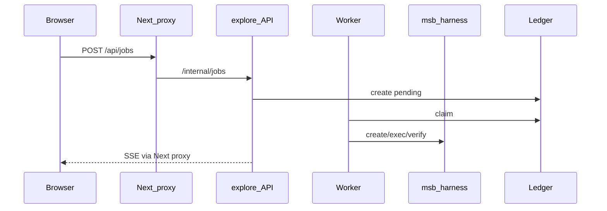

# CODEMAP.md — Where code lives

Engineer map from concern → directory → module. Product intent: [PRODUCT.md](../PRODUCT.md). Planes and trust zones: [ARCHITECTURE.md](../ARCHITECTURE.md). Glossary: [GLOSSARY.md](GLOSSARY.md).

Plane 2 is **not** a repo folder — it is a per-job Microsandbox microVM driven by `explore/harness.py` → `msb`.

---

## Top-level

| Path | Owns |
|------|------|
| [`frontend/`](../frontend/) | Plane 1 **UI** (App Router) + public `/api/*` and `/mcp` **proxies** to explore; edge rate limits. No ledger or job logic. |
| [`explore/`](../explore/) | Plane 1 **sidecar**: FastAPI Jobs API, durable ledger, worker pipeline, harness, inference, finalize. |
| [`storage/`](../storage/) | Runtime data: `ledger/`, `profiles/`, `screenshots/`, `artifacts/`, `canaries/` (D17). |
| [`ops/`](../ops/) | Operator scripts: `vx1-firewall.sh`, `cdn-pull-zone.sh`, `offline/` (deny-all guest egress on VX1). |
| [`docs/`](../docs/) | How-it-works supplements (this file, glossary). |
| Root `*.md` | Canonical product spine — see [PRODUCT.md](../PRODUCT.md) Doc map. |

---

## Five “how it works” topics

### 1. Request path: browser → Next → explore → worker → harness → ledger → SSE

| Layer | Anchors |
|-------|---------|
| Public proxy | [`frontend/app/api/`](../frontend/app/api/), [`frontend/lib/explore.ts`](../frontend/lib/explore.ts), [`frontend/app/mcp/route.ts`](../frontend/app/mcp/route.ts) |
| Internal API | [`explore/main.py`](../explore/main.py), [`explore/api/routes.py`](../explore/api/routes.py) |
| Create / cancel / snapshot | [`explore/service.py`](../explore/service.py) |
| Async pipeline | [`explore/worker.py`](../explore/worker.py) |
| Plane 2 | [`explore/harness.py`](../explore/harness.py) |
| Live UI | [`frontend/components/JobLiveView.tsx`](../frontend/components/JobLiveView.tsx), [`frontend/lib/api.ts`](../frontend/lib/api.ts) |

Also: [ARCHITECTURE.md](../ARCHITECTURE.md) “End-to-end flow” · [API.md](../API.md).

### 2. Pipeline env flags

Without the claim flags, jobs are created and may never leave `pending` / never run discover→finalize.

| Flag family | Role |
|-------------|------|
| `MSB_AUTO_CREATE` | Allow bootstrap sandbox create |
| `DISCOVER_ON_CLAIM` … `FINALIZE_ON_CLAIM` | Enable each pipeline stage on claim |

Central list: [SETUP.md](../SETUP.md) §5 · [`.env.example`](../.env.example) · [`explore/config.py`](../explore/config.py) · claim skip behavior (D83) in [`explore/service.py`](../explore/service.py).

### 3. Discover = heuristics (+ fixtures) today

| Piece | Path |
|-------|------|
| Heuristic runtime profile | [`explore/discover.py`](../explore/discover.py) `infer_runtime_profile` |
| Pinned M7 fixtures | [`explore/fixtures/m7.json`](../explore/fixtures/m7.json) (D53) |
| Intended agent prompts | [`explore/prompts/`](../explore/prompts/) (trusted; not submitted-repo config) |
| Where LLM *is* used | [`explore/inference_extras.py`](../explore/inference_extras.py) (`vuln_review`, optional vision/RAG) · [`explore/agent.py`](../explore/agent.py) |

Normative loop + implementation note: [ARCHITECTURE.md](../ARCHITECTURE.md) “Environment Agent Plan Loop”.

### 4. Profile as executable spec

| Piece | Path |
|-------|------|
| JSON Schema | [`explore/schemas/environment_profile.v1.json`](../explore/schemas/environment_profile.v1.json) |
| Load / validate | [`explore/profile.py`](../explore/profile.py) |
| Revisions on disk | `storage/profiles/{job_id}/` (D17, D64) |
| Consumers | [`explore/install.py`](../explore/install.py), [`explore/verify.py`](../explore/verify.py) |

Field rules: [DATABASE.md](../DATABASE.md) · D51.

### 5. Sandbox lifecycle, reaper, self-heal

| Concern | Path |
|---------|------|
| Create / replace / exec / destroy | [`explore/harness.py`](../explore/harness.py) |
| Confirmed destroy + receipt | [`explore/finalize.py`](../explore/finalize.py) (D57, D61) |
| Stall / wall-clock / expiry fail | [`explore/stall.py`](../explore/stall.py) (D83) |
| In-process reaper loop | [`explore/reaper.py`](../explore/reaper.py) `reaper_loop` (started from `main.py`) |
| Host reaper (Plane 1 down) | `cd explore && python -m reaper --host` |
| Lost-sandbox heal | [`explore/selfheal.py`](../explore/selfheal.py) (D80) |
| Deny-all guest egress on VX1 | [`ops/offline/`](../ops/offline/) |

---

## `explore/` modules (high signal)

| Module / dir | Role |
|--------------|------|
| `main.py` | Uvicorn app; lifespan starts `worker_loop` + `reaper_loop` |
| `api/routes.py` | `/internal/*` Jobs API + SSE + `/internal/mcp` |
| `service.py` | Create, cancel, snapshot, claim, admission hooks |
| `worker.py` | Claim → pipeline stages |
| `discover.py` / `install.py` / `verify.py` | Discover → provision → readiness |
| `screenshots.py` / `containment.py` / `vulnscan.py` / `finalize.py` | Post-readiness report path |
| `harness.py` / `harness_tools.py` / `harness_mcp.py` | Plane 2 lifecycle; agent tools; in-guest MCP shim |
| `operator_mcp.py` / `operator_mcp_tools.py` | **Operator** Jobs API MCP (D81) — distinct from harness MCP |
| `ledger/` | Schema, migrations, store, backup |
| `admission/` | Concurrency / queue / inference budgets |
| `preflight.py` / `git_url.py` | D45 / D78 |
| `net_policy.py` / `canaries.py` / `registry.py` | Network, canaries, Vultr CR pull |
| `helpers/` | Guest scripts copied in (`mcp_stdio_verify.py`, `network_probe.sh`, …) |
| `prompts/` | Trusted discover / validate / vuln_review prompts |

---

## `frontend/` (Killhub-specific)

| Path | Role |
|------|------|
| `app/api/**` | Thin proxy to explore (`INTERNAL_API_TOKEN`) |
| `lib/admission.ts` | Edge POST rate limits (D40); Valkey when split hosts (D71) |
| `lib/api.ts` / `components/JobLiveView.tsx` | Snapshot hydrate + SSE (`event_cursor` / D55) |
| `app/[owner]/[repo]/page.tsx` | GitHub short-path deep link (D82) |
| `AGENTS.md` | Next.js rules + Killhub UI notes |

Do **not** put ledger or pipeline logic in Next — that lives in `explore/` (D52).

---

## Admission split

| Layer | Where | What |
|-------|-------|------|
| Edge rate limits | `frontend/lib/admission.ts` | Per-IP / global on `POST /api/jobs` |
| Concurrency / queue / inference | `explore/admission/` | `MAX_CONCURRENT_JOBS`, queue, budgets |

Multi-instance: set `ADMISSION_STORE=valkey` on **both** with the same `VALKEY_URL` (D71). See [SETUP.md](../SETUP.md).

---

## Related

[CONTRIBUTING.md](../CONTRIBUTING.md) · [SETUP.md](../SETUP.md) · [API.md](../API.md) · [DATABASE.md](../DATABASE.md) · [DECISIONS.md](../DECISIONS.md)
